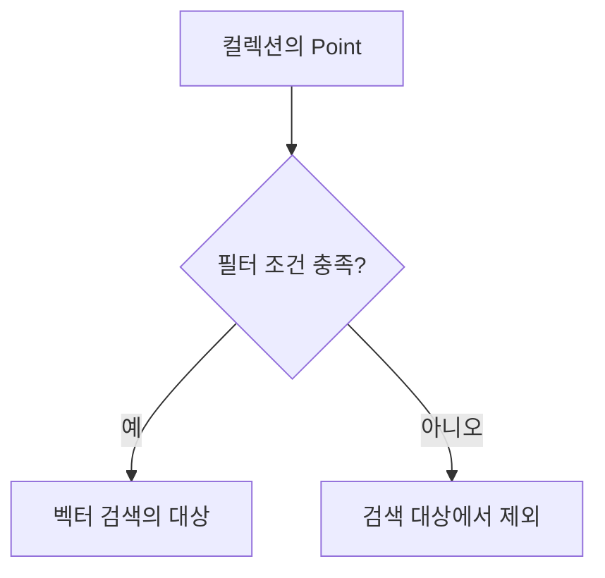
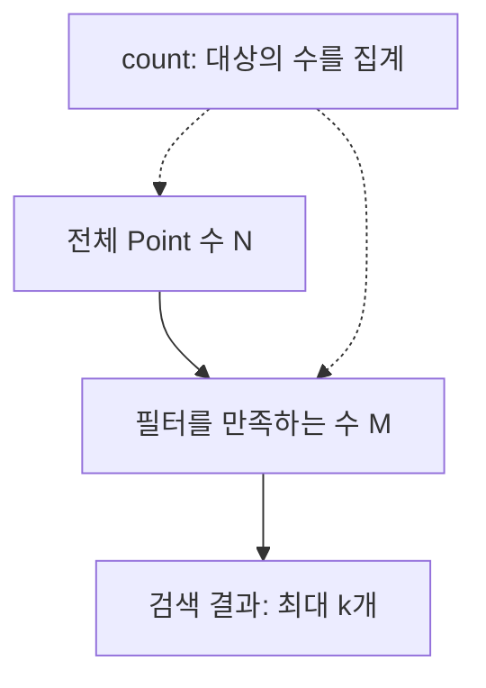
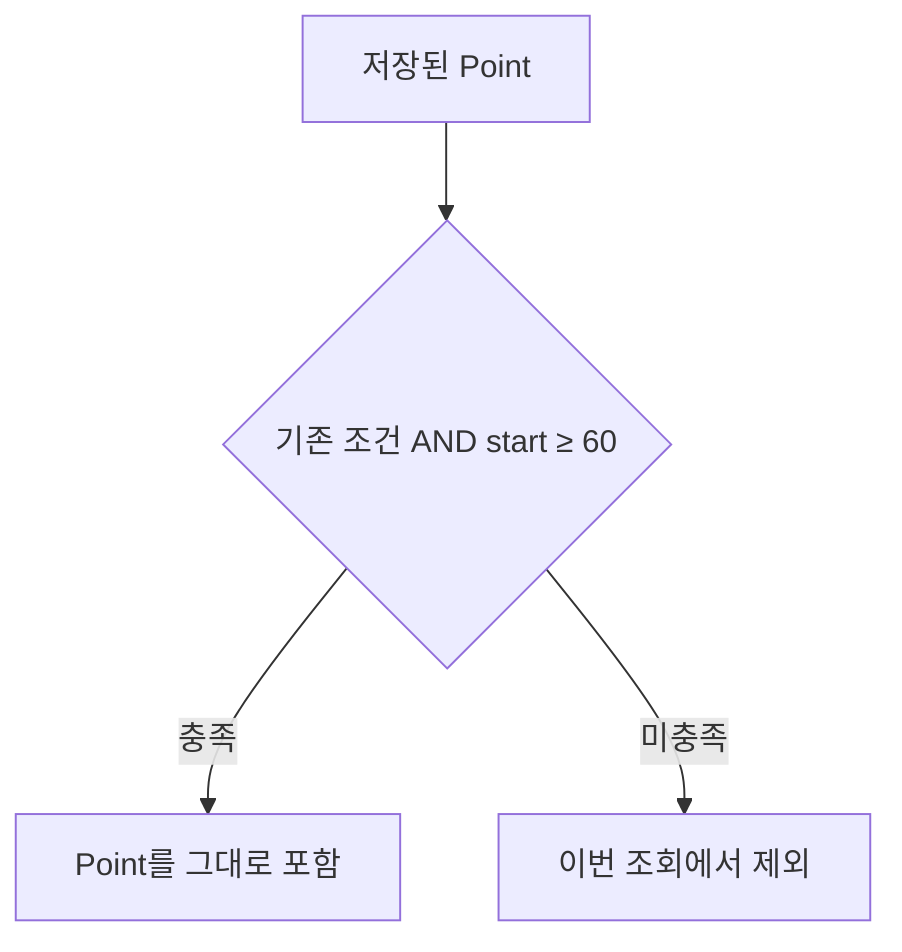
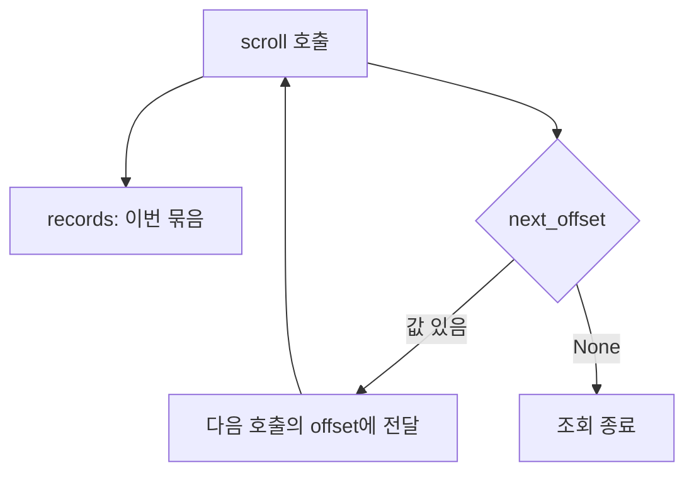
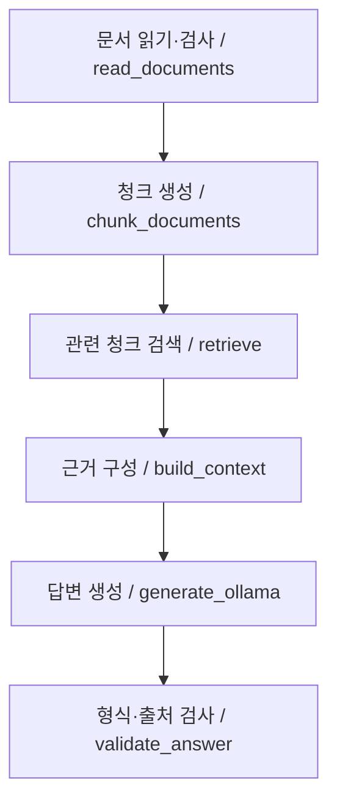
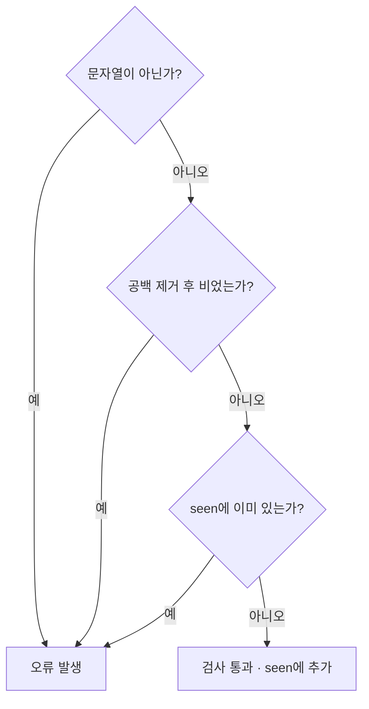
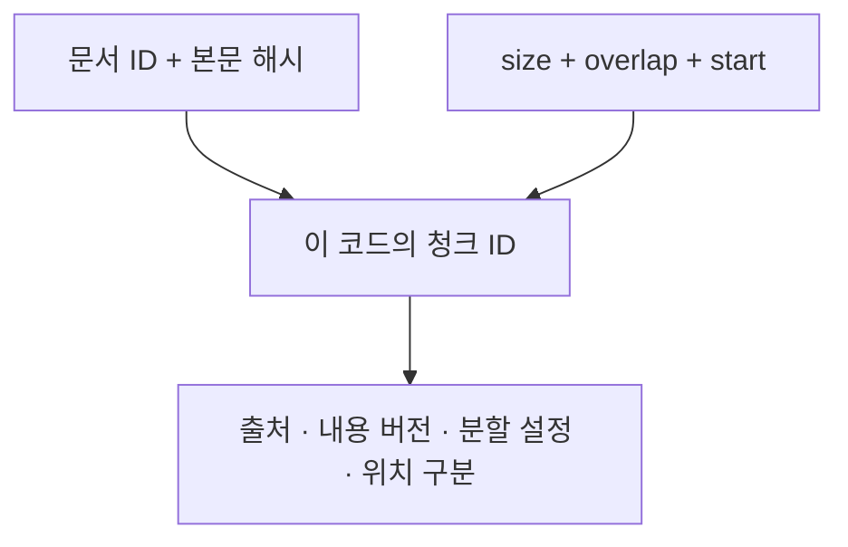
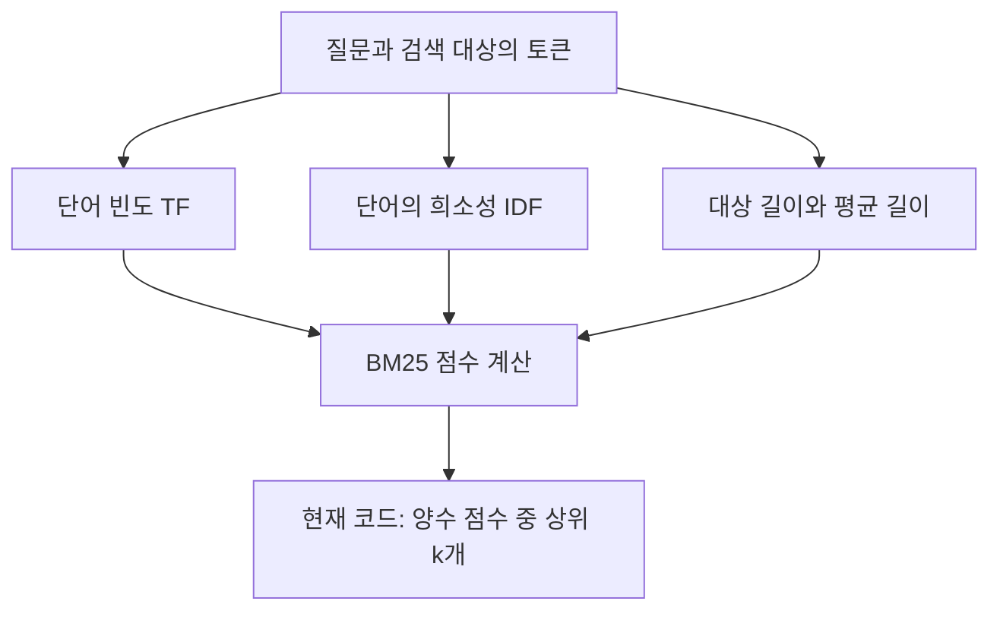

> 🗂️ **Notes · Deep Learning** — `rag` `qdrant` `chunking` `python` `bm25`
{: .prompt-info }

오늘 학습: 메타데이터 필터로 검색 범위 정하기, 조건에 맞는 데이터 조회, 파이썬의 결과 처리, 청크 갱신 원리

## 1. 메타데이터 필터와 논리 조건



**벡터 검색은 의미가 비슷한 자료를 찾고, 필터는 검색 대상으로 허용할 자료의 조건을 정한다.** 예를 들어 내용이 비슷해도 사용 권한이 없거나 적용 기간이 지난 자료라면 검색 대상에서 제외할 수 있다.

- `FieldCondition`: payload의 특정 필드에 적용할 비교 조건을 표현한다.
- `MatchValue`: 필드 값이 지정한 값과 일치하는지 검사한다.
- `Filter`: 개별 조건을 논리적으로 묶는다. `must`는 모두 만족(AND), `should`는 하나 이상 만족(OR), `must_not`은 나열한 조건 각각에 해당하는 자료를 제외한다.
- `key="metadata.status"`처럼 점으로 연결한 경로는 중첩된 payload 필드를 가리킨다. 필드 이름과 저장 값은 애플리케이션의 데이터 구조에 따라 정한다. [Qdrant 필터 공식 문서](https://qdrant.tech/documentation/search/filtering/)

**예시: 상태와 분류에 대한 값 일치 조건을 반복문으로 만들기**

```python
from qdrant_client import models

required_values = {
    "metadata.status": "current",
    "metadata.category": "출장",
}
conditions = [
    models.FieldCondition(
        key=field,
        match=models.MatchValue(value=value),
    )
    for field, value in required_values.items()
]
search_filter = models.Filter(must=conditions)
```

`FieldCondition`을 직접 나열하는 방법 외에, 조건을 변수로 만들어 재사용하거나 반복문으로 생성할 수 있다. 위 방식은 **값 일치 조건을 일괄 생성하는 예시**이며, 범위 조건 등은 그에 맞는 조건 객체를 만들어야 한다.

**기억할 문장: 필터는 자료의 자격 조건을 정하고, must에 넣은 조건은 모두 충족해야 한다.**

## 2. 변수 이름과 필터의 실제 동작 구분하기

`current_filter`, `query_filter`, `search_filter`는 개발자가 정한 변수 이름이다. 이름 자체에 Qdrant의 특별한 기능이 있는 것은 아니다. **실제 검색 범위는 Filter 안에 들어 있는 조건으로 결정된다.**

```python
status_filter = models.Filter(must=[status_condition])
narrow_filter = models.Filter(
    must=[status_condition, category_condition]
)
```

위 예시에서 두 번째 필터는 첫 번째 필터에 분류 조건을 AND로 추가했으므로, 대상 범위가 첫 번째와 같거나 더 좁다. 다만 `query_filter`라는 이름의 변수가 항상 좁은 범위를 뜻하는 것은 아니다.

`models.Filter(must=conditions)`에서 왼쪽 `must`는 라이브러리가 정한 인자 이름이고, 오른쪽 `conditions`는 자유롭게 이름을 정할 수 있는 변수다. `must: list[models.Condition] = [...]`처럼 쓰면 콜론 뒤는 변수의 예상 자료형을 나타내는 **타입 힌트**이며, AND 동작은 이를 `Filter(must=...)`에 전달할 때 정해진다.

**기억할 문장: 변수 이름은 의도를 설명하고, 객체에 담긴 조건과 API 인자가 동작을 결정한다.**

## 3. 전체 개수·조건 일치 개수·검색 반환 개수



데이터를 조회할 때 다음 세 가지를 구분한다.

- **전체 개수 N**: 컬렉션에 저장된 모든 Point 수.
- **조건 일치 개수 M**: 그중 필터를 만족하는 Point 수.
- **반환 상한 k**: 한 번의 유사도 검색에서 최대 몇 개를 가져올지 정한 값.

```python
total = client.count(collection, exact=True).count
matched = client.count(
    collection, count_filter=search_filter, exact=True
).count
```

`count()`는 개수 정보를 담은 결과 객체를 반환하고, 뒤의 `.count`는 그 객체에서 숫자를 꺼내는 속성이다. 필터가 없으면 전체를, 있으면 조건에 맞는 Point를 센다. `exact=True`는 정확한 개수를 요청한다. [Qdrant Count API](https://api.qdrant.tech/api-reference/points/count-points)

예를 들어 전체가 28개, 조건에 맞는 것이 5개인 상황에서 `k=3`이면 그중 최대 3개를 가져온다. `k=10`으로 바꿔도 조건에 맞는 자료가 10개로 늘어나지는 않는다. 오늘 확인한 28과 5는 **당시 저장 데이터와 조건으로 나온 집계 결과**이며 고정값이 아니다.

`rows = index.search(question, k=5, category="출장")`의 `index.search()`는 수업에서 만든 래퍼 메서드다. 어떤 필터와 검색 방식을 사용하는지는 해당 클래스의 구현을 확인해야 한다. `index.client`는 연결된 Qdrant 클라이언트이고, `index.collection`은 사용할 컬렉션 이름이다.

청크 하나를 Point 하나로 저장한 설계라면 Point 수는 저장된 청크 수다. 일반적으로 Point 수가 원문 문서 수와 같다고 단정할 수는 없다. 벡터 유사도 점수 또한 정답일 확률을 뜻하지 않는다.

**기억할 문장: count는 대상이 몇 개인지 확인하고, k 또는 limit는 한 번에 가져올 최대 개수를 제한한다.**

## 4. 숫자 범위 필터는 데이터를 선택하는 조건



`Range`는 가격·수량·위치처럼 숫자로 저장된 필드의 범위를 검사한다. `gt`는 초과, `gte`는 이상, `lt`는 미만, `lte`는 이하를 뜻한다. [Qdrant 범위 필터](https://qdrant.tech/documentation/search/filtering/)

```python
position_filter = models.Filter(
    must=conditions + [
        models.FieldCondition(
            key="start",
            range=models.Range(gte=60),
        )
    ]
)
```

이 코드는 기존 조건에 `start >= 60`을 추가한다. `conditions + [...]`는 새 리스트를 만들므로 기존 조건 리스트는 그대로다.

- 필터는 각 Point를 포함할지 결정한다. 저장된 본문을 잘라내거나 수정하지 않는다.
- `start`의 의미와 단위는 저장할 때 정한 데이터 구조를 확인해야 한다. 문자 위치, 토큰 위치 등 무엇을 나타내는지 이름만으로 확정할 수 없다.
- 예를 들어 `start`를 문자 기준 시작 위치로 저장했다면, 60 미만에서 시작하는 청크 전체가 제외된다. 해당 청크가 60 이후까지 이어져 있어도 이 조건을 만족하지 않는다.
- 60은 예시의 기준값이다. 뒤쪽 청크가 더 좋은 근거라는 일반 원칙은 없으며, 목적 없이 적용하면 필요한 자료가 제외될 수 있다.

**기억할 문장: 범위 필터는 필드 값으로 레코드를 고르며, 텍스트 일부를 삭제하는 연산이 아니다.**

## 5. Scroll로 나누어 읽고, 결과를 정렬하기



`scroll()`은 컬렉션의 Point를 일정 크기의 묶음으로 읽는 조회 기능이다. 데이터 점검이나 조건에 맞는 자료의 일괄 처리에 사용한다. 질문 벡터와의 유사도를 계산해 순위를 매기는 검색과 구분한다.

```python
records, next_offset = client.scroll(
    collection,
    scroll_filter=search_filter,
    limit=100,
    with_payload=True,
)
```

- `records`: 이번 호출에서 읽은 Point 목록.
- `limit=100`: 이번 묶음에서 가져올 최대 개수. 전체 처리량이 100개로 제한된다는 뜻은 아니다.
- `next_offset`: 다음 묶음을 이어 읽을 때 `offset=next_offset`으로 전달할 값. `None`이면 더 읽을 묶음이 없다.
- 위 호출처럼 별도 정렬을 지정하지 않으면 Point ID 순으로 읽는다. 반환된 커서는 직접 계산하지 않고 다음 호출에 그대로 사용한다. [Qdrant Scroll API](https://api.qdrant.tech/api-reference/points/scroll-points)

```python
pairs = sorted(
    (p.payload["document_id"], p.payload["start"])
    for p in records if p.payload
)
```

이 표현식은 다음 순서로 이해하면 된다.

1. `records`에서 Point를 하나씩 꺼낸다.
2. payload가 `None`이거나 빈 딕셔너리인 항목을 제외한다.
3. 남은 항목에서 `(document_id, start)` 쌍을 만든다.
4. 문서 ID를 먼저 비교하고, 같으면 시작 위치를 비교해 새 리스트로 정렬한다.

`if p.payload`는 payload가 비어 있지 않은지 확인할 뿐, 필요한 키가 모두 있는지까지 보장하지 않는다. 또한 여기서 정렬되는 것은 **이번에 읽은 records**이며, 컬렉션 전체가 자동으로 정렬되는 것은 아니다. [Python sorted](https://docs.python.org/3/builtins/functions.html#sorted), [튜플의 비교 규칙](https://docs.python.org/3/reference/expressions.html#value-comparisons)

**기억할 문장: scroll은 묶음 단위로 읽고, sorted는 읽어 온 값의 순서를 정리한다.**

## 6. next와 제너레이터로 값 하나 찾기

`next()`는 **반복자에서 다음 값 하나를 꺼내는 함수**다. 조건 검사 자체는 함께 사용한 제너레이터 표현식이 담당한다.

```python
target = next(
    (doc for doc in documents
     if doc["document_id"] == target_id),
    None,
)
```

- `for doc in documents`: 문서를 순서대로 살펴본다.
- `if ...`: 조건에 맞는 문서만 내보낸다.
- `next(...)`: 내보내는 값 하나를 꺼낸다. 새 제너레이터이므로 첫 번째 일치 문서를 얻는다.
- 여기서 `target`에는 문서 ID 문자열이 아니라 `doc`에 해당하는 문서 객체 전체가 담긴다.

일치 항목이 없으면 위 코드는 기본값 `None`을 반환한다. 기본값을 생략하면 반복자가 소진될 때 `StopIteration` 예외가 발생한다. 같은 반복자에 `next()`를 다시 호출하면 처음부터 찾지 않고 이어서 진행한다. 모든 일치 항목이 필요하면 리스트 컴프리헨션 등을 사용한다. [Python next](https://docs.python.org/3/builtins/functions.html#next)

**기억할 문장: next는 다음 값 하나를 꺼낸다. 무엇을 순회하고 걸러낼지는 전달한 반복자가 결정한다.**

## 7. 다시 청킹하는 이유와 저장 데이터 갱신 원리

RAG에서 원문은 검색에 사용할 작은 단위인 청크로 나누고, 각 청크의 임베딩을 저장한다. **원문이 바뀌거나 청킹 방식이 달라지면, 저장된 검색 단위가 현재 기준과 맞는지 확인해야 한다.** 청크 크기는 한 청크에 담을 분량, overlap은 인접 청크 사이에 겹치게 둘 분량을 정하며, 실제 단위는 청킹 함수의 구현에 따른다.

예를 들어 같은 원문도 청크 크기와 겹침을 바꾸면 경계와 내용이 달라질 수 있다. 이전 청크의 `start`, `end`와 새 청크의 범위를 비교하는 작업은 **어떤 검색 단위가 달라졌는지 확인하는 준비 단계**다. 원문 내용을 새로 작성해야만 갱신이 필요한 것은 아니다.

갱신할 때는 세 가지를 따로 판단한다.

- **청크 ID**: ID를 만드는 규칙에 따라 달라진다. 내용·위치·버전 등을 ID 생성에 사용하는지 확인한다. 청킹 설정 변경만으로 모든 ID가 반드시 바뀌는 것은 아니다.
- **임베딩**: 실제 모델 입력이나 모델·전처리 설정이 달라지면 새 기준에 맞는 벡터가 필요하다. 입력과 모델·설정이 동일하고 대응 관계를 확인할 수 있다면 기존 벡터를 재사용할 수 있다.
- **payload**: 출처·상태 등 메타데이터만 바뀌었고 그 값이 임베딩 입력에 포함되지 않았다면, 벡터 재계산 없이 payload만 갱신할 수 있다.

청크 목록과 벡터 행렬을 위치로 짝짓는 코드에서는 **같은 인덱스가 같은 청크를 가리키는지** 보장해야 한다. 순서나 청크 구성이 바뀌었는데 기존 벡터를 그대로 위치로 연결하면 본문과 벡터가 잘못 짝지어질 수 있다.

Qdrant에 반영할 때는 같은 ID의 Upsert는 기존 Point를 갱신하고, 다른 ID는 새 Point로 추가한다. **새 ID로 등록했다고 이전 Point가 자동으로 없어지지는 않는다.** 더 이상 사용할 청크의 삭제 또는 검색 제외까지 설계해야 한다. [Qdrant Points](https://qdrant.tech/documentation/concepts/points/), [Payload 갱신](https://qdrant.tech/documentation/concepts/payload/)

오늘 살펴본 코드는 기존 데이터를 불러오고, 같은 원문을 새 설정으로 나누어 범위를 비교한다. 이 단계만으로 새 벡터 생성이나 Qdrant 저장까지 완료되는 것은 아니다. `load_chunks()`, `load_vectors()`, `read_documents()`, `chunk_documents()`는 수업에서 정의한 함수이므로 정확한 처리 방식은 해당 구현을 확인한다.

**기억할 문장: 원문·청크·ID·벡터·payload의 대응 관계를 유지하고, 달라진 부분과 더 이상 쓰지 않는 데이터를 함께 관리한다.**

## 8. `rag_core.py` 개인 학습 — RAG의 전체 흐름

RAG는 질문에 관련된 외부 자료를 검색하고, 그 근거를 생성 모델에 제공하여 답변하게 하는 방식이다. **검색에 성공했는지, 근거가 충분한지, 생성된 답변이 근거와 일치하는지는 각각 확인해야 한다.**

이번 파일에서 각 단계는 다음 함수로 연결된다.



`main()`은 실행 옵션을 받아 흐름을 연결하고, `evaluate()`는 검색 결과를 정답 문서 목록과 비교한다. 이 코드의 `validate_answer()`는 응답 구조와 출처 ID를 검사하며, 답변 내용의 사실성까지 보장하지는 않는다.

**파일 경로의 기준 잡기**

```python
ROOT = Path(__file__).resolve().parent
docs = read_documents(ROOT / "documents.json")
```

`__file__`은 현재 모듈 파일의 경로, `Path()`는 경로를 다루는 객체, `resolve()`는 절대 경로로 해석하는 메서드, `parent`는 상위 폴더다. 여기서는 코드 파일이 있는 폴더를 기준으로 입력 파일을 찾는다. `Path` 객체의 `/`는 경로를 연결하는 연산이므로, 터미널의 실행 폴더가 달라져도 같은 위치의 자료를 읽을 수 있다. [Python pathlib](https://docs.python.org/3/library/pathlib.html)

**기억할 문장: 먼저 데이터가 어떤 단계를 거쳐 답변으로 이어지는지 파악하고, 각 함수가 맡은 책임을 구분한다.**

## 9. 입력 검증 — not·or·in과 단락 평가



입력 검증은 잘못된 데이터가 이후 처리로 넘어가기 전에 문제를 발견하는 과정이다. 자료형, 필수 값, 식별자의 중복 여부 등을 확인한다.

```python
if not isinstance(did, str) or not did.strip() or did in seen:
    raise ValueError("빈 ID 또는 중복 document_id")
```

- `not isinstance(did, str)`: ID가 문자열이 아니면 참.
- `not did.strip()`: 앞뒤 공백을 제거한 결과가 빈 문자열이면 참. 빈 문자열은 조건식에서 거짓으로 취급되고 `not`이 이를 뒤집는다.
- `did in seen`: 이미 확인한 ID 집합에 같은 값이 있으면 참.
- `or`: 나열한 조건 중 하나라도 참이면 오류 처리로 들어간다.

**or는 왼쪽부터 평가하다 참인 값을 만나면 뒤쪽 평가를 생략한다.** 이를 단락 평가라고 한다. `did=123`이면 첫 조건에서 걸리므로 숫자에 `strip()`을 호출하지 않는다. 이처럼 자료형 검사를 먼저 두면 뒤 연산을 안전하게 수행할 수 있다. 일반적으로 `or`는 불리언으로 변환된 값이 아니라 평가한 피연산자 중 하나를 반환하지만, 이 코드의 각 조건은 불리언 결과다. [Python 참·거짓과 논리 연산](https://docs.python.org/3/builtins/stdtypes.html#boolean-operations-and-or-not)

검사를 통과한 ID를 `seen.add(did)`로 기록하면 다음 문서부터 중복을 확인할 수 있다. 여기서 `strip()`은 검사에만 사용한다. 따라서 이 코드는 `"doc1"`과 `" doc1 "`을 같은 ID로 정규화하지는 않는다.

**기억할 문장: 잘못된 경우들을 or로 연결해 하나라도 해당하면 막고, 뒤 연산의 전제 조건을 먼저 검사한다.**

## 10. 청킹 — 겹침과 끝 위치를 다루는 이유

청킹은 원문을 검색·모델 입력에 사용할 작은 단위로 나누는 과정이다. 겹침(overlap)은 인접 청크에 일부 내용을 중복 포함하여 **경계에서 분리된 정보와 문맥의 손실을 줄이려는 방법**이다. 모든 문맥 단절을 해결하는 것은 아니며, 겹침이 커질수록 중복 저장·처리량도 늘어난다.

이번 구현은 파이썬 문자열 인덱스를 기준으로 일정 길이씩 나눈다. 이는 모델의 토큰 수 기준과 다르다.

```python
for start in range(0, len(text), size - overlap):
    end = min(start + size, len(text))
    chunk_text = text[start:end]
    # 이 위치에서 청크를 저장한다.
    if end == len(text):
        break
```

- `size - overlap`: 다음 청크의 시작 위치까지 이동할 거리.
- `0 <= overlap < size`: 겹침은 음수가 아니며, 시작 위치가 앞으로 이동하도록 하는 조건. 이 구현의 크기와 겹침은 문자 수를 나타내는 정수여야 한다.
- `end`: 실제 원문 범위를 넘지 않도록 제한한 끝 위치. `text[start:end]`는 start를 포함하고 end는 포함하지 않는다.
- `break`: 원문 끝까지 포함하는 청크를 저장했으면 종료하여 불필요한 뒤쪽 청크를 더 만들지 않는다.

**예시:** 원문 길이가 150이고 시작 위치가 120, 크기가 80이면 계산상 끝은 200이지만 실제 끝은 150이다. 따라서 `[120:150]`의 남은 30자만 담는다.

파이썬은 `text[120:200]`으로 잘라도 범위를 벗어난 끝 때문에 오류가 나지는 않는다. 하지만 `end=200`을 저장하면 실제 청크 범위와 위치 정보가 어긋난다. 끝 위치를 제한하는 것은 **메타데이터의 정확성과 종료 판단**에 필요하다. [Python 시퀀스 슬라이싱](https://docs.python.org/3/builtins/stdtypes.html#common-sequence-operations)

**기억할 문장: overlap은 경계의 정보 손실을 줄이고, end는 실제 원문 범위와 일치하도록 기록한다.**

## 11. 청크 ID — 출처·내용 버전·분할 설정·위치 구분



청크 ID는 저장된 청크를 구분하고, 같은 대상을 다시 처리할 때 기존 데이터와 연결하기 위한 식별자다. 무엇이 바뀌면 다른 청크로 취급할지에 따라 ID 설계가 달라진다.

```python
fingerprint = hashlib.sha256(text.encode()).hexdigest()[:12]
cid = f'{doc["document_id"]}:{fingerprint}:{size}:{overlap}:{start}'
```

이번 코드의 구성 요소는 다음 역할을 한다.

- `document_id`: 어떤 원문 문서에서 나온 청크인지 구분.
- `fingerprint`: 문서 전체 본문의 해시 일부로 내용 버전을 구분.
- `size`, `overlap`: 어떤 분할 설정으로 생성했는지 구분.
- `start`: 같은 문서·분할 설정에서 어느 위치의 청크인지 구분.

**같은 입력 요소로는 같은 ID를 재생성할 수 있다는 점**이 핵심이다. 다만 해시는 수학적으로 충돌 가능성이 있고, 여기서는 12자리로 줄였으므로 완전한 유일성을 보장하는 값은 아니다.

이 구현에서는 문서 전체 본문을 해시하므로, 원문 일부가 바뀌어 fingerprint가 달라지면 변경되지 않은 부분을 포함한 모든 청크의 ID도 바뀐다. 반대로 metadata만 바꾸면 이 ID의 구성 요소는 그대로일 수 있다.

문서·본문 버전·분할 설정·위치를 함께 넣는 것은 **이 코드의 선택**이다. 모든 RAG 시스템의 필수 형식은 아니다. 또한 새 ID로 등록해도 이전 ID의 자료가 자동 삭제되지는 않으므로, 갱신 정책을 함께 마련해야 한다.

**기억할 문장: 청크 ID에는 무엇을 같은 청크로 볼 것인지에 대한 설계 기준이 담긴다.**

## 12. BM25 — 단어 일치 기반 검색과 직접 구현



**BM25는 질문과 문서의 어휘 일치를 바탕으로 관련성 점수를 계산하는 검색 알고리즘**이다. 입력을 토큰으로 나눈 뒤 다음 요소를 반영한다.

- **TF(단어 빈도)**: 해당 문서에서 질문의 단어가 등장한 횟수. 반복이 늘면 기여도가 커지지만 증가 폭은 줄어드는 포화 효과를 적용한다.
- **IDF(역문서 빈도)**: 전체 검색 대상 가운데 그 단어가 등장하는 문서가 적을수록 더 큰 가중치를 준다.
- **길이 보정**: 긴 문서가 단어를 많이 포함하기 쉬운 효과를 평균 문서 길이와 비교해 보정한다.

여기서 문서는 검색 점수를 계산하는 단위를 뜻한다. 청크를 검색 대상으로 사용하면 TF·등장 문서 수·평균 길이도 청크 기준으로 계산한다. BM25에는 여러 구현 변형이 있으며, 점수는 정답 확률이 아니다. [BM25 구현 변형 비교 연구](https://pmc.ncbi.nlm.nih.gov/articles/PMC7148026/)

```python
def bm25(query, chunks, k=5):
    ...
```

이번 함수는 외부 BM25 검색 라이브러리를 호출하는 대신 **파이썬 표준 라이브러리로 직접 계산식을 구현**한다.

1. `tokenize()`로 청크와 질문을 토큰으로 나눈다.
2. `Counter`로 청크 내부의 토큰별 빈도를 센다.
3. 전체 청크에서 토큰이 등장한 청크 수와 평균 길이를 계산한다.
4. 각 청크의 BM25 점수를 계산한다.
5. 양수 점수만 남겨 점수 내림차순으로 최대 `k`개를 반환한다. 동점이면 청크 ID로 순서를 정한다.

이 구현의 토큰화는 영문을 소문자로 바꾸고 한글·영문·숫자의 연속 구간을 추출한다. 한국어 조사 제거·형태소 분석·동의어 처리는 하지 않는다. 따라서 의미가 비슷해도 다른 토큰이면 자동으로 같은 말로 보지 않는다.

또한 질문의 중복 토큰은 한 번만 계산하고, 빈도 포화 계수 `k1=1.5`, 길이 보정 계수 `b=0.75`를 사용한다. 이 값들과 양수 점수만 반환하는 정책은 **현재 구현의 설정**이며 BM25 전체의 고정 규칙은 아니다.

이 함수 자체에는 임베딩 모델이나 Qdrant가 필요하지 않다. BM25의 어휘 기반 검색과 임베딩의 의미 기반 검색은 서로 다른 단서를 사용하므로, 목적과 데이터에 따라 비교하거나 결합할 수 있다.

**기억할 문장: BM25는 단어 일치의 빈도·희소성·문서 길이를 함께 반영하며, 현재 파일은 그 계산을 파이썬으로 직접 구현한다.**

학습 범위: 업로드한 `rag_core.py` 코드의 전체 흐름, 입력 조건문, 청킹 경계, 청크 ID 구성, BM25의 의미와 구현 방식.

## 참고

- [2026-10-22 노션 학습 노트](https://app.notion.com/p/400682609ddd81ceb9b2f0f153909b9a) — 이 글의 학습 원문
- `rag_core.py` — 학습에 사용한 RAG 실습 코드. 위 설명에서 해당 코드의 선택과 일반 개념을 구분했다.

## 관련 글

- [Qdrant로 질문 검색하기 — 필터와 검색 결과 정리](/posts/qdrant-query-filter-search-results/)
- [Qdrant의 Point 구조와 저장·조회 흐름](/posts/qdrant-point-collection-upsert-retrieve/)
