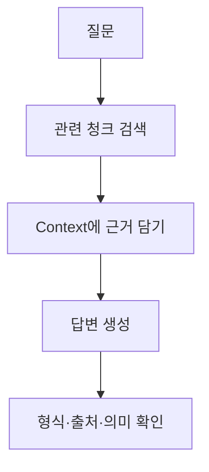
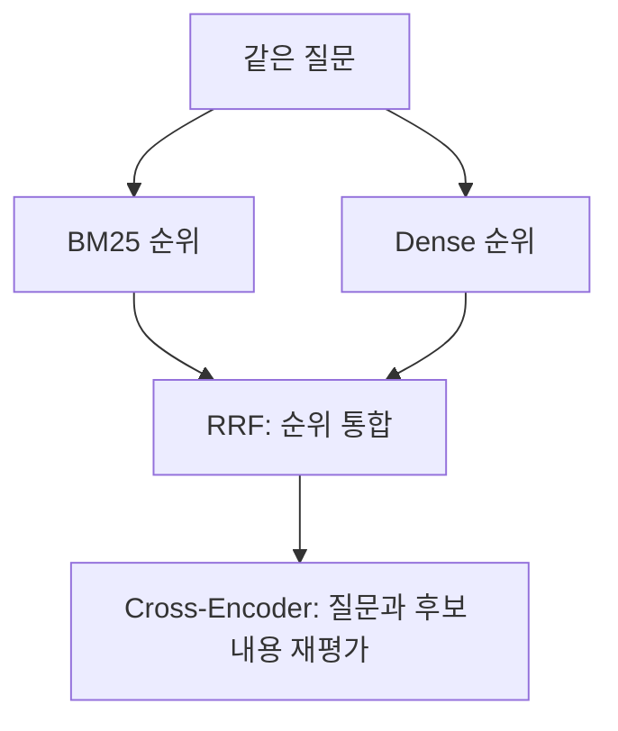
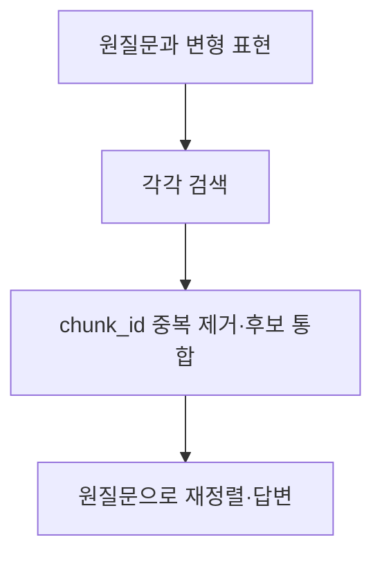

> 🗂️ **Notes · Deep Learning** — `rag` `chunking` `bm25` `rrf` `reranking`
{: .prompt-info }

---

## 1. 📖 개요

RAG 4일차 강의와 질문에서 다룬 **근거 구성과 답변 검사, 검색 결과 통합과 재정렬,
질문 표현 변형**을 정리한다.



2-Step RAG의 큰 흐름은 **검색 → 생성**이다. 위 검사 단계는 교안의 후처리 구성 예다.
이 글은 개념과 코드를 이해한 기록이며, 실제 모델 실행·성능 측정 결과는 아니다.

> 📌 **왜 필요한가** · 관련 문서를 찾는 것과, 답이 담긴 구간을 모델에게 전달하는 것은 다르다.
{: .prompt-tip }

---

## 2. 🧩 청크 크기·검색 개수·budget

Context는 생성 모델이 읽을 참고 자료다. 문서를 나눌 때는 조건과 앞뒤 문맥이 끊기지 않는지 확인한다.

| 설정 | 정하는 것 |
| --- | --- |
| 청크 크기 | 문서를 나누는 한 조각의 길이 |
| 검색 개수 `k` | 가져올 검색 후보 수 |
| Context `budget` | 참고 자료에 담을 전체 허용량 |

```python
for budget in [120, 200, 300]:
    context, sources = pack_context(
        unique, max_chars=budget
    )
    print(budget, "실제 길이", len(context))
```

위 숫자는 **교안의 문자 예산 비교 예시**다. 이 `pack_context`는 청크를 요약하지 않고,
공간에 들어가면 통째로 담고 들어가지 않으면 다음 청크를 확인한다.

- 라벨·제목·구분자도 공간을 사용한다. 실제 서비스에서는 모델별 토큰 한도와 지시문·질문·대화 기록·출력 공간을 함께 고려한다.
- 같은 문서의 다른 청크에는 다른 사실이 있으므로, 교안에서는 `chunk_id`로 중복을 제거한다.

> 📌 **기억** · 청크 크기는 한 조각, k는 후보 수, budget은 참고 자료 전체 허용량이다. budget은 답변 길이가 아니다.
{: .prompt-tip }

---

## 3. ⚙️ 답변 생성과 근거 검사

```text
prepare → invoke_model → finish
근거 준비   답변 초안 생성   검사·출처 연결
```

세 함수는 교안의 역할 분리 예이며, `state` 딕셔너리로 `context`·`sources`·`draft` 등을 전달한다.
**JSON Schema는 응답 양식을 제한하지만, 답변의 사실성까지 보장하지는 않는다.**

### 출처와 문장의 의미를 함께 확인한다

```text
답변 문장 ↔ 원문 발췌 ↔ 실제 청크
```

- `S1` 같은 출처 라벨은 현재 요청의 `sources`에서 실제 청크로 연결한다. URL은 저장된 출처 정보에서 가져온다.
- 출처 ID와 발췌의 존재뿐 아니라 **대상·금액·단위·조건, 질문의 누락 항목**을 확인한다.
- 예를 들어 “1박당 12만원”을 “출장 전체 12만원”으로 바꾸면 숫자가 같아도 의미가 다르다.
- 교안의 `extractive_match`는 문장 일치, `review_meaning`은 의미 검토 요청이다. 문장이 다르다는 이유만으로 오답은 아니다. URL 형식 통과도 실제 접속 성공과는 다르다.

### 근거 부족과 처리 오류는 다르다

| 교안의 상태명 | 의미 |
| --- | --- |
| `insufficient` | 현재 근거로 답하기 어려움 |
| `system_error` | 연결·요청 실패 |
| `invalid_output` | 파싱·검사 규칙 위반 |

> 📌 **기억** · 근거가 부족하면 필요한 자료를 알리고, 질문이 모호하면 확인한다. 자료에 없다는 이유로 금지·불가를 단정하지 않는다.
{: .prompt-tip }

---

## 4. 🔍 BM25와 Dense

| 방식 | 검색 단서 | 유리할 수 있는 경우 |
| --- | --- | --- |
| BM25 | 토큰 일치에 희소성·빈도 포화·길이 보정 반영 | 특정 용어가 중요한 질문 |
| Dense | 질문과 청크를 각각 임베딩한 벡터의 유사도 | 표현이 다른 관련 자료를 찾는 질문 |

교안의 “영수증 / 영수증을 / 영수증으로” 불일치는 해당 토큰화 구현의 사례다.
모든 BM25가 같은 결과를 내는 것은 아니다.

사용처가 고정된 것은 아니므로 대표 질문들로 **정답 근거의 포함 여부·순위·답변 품질·시간·비용**을
비교해 하나를 선택하거나 결합한다. BM25의 `8.3`과 Dense의 `0.9`는 척도가 달라 직접 비교할 수 없다.

> 📌 **기억** · 두 방식은 다른 검색 단서를 사용한다. 검색 점수는 정답 확률이 아니며, 필요한 근거가 있는지는 원문으로 확인한다.
{: .prompt-tip }

---

## 5. 🔀 RRF와 Re-ranking



위는 두 방법을 함께 쓰는 구성 예다.

### RRF는 순위를 합친다

Hybrid Search는 서로 다른 검색 방식을 함께 쓰는 것이고, RRF는 각 검색기의 순위를 공통 기여도로
바꾸어 합치는 방법이다. 교안은 같은 `chunk_id`에 대해 다음 값을 더한다.

```text
RRF(청크) = 각 검색기에서 받은 1 / (c + 순위)의 합
순위는 1부터 시작
```

| 교안 예시: c=60 | 계산 |
| --- | --- |
| 두 검색기에서 모두 1위 | `1/61 + 1/61` |
| 한 검색기에서만 1위 | `1/61` |

`c`는 순위별 차이를 조절하는 상수이며 후보 수나 budget이 아니다.
RRF도 정답 확률이 아니므로, 두 검색기가 같은 무관한 청크를 높게 평가하면 그 청크가 올라갈 수 있다.

### Cross-Encoder는 내용을 재평가한다

| 구분 | 질문과 청크 처리 |
| --- | --- |
| Bi-Encoder | 따로 인코딩해 벡터 비교. 문서 벡터를 미리 저장 가능 |
| Cross-Encoder | 질문과 후보 청크를 한 쌍으로 처리해 관련성 점수 계산 |

Cross-Encoder는 검색된 후보를 새 점수로 정렬한다. 후보가 늘면 평가할 쌍도 늘고,
입력 길이 제한을 넘으면 내용이 잘릴 수 있다. 교안처럼 원시 logit을 받으면 음수도 나올 수 있으며 확률이 아니다.

> 📌 **기억** · RRF는 순위 통합, Re-ranking은 내용 재평가다. 둘 다 입력 후보에 없는 정답 청크를 복구하지는 못한다.
{: .prompt-tip }

---

## 6. ✏️ Query Rewrite와 Multi-Query

| 방법 | 바꾸는 방식 |
| --- | --- |
| Rewrite | 하나의 질문을 검색에 맞는 다른 표현으로 변경 |
| Multi-Query | 같은 의도의 여러 표현으로 각각 검색 |
| 질문 분해 | 복합 질문을 서로 다른 하위 질문으로 분리 |



위는 원질문을 보존하는 교안의 구성 예다. 검색 표현에 미확인 금액이나 정답을 넣어 의도를 바꾸지 않는다.
**검색 문장의 중복과 청크의 중복은 별개**이며, 단순 합집합의 발견 순서는 관련도 순위가 아니다.
검색 횟수·모델 호출 증가와 무관한 후보 유입도 함께 평가한다.

> 📌 **기억** · 검색 표현을 바꾸더라도 사용자 의도와 적용 조건은 유지한다.
{: .prompt-tip }

---

## 7. 🐍 검색 결과를 읽는 코드

### 검색 문장마다 결과 확인하기

```python
for q in variants:
    rows = bm25(q, current, k=3)
    print(f"rows : \n{rows}")
    print(q, [
        (r["document_id"], r["start"])
        for r in rows
    ])
```

`variants`는 검색 문장 목록, `current`는 대상 청크, `bm25`는 교안의 검색 함수다.
첫 출력은 전체 결과, 두 번째는 검색 문장과 **(문서 ID, 시작 위치)** 목록이다.
매 반복의 `rows`는 덮어쓰므로, 이 코드 자체는 결과를 누적·통합하거나 중복 제거하지 않는다.

### 조건을 만족하는 첫 기록 꺼내기

```python
run = next(
    (r for r in runs
     if r["question_id"] == "q06"),
    None
)
```

`runs`는 `question_id` 키가 있는 검색 기록 목록이다. 조건에 맞는 **첫 딕셔너리 전체를 `run`에 저장**한다.
없으면 위 코드는 `None`을 반환하고, 기본값을 생략하면 `StopIteration`이 발생한다.

> 📌 **기억** · 리스트 컴프리헨션은 필요한 값을 모으고, next는 조건에 맞는 첫 항목을 꺼낸다.
{: .prompt-tip }

---

## 8. ✅ 핵심 정리

1. **Context 구성**: 청크 크기·k·budget을 구분하고, 필요한 근거가 실제로 담겼는지 확인한다.
2. **답변 검사**: 형식과 출처뿐 아니라 원문의 의미와 질문의 누락 항목을 확인한다.
3. **검색 개선**: BM25·Dense의 결과를 비교하고, 필요하면 순위 통합과 내용 재평가를 적용한다.
4. **질의 변형**: 원래 의도를 유지하며 검색 표현을 바꾸고, 질문 전체에 답할 근거가 모였는지 확인한다.

---

## 9. 🧠 핵심 기억 카드

<details markdown="1">
<summary><strong>펼쳐서 확인</strong></summary>

- **청크 크기 / k / budget**: 한 조각의 길이 / 후보 수 / 참고 자료 전체 허용량.
- **형식 통과 ≠ 내용 정확**: 대상·금액·단위·조건과 답변 누락을 확인한다.
- **BM25·Dense**: 검색 단서와 점수 척도가 다르다. 점수를 직접 비교해 승자를 고르지 않는다.
- **RRF / Cross-Encoder**: 순위 통합 / 질문과 후보 내용 재평가.
- **Multi-Query**: 같은 의도의 여러 표현으로 검색하고, 원질문을 기준으로 답한다.
- **최종 기준**: 답에 필요한 근거가 실제 Context에 남았는가?

</details>

---

## 참고

- [원문: 2026-10-26 노션 학습 노트](https://app.notion.com/p/404682609ddd81bbbb90e30b095fa1ce)
- 강의 자료: RAG 4일차 오전 6장·오후 7장. 교안의 구현 규칙과 예시는 일반 법칙과 구분했다.
- [RAG와 2-Step 구조](https://docs.langchain.com/oss/python/deepagents/retrieval) · [문서 분할](https://learn.microsoft.com/en-us/azure/search/vector-search-how-to-chunk-documents)
- [Ollama 구조화 출력](https://docs.ollama.com/capabilities/structured-outputs) · [ALCE의 답변·인용 품질 평가](https://arxiv.org/abs/2305.14627)
- [BM25 점수 구성](https://www.elastic.co/docs/reference/elasticsearch/index-settings/similarity) · [RRF 수식](https://www.elastic.co/docs/reference/elasticsearch/rest-apis/reciprocal-rank-fusion)
- [검색과 재정렬](https://www.sbert.net/examples/sentence_transformer/applications/retrieve_rerank/README.html) · [CrossEncoder 설정](https://www.sbert.net/docs/package_reference/cross_encoder/model.html) · [검색 평가](https://www.sbert.net/docs/package_reference/sentence_transformer/evaluation.html)
- [Query Rewriting 논문](https://arxiv.org/abs/2305.14283) · [MultiQueryRetriever](https://reference.langchain.com/python/langchain-classic/retrievers/multi_query/MultiQueryRetriever)
- [리스트 컴프리헨션](https://docs.python.org/3/tutorial/datastructures.html#list-comprehensions) · [next](https://docs.python.org/3/library/functions.html#next)

---

## 관련 글

- [RAG 청킹에서 임베딩과 코사인 유사도까지](/posts/rag-chunking-embedding-cosine-similarity/)
- [RAG 검색 범위와 청크 관리 — Qdrant 필터부터 BM25까지](/posts/rag-filter-chunk-management-bm25/)
