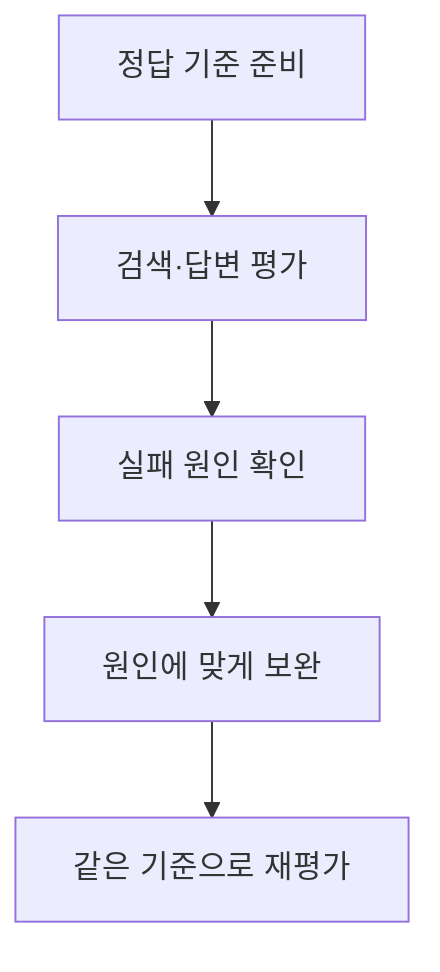
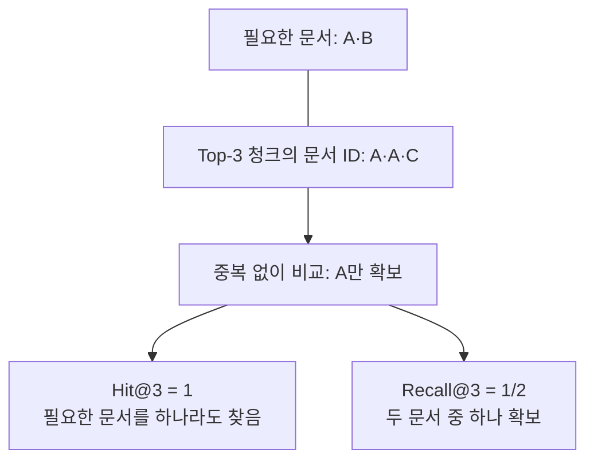
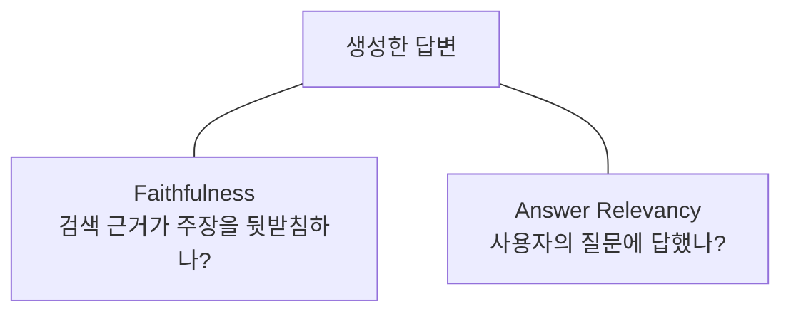
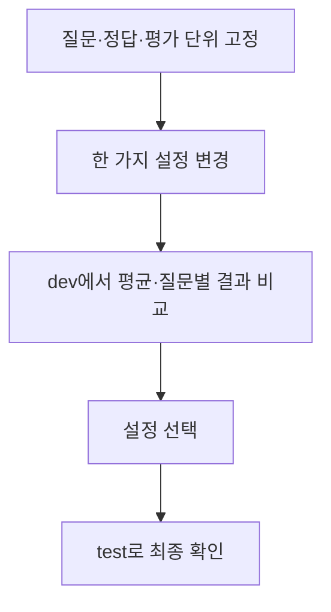
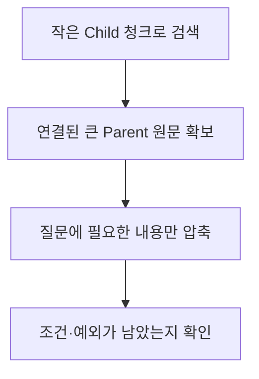
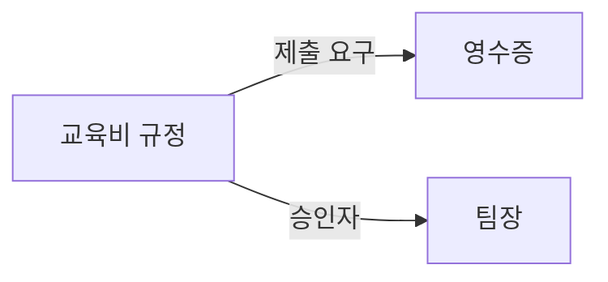
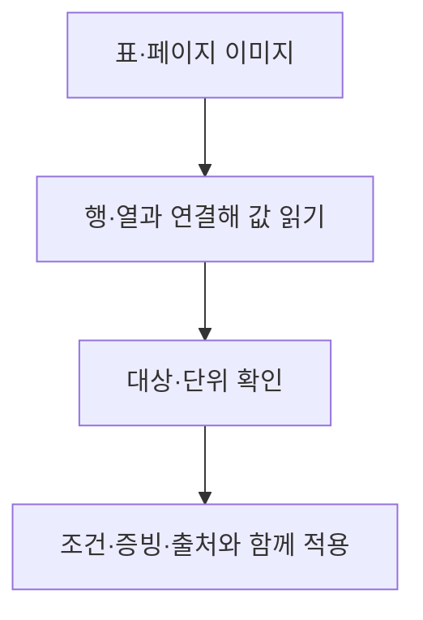
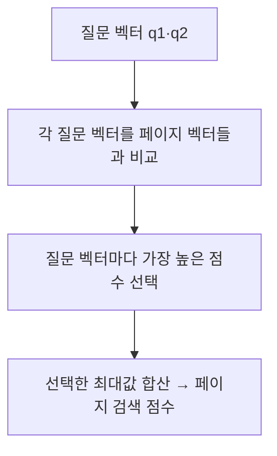

> 🗂️ **Notes · Deep Learning** — `rag` `ragas` `chunking` `graphrag` `multimodal-rag`
{: .prompt-info }

---

## 1. 📖 개요

RAG는 자료를 검색해 답변의 근거로 사용한다. 개선하려면 먼저 **어느 단계에서 필요한 정보가 빠졌는지** 확인한다.

> 📌 **기억** · 점수로 문제를 찾고, 원문과 조건으로 답을 확인한다.
{: .prompt-tip }

---

## 2. 🎯 정답 기준과 검색 평가

### Golden Dataset과 dev / test

**Golden Dataset**은 질문·참고 답변·정답 근거·답변 가능 여부를 검토해 둔 평가 기준이다.
**dev로 설정을 고르고, 개발에 사용하지 않은 test로 최종 확인**한다. test 결과를 보며 계속 고치면 그 문제에만 맞춰질 수 있다.

| 평가 자료 | 역할 |
| --- | --- |
| Golden Dataset | 질문·참고 답변·근거 답변 가능 여부 |
| dev | 검색·문맥 설정 비교·개선 |
| test | 개발에 쓰지 않은 문제로 고른 설정을 최종 확인 |

### Hit@k와 Recall@k

**Hit는 하나라도 찾았는지**, **Recall은 필요한 근거 중 찾은 비율**이다.

위 예시는 **상위 k개 청크를 먼저 고른 뒤 문서 ID로 비교**한다. A를 두 번 찾아도 정답 문서는 하나로 센다.
정답 근거가 없는 질문은 Recall의 분모가 0이므로 별도 평가한다.

---

## 3. 🔍 문맥과 답변을 나누어 평가하기

### 답변: 근거에 맞는가, 질문에 답했는가?

**숙박비 질문에 식비 규정을 정확하게 답해도 질문은 해결되지 않는다.**
Faithfulness와 Answer Relevancy를 따로 보는 이유다.

### 검색 문맥: 유용한 근거가 앞에 있는가, 필요한 사실이 있는가?

| 문맥 평가 | 확인하는 관계 |
| --- | --- |
| Context Precision | 유용한 청크의 검색 순위 |
| Context Recall | 참고 답변의 사실 ↔ 검색 문맥 |

여기서 Context는 답변 모델이 읽는 검색 근거다. 위 설명은 Ragas의 **참고 답변 기반 문맥 평가**에 해당하며,
문서 ID만 비교하는 Recall과 구분한다.

### 개선 전후 비교

평균만 보면 실패 원인이 가려진다. **어떤 질문이 좋아졌고 어떤 질문이 여전히 실패하는지** 실제 결과를 확인한다.

---

## 4. 🧩 문맥 보완과 다음 행동 선택

### Parent-Child와 Context Compression

**Parent는 검색된 Child가 속한 더 큰 원문 구간**이다. 문서 전체일 수도, 한 절처럼 큰 청크일 수도 있다.
확장 후 압축은 두 방법을 함께 쓰는 구성 예이며 모든 RAG의 필수 순서는 아니다.

> 📌 **기억** · 압축하면서 조건·예외를 빼면 답의 판단이 달라질 수 있다.
{: .prompt-tip }

### Corrective RAG와 Agentic RAG

| 관점 | 판단과 행동 |
| --- | --- |
| Corrective RAG | 검색 평가 → 근거 정제 필요하면 추가 검색 |
| Agentic RAG | AI가 질의·도구 선택 추가 검색·종료 선택 |

- **Corrective RAG:** 검색 품질을 평가해 근거를 정제하거나 추가 검색으로 보완한다. 원 논문의 CRAG는 웹 검색도 활용한다.
- **Agentic RAG:** AI가 허용된 범위에서 검색어·도구·추가 검색·종료 같은 다음 행동을 선택한다.

두 관점은 함께 쓸 수 있다. **검색 후보 확보는 답할 근거가 충분하다는 보장이 아니다.**

---

## 5. 🕸️ GraphRAG: 흩어진 관계 연결하기

개체는 관계로 연결하는 대상, 관계는 대상 사이의 연결이다. 예를 들어 **영수증을 요구하는 규정 → 그 규정의 승인자**를 따라 근거를 모은다.
그림의 화살표는 **규정 → 제출 대상·승인자** 방향의 관계다. 영수증에서 규정을 찾을 때는 들어오는 관계를 거슬러 확인한다. 관계의 조건과 원문 출처도 함께 읽는다.

| 탐색 방식 | 사용하는 근거 |
| --- | --- |
| Local | 관련 개체의 주변 관계와 원문 |
| Global | 커뮤니티 보고서 종합 전체 주제 파악 |
| DRIFT | 관련 보고서 → 후속 질문 Local 탐색 |

**Local은 관련 개체 주변**, **Global은 커뮤니티 보고서를 통한 전체 주제**를 본다.
**DRIFT는 관련 보고서에서 시작해 후속 질문과 Local 탐색**으로 구체화한다.

---

## 6. 🖼️ Multimodal RAG와 ColPali

### 표·이미지도 근거로 활용한다

표의 숫자는 **어느 행·열의 값인지, 대상과 단위가 무엇인지** 함께 읽는다.
산술 계산이 맞더라도 실제 적용·승인 조건은 별도 확인한다.

### ColPali와 MaxSim

| 계산용 예시 | d1 | d2 | 최대값 |
| --- | ---: | ---: | ---: |
| 질문 벡터 q1 | 0.9 | 0.3 | 0.9 |
| 질문 벡터 q2 | 0.2 | 0.8 | 0.8 |

**MaxSim = 0.9 + 0.8 = 1.7.**

ColPali는 **페이지 이미지를 여러 벡터로 표현해 관련 페이지를 찾는 검색 모델**이다.
MaxSim은 **질문 벡터마다 페이지 벡터 중 최고 일치 점수를 고르고, 그 최대값들을 더한다.**

그림의 점수는 계산 원리를 보여 주는 학습용 예시이며 실제 모델 출력이 아니다.
**검색 점수는 정답 확률이 아니며, 최종 답변의 정확성은 따로 확인**한다.

---

## 7. ✅ 핵심 정리

- **평가 기준:** dev로 고치고 test로 최종 확인한다.
- **지표 해석:** 하나라도 찾았는지, 얼마나 찾았는지, 근거와 질문에 맞는지 나누어 본다.
- **원인별 보완:** 문맥은 확장·압축, 검색 실패는 보정·행동 선택, 흩어진 관계는 그래프, 시각 정보는 멀티모달로 다룬다.
- **최종 확인:** 필요한 문장·조건·단위·출처가 답변에 보존됐는지 확인한다.

---

## 8. 🧠 핵심 기억 카드

<strong>펼쳐서 확인</strong>

- **Hit / Recall:** 하나라도 찾았나 / 필요한 근거 중 얼마나 찾았나.
- **Faithfulness / Relevancy:** 근거에 맞나 / 질문에 답했나.
- **문서 발견 ≠ 필요한 문장 확보.**
- **Parent-Child:** 작게 찾고 넓게 읽기. 압축해도 판단 조건은 남기기.
- **Corrective / Agentic:** 검색 결과 보완 / 다음 행동 선택.
- **GraphRAG / Multimodal:** 관계 연결 / 표·이미지까지 근거 활용.
- **MaxSim:** 질문 벡터별 최대값을 더하기. 점수는 정답 확률이 아니다.

---

## 참고

- [원문: 2026-10-27 노션 학습 노트](https://app.notion.com/p/405682609ddd8155afa3dadc75b776f9)
- [개발·평가 데이터 분리](https://scikit-learn.org/stable/modules/cross_validation.html) · [검색 평가](https://www.sbert.net/docs/package_reference/sentence_transformer/evaluation.html)
- [Ragas Faithfulness](https://docs.ragas.io/en/latest/concepts/metrics/available_metrics/faithfulness/) · [Answer Relevancy](https://docs.ragas.io/en/latest/concepts/metrics/available_metrics/answer_relevance/)
- [Context Precision](https://docs.ragas.io/en/latest/concepts/metrics/available_metrics/context_precision/) · [Context Recall](https://docs.ragas.io/en/latest/concepts/metrics/available_metrics/context_recall/)
- [ParentDocumentRetriever](https://reference.langchain.com/python/langchain-classic/retrievers/parent_document_retriever/ParentDocumentRetriever) · [Contextual Compression](https://www.langchain.com/blog/improving-document-retrieval-with-contextual-compression)
- [CRAG 원 논문](https://arxiv.org/abs/2401.15884) · [Agentic RAG](https://docs.langchain.com/oss/python/deepagents/retrieval#agentic-rag)
- [Microsoft GraphRAG](https://microsoft.github.io/graphrag/query/overview/) · [ColPali 원 논문](https://arxiv.org/abs/2407.01449)

---

## 관련 글

- [RAG 근거 구성과 검색 개선 — Context부터 RRF·재정렬까지](/posts/rag-context-hybrid-retrieval-reranking/)
- [RAG 검색 범위와 청크 관리 — Qdrant 필터부터 BM25까지](/posts/rag-filter-chunk-management-bm25/)
