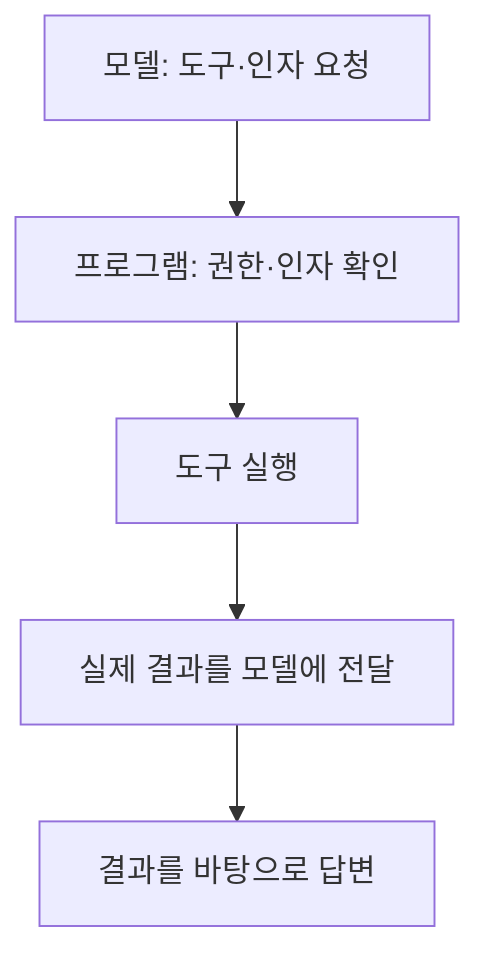

> 🗂️ **Notes · Deep Learning** — `llm` `rag` `token` `python`
{: .prompt-info }

---

## 1. 📖 개요

**컨텍스트는 모델이 이번 답변에 참고하는 입력**이다. 컨텍스트 엔지니어링은 필요한 정보를 골라 알맞은 형태와 길이로 전달하는 일이다.

{: w="680" h="490" }

- **프롬프트 엔지니어링:** 어떻게 지시할까? 예: “세 줄로 답해줘.”
- **RAG:** 어떤 근거를 찾아줄까? 예: 회사 규정을 검색해 답변에 활용.
- **컨텍스트 엔지니어링:** 지시·검색 결과·대화·메모리·도구 결과와 길이를 함께 관리.

넓게 보면 **프롬프트 설계와 RAG는 컨텍스트 엔지니어링의 일부**다.

---

## 2. 🧠 메모리: 어디에서 다시 쓰는가?

{: w="680" h="560" }

**보관 기간이나 DB 사용 여부만으로 단기·장기를 나누지 않는다.** 현재 대화·작업을 이어 가는지, 다른 대화에서도 다시 활용하는지가 기준이다.

RAG는 **검색을 답변에 연결하는 방식**, 메모리는 **이전 정보를 보관·재사용하는 체계**다. 저장된 기억을 검색해 답변에 쓰면 RAG 방식으로 구현할 수 있다. “RAG는 문서, 메모리는 대화”로 엄격히 나뉘지는 않는다.

메모리도 `임베딩 → 벡터 DB → 유사도 검색`을 쓸 수 있다. ID·키·프로필 조회도 가능하다.

### Mem0는 저장·검색·수정·삭제 관리를 돕는다

| 설정 | 저장 과정 |
| --- | --- |
| `infer=True` | LLM으로 사실·선호 등<br>기억 후보 추출 |
| `infer=False` | 추출용 LLM 생략<br>전달한 내용 저장 |

**Mem0의 벡터 저장 경로는 `infer=False`에서도 임베딩한다.** 개발자는 저장 목적·범위 등 정책을 조정한다.

- **저장 판단:** 지속 적용 요청·반복되는 선호·일시적인 상황을 구분한다. 공통으로 정해진 반복 횟수는 없다. ChatGPT·Claude의 정확한 내부 기준이나 Mem0 사용 여부도 단정할 수 없다.
- **삭제:** 저장된 항목과 사용자 소유 범위를 확인한다. 채팅 삭제와 저장된 메모리 삭제는 범위가 다를 수 있다.

---

## 3. 📏 토큰 예산: 출력할 공간부터 남기기

**입력 예산 = 전체 한도 − 출력 예약 − 여유분**

{: w="680" h="300" }

위 숫자는 설명용이다. 질문·지시·문서·대화·기억을 합쳐 입력 예산에 맞춘다. **문자 수와 토큰 수는 다르며**, 모델별 한도와 추론 토큰 등 추가 사용량도 확인한다.

초과하면 오래되거나 무관한 내용을 빼고, 요약하거나 필요한 부분만 검색한다. **조건·예외·출처는 남긴다.** 그대로 넘기면 오류가 날 수 있으며 자동 정리 방식은 서비스마다 다르다.

긴 채팅의 한도 안내도 비슷한 제약과 관련될 수 있지만, 같은 원인이라고 단정하지 않는다.

---

## 4. ♻️ KV · Prefix · 응답 캐시

{: w="680" h="450" }

**Prefix는 공통 앞부분의 KV를 재사용하는 방식**이다. 같은 규정에 서로 다른 질문을 하면 규정 처리 계산은 재사용해도 새 질문의 답변은 다시 생성한다.

응답 캐시는 입력·설정·근거 버전 등 재사용 조건이 맞아야 한다. 캐싱이 입력 길이 제한을 없애지는 않는다.

---

## 5. 🛠️ 함께 구분할 용어

- **sLLM:** 비교적 작은 언어 모델. **vLLM:** 모델을 효율적으로 실행·서빙하는 엔진.
- **Citation:** 답변의 근거를 가리키는 출처 표시. 원문이 실제 주장을 뒷받침하는지 확인한다.
- **Tool calling:** 모델이 도구와 인자를 요청하고, 프로그램이 실행 결과를 반환하는 방식.



**모델의 요청과 실제 실행은 구분한다.** 완료 여부는 실제 도구 결과로 확인한다.

---

## 6. 🐍 Python: 위치와 키 구분하기

| 표현 | 의미 |
| --- | --- |
| `rows[0]` | 리스트의 첫 항목 |
| `row['id']` | 딕셔너리의 `id` 값<br>없으면 오류 |
| `row.get('id')` | 딕셔너리의 `id` 값<br>없으면 기본값 `None` |

```python
ids = [
    r["id"] for r in results
    if r.get("event") == "ADD"
]
first_id = ids[0] if ids else None
```

`results`가 `id`를 가진 딕셔너리 목록일 때의 예시다. 바깥 `[ ... for ... if ... ]`는 조건에 맞는 값으로 **새 리스트를 만든다**. 뒤의 `[0]`은 **그 리스트의 첫 항목을 고른다**. 위 코드는 빈 목록이면 `None`을 저장한다.

---

## 7. 🧠 핵심 기억 카드

<details markdown="1">
<summary><strong>펼쳐서 확인</strong></summary>

- **전체 입력 설계:** 프롬프트·RAG·메모리를 함께 관리한다.
- **메모리:** 보관 기간만으로 판단하지 않고 재사용 범위를 본다.
- **예산:** 전체 한도에서 출력 예약과 여유분을 **뺀다**.
- **캐시:** KV는 내부 계산, Prefix는 공통 앞부분의 KV, 응답은 완성된 답변.
- **Python:** 리스트는 위치, 딕셔너리는 키. 컴프리헨션과 뒤의 `[0]`은 별개다.
- **공격 탐지에서:** 오탐은 정상 차단, 미탐은 공격을 놓쳐 통과시킨 경우다.

</details>

---

## 참고

- [원문: 2026-10-28 노션 학습 노트](https://app.notion.com/p/406682609ddd81bea366d295e64ecf5f)
- [컨텍스트 엔지니어링 — Anthropic](https://www.anthropic.com/research/effective-context-engineering-for-ai-agents) · [메모리의 범위 — LangChain](https://docs.langchain.com/oss/python/concepts/memory)
- [Mem0 기억 추출](https://docs.mem0.ai/core-concepts/memory-operations/add) · [Mem0 OSS 저장 구현](https://github.com/mem0ai/mem0/blob/main/mem0/memory/main.py)
- [컨텍스트와 토큰](https://developers.openai.com/api/docs/guides/conversation-state) · [KV 캐시](https://huggingface.co/docs/transformers/en/cache_explanation) · [vLLM Prefix Caching](https://docs.vllm.ai/en/latest/features/automatic_prefix_caching/) · [응답 캐시](https://reference.langchain.com/python/langchain-core/caches/InMemoryCache)
- [Tool calling](https://platform.claude.com/docs/en/agents-and-tools/tool-use/overview) · [도구 실행과 권한 검사](https://cheatsheetseries.owasp.org/cheatsheets/LLM_Prompt_Injection_Prevention_Cheat_Sheet.html)
- [Python 리스트 컴프리헨션](https://docs.python.org/3/tutorial/datastructures.html#list-comprehensions) · [dict.get](https://docs.python.org/3/library/stdtypes.html#dict.get) · [오탐·미탐](https://scikit-learn.org/stable/modules/generated/sklearn.metrics.confusion_matrix.html)

---

## 관련 글

- [RAG 근거 구성과 검색 개선 — Context부터 RRF·재정렬까지](/posts/rag-context-hybrid-retrieval-reranking/)
- [RAG 청킹에서 임베딩과 코사인 유사도까지](/posts/rag-chunking-embedding-cosine-similarity/)
