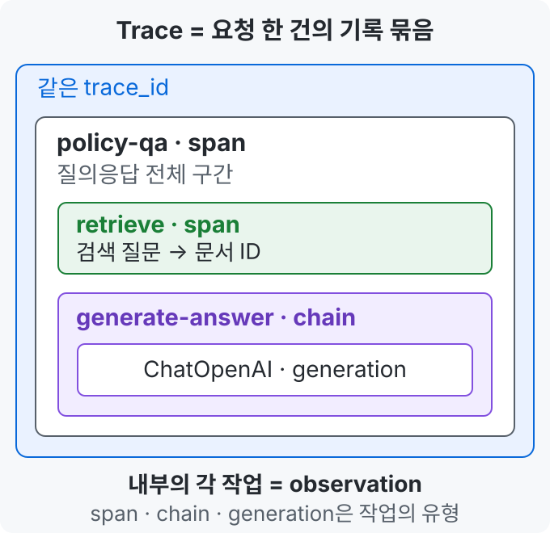
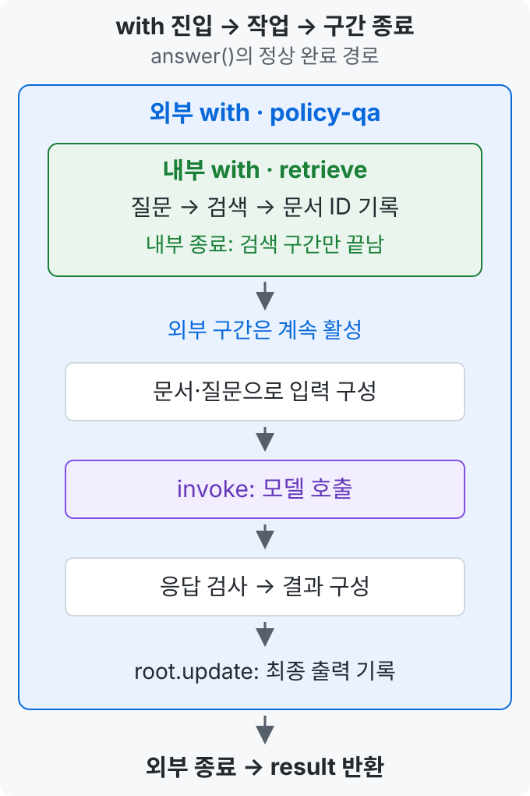
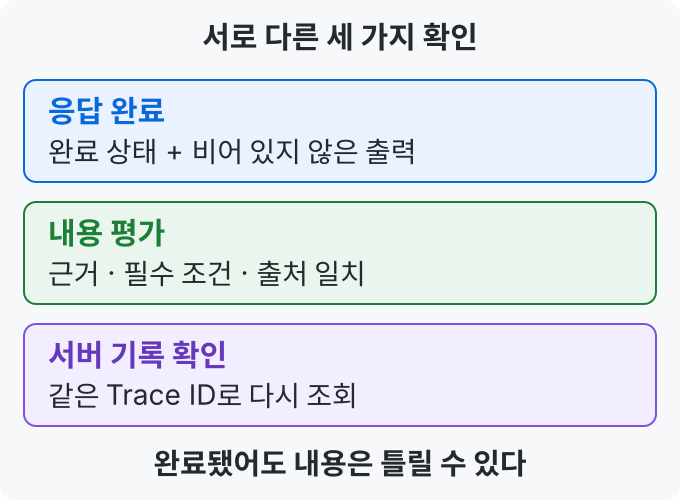

> 🗂️ **Notes · Deep Learning** — `llm` `langfuse` `langchain` `python`
{: .prompt-info }

---

## 1. 📖 Langfuse: 답변이 나온 과정을 확인하기

**Langfuse는 LLM 앱의 실행 과정을 기록해, 오답·지연의 원인을 찾고 개선 효과를 확인하는 도구**다.

최종 답변만 보면 **검색 실패·입력에서 근거 누락·생성 과정의 오류**를 구분하기 어렵다. 각 단계의 입력·출력을 대조해 문제가 처음 드러난 위치를 찾는다. 소요 시간·사용량·평가 결과를 모으면 속도·비용과 변경 전후의 품질도 비교할 수 있다.

{: w="680" h="660" }

| 용어 | 의미 |
| --- | --- |
| **Trace** | 요청 한 건의 실행 기록 묶음.<br>같은 `trace_id`로 연결한다. |
| **observation** | 작업 하나의 실행 기록.<br>부모·자식으로 중첩할 수 있다. |
| **span** | 일반 작업 구간을 나타내는<br>observation의 한 유형. |

그림의 **각 작업은 모두 observation**이다. 프롬프트 관련 중간 기록은 생략했다.

### as_type은 기록할 작업의 종류

`name`은 기록 이름, `as_type`은 기록 유형을 정한다. 둘 다 Langfuse 메서드에 전달하는 인자다.

| as_type | 기록할 작업 |
| --- | --- |
| `span` | 질의응답 전체 등 일반 작업 구간 |
| `tool` | 업무 조회·계산·API 호출 등 도구 실행 |
| `generation` | AI 모델의 응답 생성 |

세 유형 모두 입력·출력·시간 등을 기록할 수 있다. **generation은 모델 이름·설정·토큰 사용량·비용 같은 모델 전용 정보도 다룬다.** 정보는 연동 기능으로 수집하거나 직접 전달해야 한다.

**유형을 지정하는 것과 실제 실행은 별개다.** `as_type="tool"`이 도구를 실행하거나, `as_type="generation"`이 모델을 호출하지는 않는다. 실제 작업은 블록 안의 코드가 수행한다.

---

## 2. 🔍 중첩 with: 전체 요청과 검색을 나누기

**with는 진입 시 준비하고, 들여쓴 코드를 실행한 뒤, 블록을 벗어날 때 종료·정리 절차를 수행하는 문법**이다. 정리할 내용은 객체가 정한다. 파일에서는 닫기, 이 Langfuse 코드에서는 관측 구간 종료에 활용한다.

`lf.start_as_current_observation(...)`은 **관측을 시작하고 현재 활성 구간으로 설정하는 SDK 메서드**다. 그 안에서 생성한 관측은 자식으로 연결된다. 기본 설정에서는 블록을 벗어날 때 구간을 종료하고 이전 활성 구간으로 복귀한다.

질의응답 함수에서 관측을 나누는 부분을 발췌하면 다음과 같다.

```python
with lf.start_as_current_observation(
    name="policy-qa", as_type="span", input={"question": question}
) as root:
    with lf.start_as_current_observation(
        name="retrieve", as_type="span", input=question
    ) as step:
        docs = retrieve(question)
        step.update(output={"document_ids": [d["id"] for d in docs]})

    # 검색 구간 종료 후에도 외부 구간에서 입력 구성·모델 호출 등이 이어진다.
```

{: w="680" h="1020" }

| 구간 | 기록한 입력 → 출력 | 관측 객체 |
| --- | --- | --- |
| 외부 `with` | 질문 → 최종 답변 | `as root` |
| 내부 `with` | 검색 질문 → 문서 ID | `as step` |

이 흐름의 `answer()` 함수는 **문서를 검색해 모델에 전달하고, 답변과 Trace ID·문서 ID·사용량·소요 시간을 반환**한다.

- `step.update(...)`: 검색 결과의 문서 ID를 기록한다.
- `root.update(...)`: 최종 답변과 완료 상태를 기록한다.
- `root.trace_id`: 같은 실행을 다시 찾을 식별자다.
- 일반 Python 함수 `retrieve()`의 경계는 수동 span으로 표시하고, LangChain 프롬프트·모델 실행은 연결한 콜백으로 관측한다.

**내부 구간이 끝나도 외부는 계속된다.** 부모 시간에는 자식 구간이 포함되므로 전체 시간에 자식 시간을 다시 더하면 중복 계산이다.

바깥 관측이 있으면 그 아래에 연결되고, 없으면 새 Trace가 시작된다. 블록 안에서 예외가 발생해도 종료 절차를 거친다. 이 함수는 예외를 잡지 않으므로 오류 뒤의 완료 기록·결과 반환까지 진행하지 않는다.

### 같은 질문을 두 곳에 기록하는 이유

현재 코드는 같은 `question`을 전달한다. 외부는 **어떤 질문에 무엇을 답했는지**, 내부는 **어떤 질문으로 어떤 문서를 찾았는지**를 확인하기 위한 기록이다.

각 단계를 독립적으로 해석할 수 있게 남기는 것이며, 두 기록이 모두 있어야 실행되는 것은 아니다. 검색용 질문을 재작성하는 시스템에서는 전체 요청과 검색 입력이 달라질 수도 있다.

---

## 3. ▶️ invoke: 연결한 처리를 실행하기

```python
reply = (prompt | model).invoke(
    {"context": context, "question": question},
    config={"callbacks": [handler], "run_name": "generate-answer"},
)
```

```text
context·question
      ↓
prompt: 값을 채워 메시지 구성
      ↓
model: 메시지를 받아 답변 생성
      ↓
reply: 응답 메시지 객체
```

| 부분 | 역할 |
| --- | --- |
| `prompt \| model` | 왼쪽 출력을 오른쪽 입력으로 전달하도록 연결 |
| `.invoke(...)` | 입력 하나로 처리를 실행하고 결과 반환 |
| `callbacks: [handler]` | 실행 이벤트를 Langfuse 콜백에 전달 |
| `run_name` | 이번 체인 실행을 기록에서 찾을 이름 |

**연결 구성은 `prompt | model`, 실행은 `.invoke()`가 담당한다.** 콜백은 객체를 만드는 데서 끝내지 않고 실행에 연결해야 한다. `config`는 실행 설정이며 프롬프트에 넣는 질문·근거 내용과 구분한다.

---

## 4. ✅ 응답 완료·정답·서버 기록을 구분하기

{: w="680" h="500" }

**응답 완료는 정답을 보장하지 않는다.** 제공된 함수는 완료 상태와 빈 답변을 검사하며, 사실의 정확성은 별도 평가가 필요하다. 응답 메타데이터의 필드·완료값은 사용 중인 모델 연동 기준으로 확인한다.

관측 구간 종료나 전송 처리만으로 서버 조회 성공을 단정하지 않는다. **사용량이 없으면 알 수 없음(`None`)으로 유지하며 0으로 해석하지 않는다.**

---

## 5. 🐍 get과 []: 누락을 어떻게 처리할까?

| 상황 | `row["status"]` | `row.get("status")` |
| --- | --- | --- |
| 값이 `"completed"` | `"completed"` | `"completed"` |
| 키는 있고 값이 `None` | `None` | `None` |
| 키가 없음 | `KeyError` | `None` |

분류 함수의 상태 검사 부분을 발췌하면 다음과 같다. **`row`는 딕셔너리이며, 상태 값은 문자열 또는 `None`인 예시다.**

```python
# 누락·허용되지 않은 문자열 상태를 분류
if row.get("status") not in {"completed", "failed"}:
    return "incomplete"

# 위 검사를 통과했으므로 키와 허용된 값이 있음을 확인한 상태
if row["status"] == "failed":
    return "model_error"
```

**get은 누락을 예상해 처리할 때, []는 필수 값이거나 앞에서 확인한 값을 사용할 때 적합하다.** 필수 시각을 `row["started_at"]`으로 읽고 누락 시 `KeyError`를 잡아 분류하는 방식도 가능하다.

`row.get("status", "unknown")`의 기본값은 **키가 없을 때만** 적용된다. 키가 있고 값이 `None`이면 그대로 `None`이다.

---

## 6. 🧠 핵심 기억 카드

<details markdown="1">
<summary><strong>펼쳐서 확인</strong></summary>

- **Trace는 묶음, observation은 작업 기록, span은 그 유형 중 하나다.**
- **외부 with는 전체 요청, 내부 with는 검색 단계다.** 내부가 끝나도 외부는 계속된다.
- **as_type은 기록의 종류다.** 실제 검색·도구 실행·모델 호출은 내부 코드가 수행한다.
- **연결은 `|`, 실행은 `.invoke()`다.** 콜백은 실행 설정에 연결한다.
- **완료·정답·서버 조회는 각각 확인한다.** 사용량 누락은 비용 0을 뜻하지 않는다.
- **get과 []는 누락 처리 의도에 따라 선택한다.**

</details>

---

## 참고

- [원문: 2026-10-30 노션 학습 노트](https://app.notion.com/p/40c682609ddd81908f35c46f2b0a69ae)
- [Langfuse 관측 구조](https://langfuse.com/docs/observability/data-model) · [관측 유형](https://langfuse.com/docs/observability/features/observation-types)
- [Langfuse 관측 구간과 중첩](https://langfuse.com/docs/observability/sdk/instrumentation#context-manager) · [모델 전용 기록 필드](https://python.reference.langfuse.com/langfuse)
- [LangChain Runnable·invoke](https://reference.langchain.com/python/langchain-core/runnables/base/Runnable) · [실행 설정](https://reference.langchain.com/python/langchain-core/runnables/config/RunnableConfig)
- [Python with와 정리](https://docs.python.org/ko/3/tutorial/errors.html#predefined-clean-up-actions) · [딕셔너리 get](https://docs.python.org/ko/3/builtins/stdtypes.html#dict.get)

---

## 관련 글

- [컨텍스트 엔지니어링 핵심 — RAG·메모리·토큰 예산·캐시](/posts/context-engineering-memory-budget-cache/)
- [RAG 평가와 원인별 보완 — 정답 기준부터 GraphRAG·ColPali까지](/posts/rag-evaluation-and-advanced-retrieval/)
