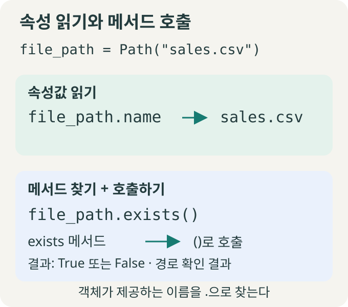
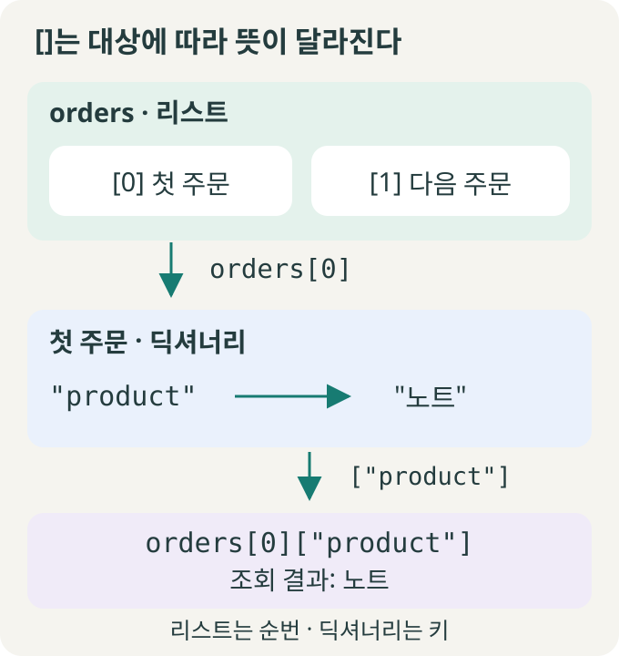
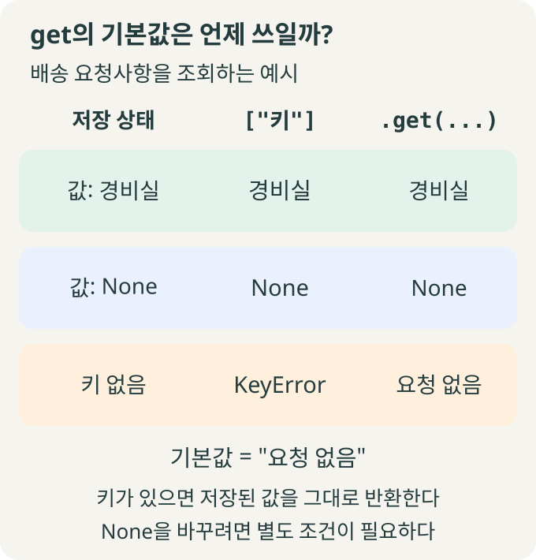

> 🗂️ **Notes · Python** — `python`
{: .prompt-info }

---

## 1. 💡 무엇을 꺼내려는지 먼저 보기

**`.`은 속성·메서드를 이름으로 찾고, `[]`는 항목을 키나 순번으로 찾는다. `.get()`은 딕셔너리의 조회 메서드를 호출한 형태**다.

| 표현 | 찾는 대상 |
| --- | --- |
| `.` | 속성·메서드 이름 |
| `[]` | 리스트의 순번·딕셔너리의 키 |
| `.get()` | 딕셔너리 값. 키가 없으면 기본값 |

**속성**은 객체가 이름으로 제공하는 값이고, **메서드**는 객체를 통해 사용하는 함수다. 딕셔너리와 리스트도 객체이므로 속성·메서드를 가질 수 있다.

---

## 2. 📁 점: 속성 읽기와 메서드 호출

파일명과 확장자를 확인하는 예시다.

{: w="680" h="600" }

```python
from pathlib import Path

file_path = Path("sales.csv")
print(file_path.name)    # sales.csv
print(file_path.suffix)  # .csv
file_path.exists()       # True 또는 False
```

`.name`은 속성값을 읽고, `.exists()`는 메서드를 찾아 호출한다. **이름에 접근하는 것과 `()`로 실행하는 것을 구분한다.** 파일명·확장자는 경로 문자열만으로 읽을 수 있으며 이 코드는 파일을 만들지 않는다.

---

## 3. 📦 대괄호: 딕셔너리는 키, 리스트는 순번

**딕셔너리는 키와 값을 짝지어 저장한다.** 상품명은 `"product"`라는 키로 찾는다.

```python
order = {
    "product": "노트",
    "unit_price": 3000,
    "quantity": 2,
}

print(order["product"])  # 노트
total = order["unit_price"] * order["quantity"]
print(total)             # 6000
```

**리스트는 항목을 순서대로 저장하며 순번은 0부터 시작한다.** 리스트 안에 딕셔너리가 있다면, 순번으로 항목을 꺼낸 뒤 키로 값을 찾는다.

{: w="680" h="720" }

```python
orders = [{"product": "노트"}, {"product": "펜"}]
print(orders[0])             # {'product': '노트'}
print(orders[0]["product"])  # 노트
```

| 대상 | 없는 항목을 읽으면 |
| --- | --- |
| 기본 `dict`의 키 | `KeyError` |
| `list`의 범위를 벗어난 정수 순번 | `IndexError` |

딕셔너리는 정수도 키로 쓸 수 있으므로 `[0]`이 항상 첫 항목이라는 뜻은 아니다. `orders = []`는 빈 리스트를 만드는 표현이고, `orders[0]`는 기존 리스트의 항목에 접근하는 표현이다.

---

## 4. 🔍 get: 키가 없을 때의 대안

배송 요청사항처럼 생략할 수 있는 항목은 누락을 예상하고 조회한다.

```python
order = {"product": "노트", "quantity": 2}

print(order.get("product"))        # 노트
print(order.get("delivery_note"))  # None
note = order.get(
    "delivery_note", "요청 없음"
)
print(note)                        # 요청 없음
```

`order.get(...)`은 **`.`으로 `get` 메서드를 찾고 `()`로 키와 기본값을 전달해 호출**한다. 기본값을 생략하면 키가 없을 때 `None`을 반환한다.

### 기본값은 키가 없을 때만 적용된다

{: w="680" h="710" }

`None`은 Python의 값이다. 애플리케이션에서 미입력·미확인 등을 나타내는 데 사용할 수 있으며 의미는 데이터 규칙으로 정한다. **키가 있고 값이 `None`이면 `.get()`도 그대로 `None`을 반환한다.**

키 누락과 `None` 모두를 같은 안내로 표시하려면 명시적으로 처리한다.

```python
order = {"delivery_note": None}

note = order.get("delivery_note")
if note is None:
    note = "요청 없음"
print(note)  # 요청 없음
```

키 존재 자체를 구분하려면 `"delivery_note" in order`로 확인한다. 빈 문자열 `""`이나 숫자 `0`도 같은 상태로 취급할지는 별도로 정한다.

---

## 5. ✅ 실무에서 고르는 기준

| 상황 | 선택 기준 |
| --- | --- |
| 금액 계산의 필수 단가·수량 | `[]`로 읽어 누락을 오류로 드러낸다. 기본값 `0`은 잘못된 금액을 감출 수 있다. |
| 선택 입력인 배송 요청사항 | `.get()`으로 읽고 누락 시 표시할 기본값을 정한다. |
| 외부에서 받은 데이터 | 입력 단계에서 필수 키·자료형·값의 범위를 검증한 뒤 사용한다. |

**조회와 검증은 별개다.** `[]`는 수량이 `-1`이어도 키가 있으면 그대로 반환한다. `.get()`도 대상 자체가 `None`이면 호출할 수 없어 `AttributeError`가 발생한다.

일반적인 딕셔너리의 `"product"` 키는 `order.product`로 읽지 않는다. `order["product"]` 또는 `order.get("product")`로 조회한다. 기본 리스트에는 `get` 메서드가 없다. 라이브러리나 사용자 정의 객체의 접근 방식은 해당 자료형의 규칙을 확인한다.

---

## 6. 🧠 핵심 기억 카드

<details markdown="1">
<summary><strong>펼쳐서 확인</strong></summary>

- **`.`**: 속성·메서드를 이름으로 찾는다. 메서드를 실행하려면 `()`를 붙인다.
- **`[]`**: 리스트는 순번, 딕셔너리는 키로 항목을 읽는다.
- **`.get()`**: 딕셔너리의 키 누락 시 기본값을 반환한다.
- **키 누락과 `None`**: 기본값은 키가 없을 때만 사용된다.
- **실무 선택**: 필수 값은 누락을 드러내고, 선택 값은 대안을 정한다. 입력 검증은 따로 한다.

</details>

---

## 참고

- [원문: 2026-11-03 노션 학습 노트](https://app.notion.com/p/408682609ddd812eaf09deedfbc5fa01)
- [Python 속성 접근·항목 접근·호출](https://docs.python.org/3/reference/expressions.html#attribute-references)
- [Python 딕셔너리와 get](https://docs.python.org/3/library/stdtypes.html#dict.get)
- [pathlib의 name·suffix](https://docs.python.org/3/library/pathlib.html#pathlib.PurePath.name)
