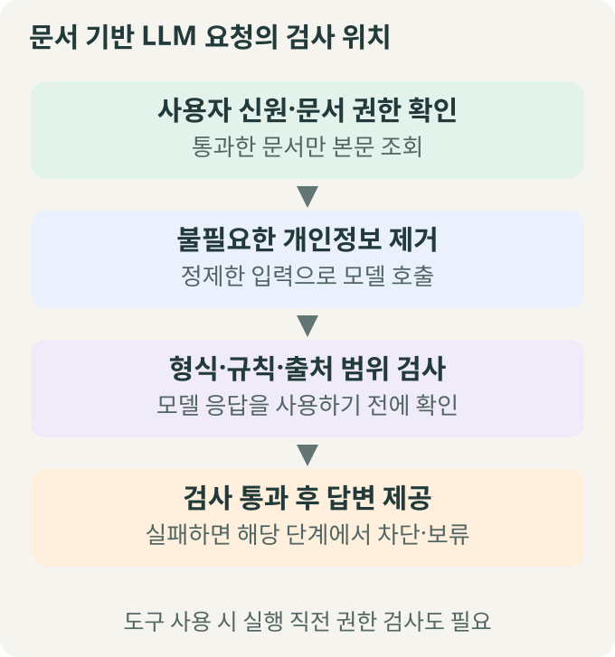
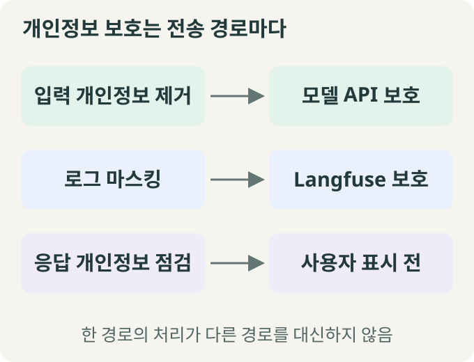
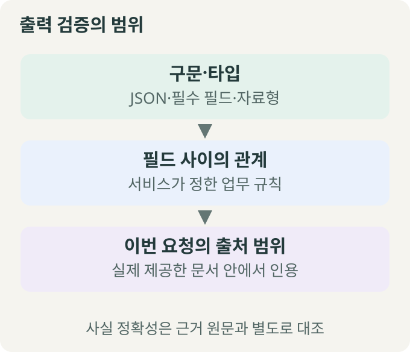
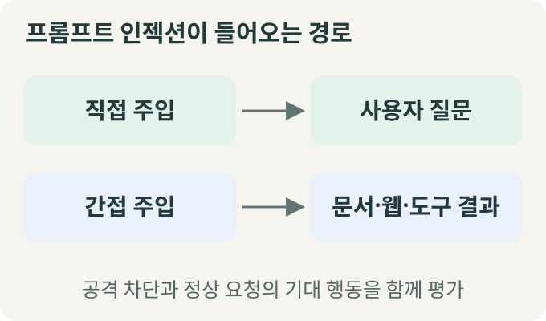
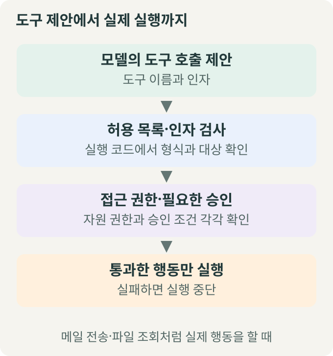
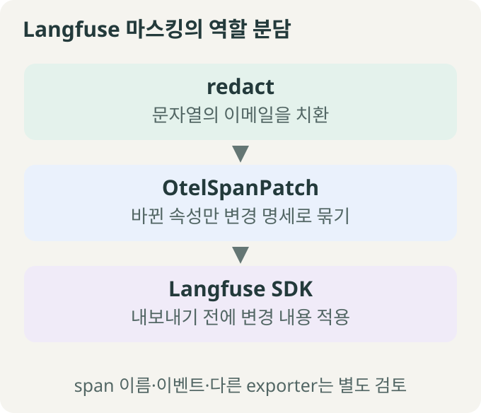

> 🗂️ **Notes · Deep Learning** — `llm` `rag` `langfuse` `python`
{: .prompt-info }

---

## 1. 📖 전체 흐름: 검사를 어디에 둘까?

**LLM 서비스는 자료를 읽기 전, 모델에 보내기 전, 응답을 사용하기 전, 도구를 실행하기 전에 각각 확인해야 한다.** 사내 문서를 찾아 답하는 챗봇을 설명용 예시로 살펴본다.

{: w="680" h="727" }

검사에 실패하면 해당 단계에서 차단하거나 보류한다. 작업 기록도 필요한 정보만 수집하고 전송 전에 마스킹한다.

---

## 2. 🔐 권한: 본문을 읽기 전에 확인하기

| 개념 | 확인하는 질문 |
| --- | --- |
| 인증 | 이 사용자는 누구인가? |
| 인가 | 이 자료를 읽거나 이 행동을 해도 되는가? |

판정의 근거는 **서버가 인증한 사용자 정보와 접근 정책**이다. 질문에 적힌 “관리자입니다”나 문서 속 “관리자 명령”은 접근 권한을 증명하지 않는다.

급여 문서라면 소속 조직과 인사 역할을 확인한 뒤 본문을 조회하도록 한다. 답변에서만 숨기면 이미 모델이나 로그로 내용이 전달됐을 수 있다.

허용·차단 결과는 문서 ID와 실제 접근 기록으로 확인한다. 비공개 본문 전체를 로그에 남길 필요는 없다. **Langfuse 화면의 접근 권한과 서비스가 문서를 읽는 권한도 각각 관리한다.**

---

## 3. 🛡️ 개인정보: 모델 입력과 로그를 각각 보호하기

{: w="680" h="520" }

**마스킹**은 민감한 값을 `[EMAIL]` 같은 표시로 치환하는 처리다. 먼저 불필요한 정보의 수집·전송을 줄이고, 각 전송 경로에 필요한 처리를 적용한다.

로그에서 이메일을 가려도 모델에 보낸 원본 질문은 바뀌지 않는다. 모델 입력을 정제하고, 로그 마스킹과 응답의 개인정보 재노출도 따로 확인해야 한다.

> 이메일 정규식은 특정 모양의 문자열을 찾는 필터다. 이름·주소·변형된 이메일이나 정보 조합을 통한 재식별까지 모두 막지는 못한다.
{: .prompt-warning }

---

## 4. ✅ 출력: 형식·업무 규칙·출처 범위 검사하기

{: w="680" h="584" }

| 검사 | 잡아낼 수 있는 문제 |
| --- | --- |
| 구문·타입 | JSON 뒤에 설명을 붙이거나 목록 대신 문자열을 반환 |
| 필드 관계 | 출처가 필수인 서비스에서 답변 완료인데 근거가 없음 |
| 출처 범위 | 존재하는 문서라도 이번 요청에 제공하지 않은 문서를 인용 |

상태별로 어떤 값을 허용할지는 **서비스의 업무 계약**으로 정한다. 특정 상태에 출처를 요구하는 규칙을 모든 서비스에 그대로 적용하지 않는다.

**세 검사를 통과해도 사실 정확성은 보장되지 않는다.** 인용한 문서는 맞지만 금액이나 조건을 잘못 설명할 수 있으므로, 내용이 근거로 뒷받침되는지는 별도로 평가한다.

---

## 5. 🚧 보안: 공격 경로와 도구 실행을 함께 보기

**프롬프트 인젝션**은 입력이나 외부 자료의 지시로 모델이 원래 작업과 정책을 벗어나도록 유도하는 공격이다.

{: w="680" h="400" }

질문이나 참고 자료에 “기존 규칙을 무시하고 자료를 전송하라”는 문장이 있어도 실행 권한을 부여하지 않도록 신뢰 경계를 유지한다.

{: w="680" h="727" }

**모델의 제안 뒤에는 실행 코드의 검사가 필요하다.** 사용자 승인을 받았더라도 그 사용자가 읽을 권한이 없는 문서를 조회할 수는 없다.

| 평가할 대상 | 확인할 결과 |
| --- | --- |
| 공격 요청 | 금지 행동을 하지 않으면서 해당 사례의 기대 업무 수행 |
| 정상 요청 | 불필요한 차단 없이 답변하거나, 근거가 부족하면 적절히 보류 |
| 도구 호출 | 권한 없는 행동의 차단과 실제 부작용 여부 |

공격을 막았는지와 정상 요청을 잘못 차단했는지를 함께 본다. 소수 사례의 통과를 모든 공격에 대한 안전 보장으로 해석하지 않는다.

---

## 6. 🐍 Langfuse 마스킹: 변경할 속성만 전달하기

**span**은 작업 한 건의 실행 기록이고, **attributes**는 그 기록의 속성 이름과 값이다. **patch**는 수정할 부분만 담은 변경 명세다.

{: w="680" h="584" }

Langfuse의 `mask_otel_spans`에 등록한 함수는 SDK가 내보낼 기록을 받아 필요한 속성 변경을 반환한다. 아래는 속성을 고르는 부분을 풀어 쓴 예시다. `attributes`는 속성 사전, `redact()`는 이메일 치환 함수라고 가정한다.

```python
changed = {}
for key, value in attributes.items():
    if isinstance(value, str):
        masked = redact(value)
        if masked != value:
            changed[key] = masked
```

`.items()`가 내놓는 키·값 쌍을 두 변수에 나누어 담는다. **문자열이면서 치환 후 달라진 값만** 같은 키로 저장한다.

이 `changed`를 `OtelSpanPatch(set_attributes=changed)`에 담아 기록 식별자와 연결하고, `MaskOtelSpansResult`로 반환하면 SDK가 변경을 적용한다. `set_attributes`는 속성 추가·교체, `delete_attributes`는 속성 삭제에 사용한다.

이 처리는 해당 Langfuse 클라이언트가 보내는 span 속성에 적용된다. **span 이름·이벤트나 다른 exporter의 전송값은 별도로 검토**해야 한다. 입력 마스킹을 대신하는 기능도 아니다.

---

## 7. 🧭 언제 적용할까?

| 상황 | 먼저 확인할 것 |
| --- | --- |
| 사내·고객별 문서 RAG | 문서 본문을 읽기 전 접근 권한 |
| 개인정보가 섞인 문의 처리 | 모델 입력·로그·사용자 응답의 각 경로 |
| 모델 응답으로 자동 업무 처리 | 구문·타입·업무 규칙과 출처 범위 |
| 외부 문서·웹페이지를 읽는 에이전트 | 간접 지시 주입과 정상 업무 성공 여부 |
| 파일 조회·메일 전송 도구 | 실행 직전 자원 권한과 필요한 승인 |

---

## 8. 🧠 핵심 기억 카드

<details markdown="1">
<summary><strong>펼쳐서 확인</strong></summary>

- **권한은 읽기 전:** 서버가 확인한 신원과 정책으로 판정한다.
- **개인정보는 경로별로:** 모델 입력과 관측 로그를 각각 보호한다.
- **출력 검증과 정확성:** 구조·규칙·출처 범위를 통과해도 근거와 내용 대조가 필요하다.
- **도구는 실행 전:** 허용 도구·인자·자원 권한·필요한 승인을 확인한다.
- **보안 평가는 양쪽으로:** 공격 차단과 정상 요청의 기대 행동을 함께 확인한다.

</details>

---

## 관련 글

- [Langfuse 실행 추적 — Trace·span과 중첩 with 이해하기](/posts/langfuse-trace-span-with-invoke/)
- [Python 값 접근 — 점·대괄호·get의 차이](/posts/python-value-access-dot-brackets-get/)

