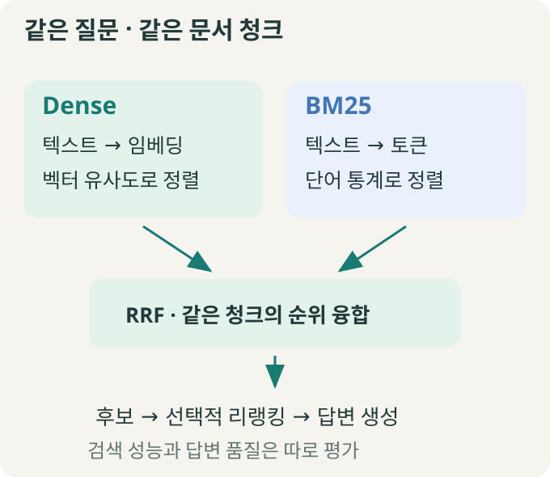
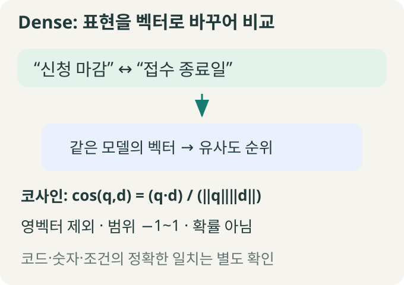
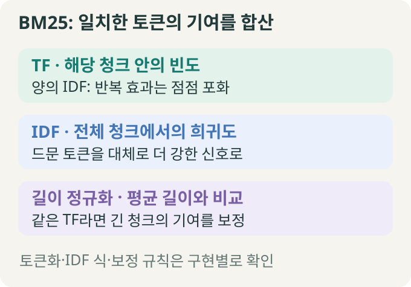
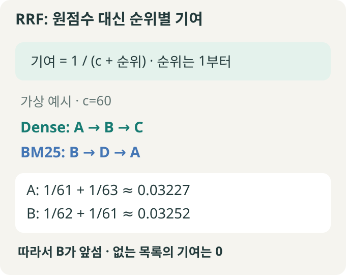
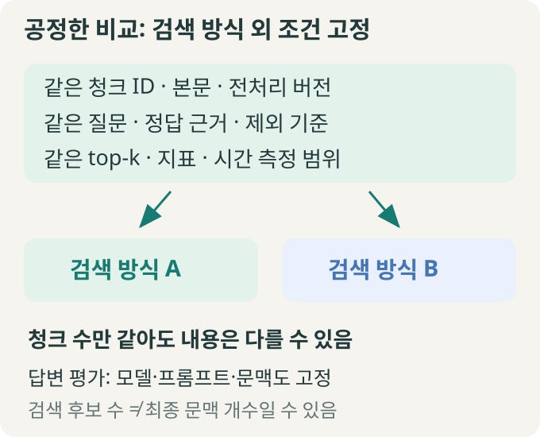
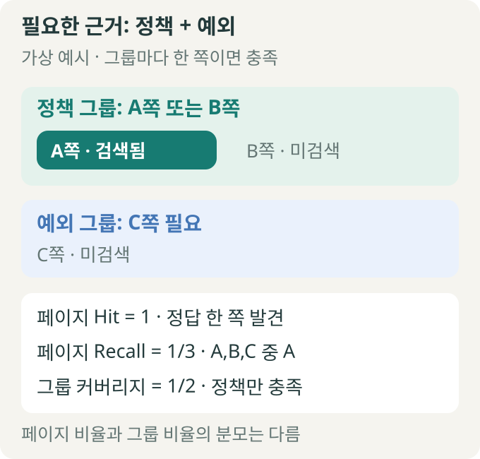

> 🗂️ **Notes · Deep Learning** — `rag` `embedding` `bm25` `rrf` `evaluation`
{: .prompt-info }

---

## 1. 📖 전체 흐름: 같은 청크를 다른 기준으로 찾기

**Dense는 학습된 의미 표현, BM25는 토큰 일치와 통계로 검색한다.** 청크는 검색을 위해 문서를 나눈 조각이다. 두 검색기는 같은 청크를 서로 다른 순서로 반환할 수 있다.

{: w="680" h="590" }

Hybrid는 여러 검색 방식을 함께 쓰는 구성이다. RRF는 결과 순위를 합치는 방법이고, 리랭킹은 모은 후보의 관련성을 다시 평가하는 단계다. **검색 성능과 생성된 답변의 품질은 따로 평가한다.**

---

## 2. 🧭 Dense: 표현이 달라도 관련 문장을 찾기

{: w="680" h="480" }

임베딩 모델은 텍스트를 고정 길이 숫자 배열인 **벡터**로 바꾼다. 검색 학습에서는 관련 질문·문단의 유사도가 상대적으로 높아지도록 조정한다. 그래서 “신청 마감”이라는 질문으로 “접수 종료일”이 적힌 자료도 찾을 수 있다. 이 표현 쌍은 원리를 보여 주는 예시이며, 특정 모델의 검색 결과를 측정한 것은 아니다.

벡터의 각 숫자에 사람이 정한 의미 이름이 붙는 것은 아니다. 학습된 표현 전체를 비교하며, 사실 검증이나 정답 보장과는 다르다.

| 확인할 것 | 해석 |
| --- | --- |
| 코사인 유사도 | 두 벡터 방향의 유사성. 영벡터를 제외하고 범위는 −1~1 |
| 내적과 코사인 | 길이가 1로 정규화된 두 벡터에서는 같음 |
| 임베딩 차원 | 모델별 사양. BGE-M3 Dense는 1024차원 |
| 코드·숫자 | 주변 문맥이 비슷해도 정확한 식별자·조건은 따로 확인 |

```python
# 길이가 각각 1인 가상 벡터
q = [1.0, 0.0]
d = [0.6, 0.8]
similarity = sum(a * b for a, b in zip(q, d))
print(similarity)  # 0.6
```

이 예시에서는 내적이 코사인과 같다. **0.6은 정답 확률 60%가 아니다.**

---

## 3. 🔎 BM25: 단어 일치에 세 가지 신호 더하기

{: w="680" h="475" }

BM25는 질문에 있는 토큰과 문서 토큰의 일치를 확인하고 기여도를 더한다. 단순히 겹친 단어 개수만 세지 않는다.

- **TF**: 해당 청크 안의 등장 횟수. 양의 IDF를 가진 토큰은 반복될수록 기여가 늘지만 증가 폭은 줄어든다.
- **IDF**: 전체 검색 단위에서 그 토큰이 얼마나 드문지 나타내는 가중치다.
- **길이 정규화**: 같은 TF라면 긴 청크의 기여를 상대적으로 낮춘다. 보정 강도는 설정에 따라 달라진다.

청크를 검색하면 빈도·등장 문서 수·평균 길이도 **청크 기준**이다. 질문과 문서는 일관되게 토큰화하고, 약어나 제품 코드가 어떻게 나뉘는지 확인한다. “AB-120”을 하나로 보존할지 나눌지에 따라서도 검색 결과가 달라질 수 있다.

### 일반 원리와 구현 규칙을 구분하기

| 흔한 오해 | 정확한 해석 |
| --- | --- |
| 흔한 단어는 언제나 0점 | IDF 식과 보정에 따라 다름 |
| BM25 점수는 항상 양수 | 구현과 문서 집합에 따라 음수도 가능 |
| 질문에 없는 단어는 영향 없음 | 직접 일치 점수는 없지만 문서 길이·통계에 간접 영향 |
| 무일치 결과는 자동 제외 | 검색기 구현의 반환 정책을 확인해야 함 |

`rank-bm25`의 `BM25Okapi`는 음의 IDF를 `epsilon × average_idf`로 바꾼다. 이 값이 항상 0이거나 양수라는 보장은 없다. 빈도 포화 계수 `k1`, 길이 보정 계수 `b`의 기본값도 최적값이나 모든 라이브러리의 공통값은 아니다.

**BGE-M3 Sparse도 BM25와 다르다.** BGE-M3는 모델이 학습한 토큰 가중치를 사용할 수 있고, BM25는 문서 집합의 빈도 통계를 사용한다.

---

## 4. 🔀 RRF: 다른 점수 척도를 순위로 합치기

Dense 점수와 BM25 점수는 척도와 분포가 다르다. 원점수를 그대로 더하면 큰 숫자를 내는 방식이 과도하게 유리해질 수 있다. 정규화·가중합도 가능하지만, **RRF는 원점수 대신 순위별 기여를 합산한다.**

{: w="680" h="540" }

같은 청크를 ID로 연결해 각 검색 목록에서 받은 `1 / (c + 순위)`를 더한다. 순위는 1부터 시작하고, 목록에 없으면 그 목록의 기여는 0이다. `c`는 순위별 영향력을 조절하는 상수로, 반환 개수인 top-k와 다르다.

```python
# A는 1·3위, B는 2·1위인 가상 예시
c = 60
a = 1 / (c + 1) + 1 / (c + 3)
b = 1 / (c + 2) + 1 / (c + 1)
print(round(a, 5), round(b, 5))
# 0.03227 0.03252
```

융합하면 B가 A보다 앞선다. **각 검색기의 1등이 유지되거나 성능이 향상된다는 보장은 없다.** 두 방식이 같은 무관한 청크를 높게 평가할 수도 있다. 후보 목록의 크기와 중복 제거 기준도 결과에 영향을 준다.

리랭킹은 융합된 후보의 내용을 다시 평가하는 별도 단계다. 어느 후보 목록에도 없는 정답을 RRF나 리랭킹만으로 새로 찾아낼 수는 없다.

---

## 5. ⚖️ 공정한 비교: 같은 자료·질문·채점 기준

{: w="680" h="550" }

검색 방식의 차이를 보려면 나머지 조건을 맞춘다. Dense가 벡터 저장소를, BM25가 파일을 사용해도 **청크 ID·본문·메타데이터·전처리 버전은 같은지** 확인해야 한다. 청크 수가 같다는 사실만으로 버전 일치가 증명되지는 않는다.

- **검색 비교**: 같은 질문·정답·제외 기준, 청킹 단위, 필터, top-k와 지표를 사용한다.
- **모델 설정**: 임베딩은 Dense가 포함된 방식끼리, 리랭커는 사용하는 방식끼리 비교 목적에 맞게 고정한다. BM25에 임베딩 모델이 필요한 것은 아니다.
- **시간 비교**: 색인 구축, 질문 임베딩, 실제 검색 중 무엇을 포함했는지 구분한다. 캐시와 실행 환경도 기록한다.
- **답변 비교**: 프롬프트·답변 모델·문맥 개수와 길이·생성 설정까지 맞춘다.

검색 단계의 top-k가 최종 답변 모델에 전달하는 문맥 개수와 반드시 같은 것은 아니다. 중복 제거·리랭킹·문맥 예산 제한을 거치면 달라질 수 있다.

---

## 6. 📏 Hit·Recall·근거 그룹: 무엇을 성공으로 볼까?

| 지표 | 질문 |
| --- | --- |
| 문서 Hit@k | 상위 k개에 정답 원본 문서가 하나라도 있는가? |
| 페이지 Hit@k | 정답 페이지가 하나라도 있는가? |
| 페이지 Recall@k | 정답으로 등록한 전체 페이지 중 얼마나 찾았는가? |
| 근거 그룹 커버리지 | 답에 필요한 근거 종류 중 몇 종류를 충족했는가? |

Hit는 질문별로 0 또는 1이고, 보통 질문들의 평균으로 보고한다. 페이지 단위로 채점한다면 같은 페이지의 중복 청크를 여러 정답 페이지로 세지 않는다. **정답 파일을 찾은 것과 답에 필요한 모든 근거를 모은 것은 다르다.**

{: w="680" h="650" }

위는 **각 그룹에서 대체 페이지 한 곳만 찾으면 충족**되는 가상 예시다. 그룹 커버리지에는 표준화된 단일 정의가 없으므로 실제 평가기의 충족 규칙을 확인한다.

페이지 Recall이 그룹 커버리지보다 항상 작거나 같은 것도 아니다. 정책 대체 페이지가 9개, 예외 페이지가 1개이고 정책 9개만 찾았다면 페이지 Recall은 `9/10`, 그룹 커버리지는 `1/2`다.

소수 질문의 개발용 결과만으로 방식의 우열을 확정하지 않는다. 질문 유형별 실패를 보고, 별도 검증 데이터로 다시 비교한다. 등록된 정답 근거가 빠져 있다면 유효한 검색 결과도 오답으로 채점될 수 있다.

---

## 7. 🧠 핵심 기억 카드

<details markdown="1">
<summary><strong>펼쳐서 확인</strong></summary>

- **Dense**: 학습된 의미 표현을 벡터로 비교한다. 숫자·코드의 정확성은 별도 확인한다.
- **BM25**: 일치 토큰의 빈도·희귀도·길이를 반영한다. 토큰화와 구현 규칙이 중요하다.
- **RRF**: 순위별 기여를 합친다. 점수는 정답 확률이 아니며 성능 향상을 보장하지 않는다.
- **비교**: 검색 대상과 질문·정답·k·지표를 맞추고, 시간 측정 범위를 밝힌다.
- **평가**: 하나라도 찾았는지, 전체 정답 중 얼마나 찾았는지, 필요한 근거를 충족했는지 구분한다.

</details>
