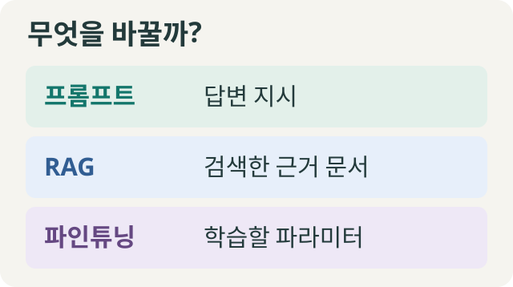
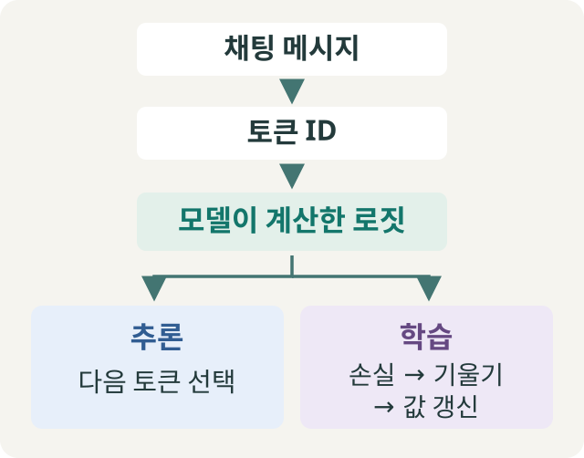
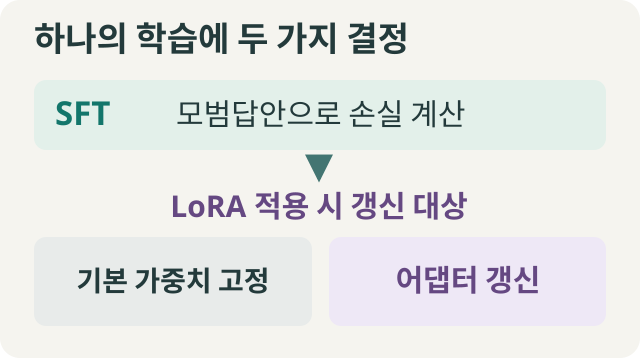
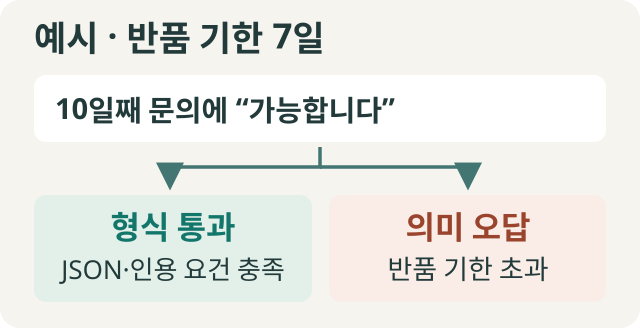

> 🗂️ **Notes · Deep Learning** — `llm` `fine-tuning` `rag` `pytorch` `model-evaluation`
{: .prompt-info }

---

## 1. 📖 전체 흐름

**입력 설계 → 학습 전 응답 기록 → 실패 분석 → 학습할 행동 정의**

파인튜닝은 사전학습된 모델의 행동을 예제로 조정하는 추가 학습이다. 먼저 같은 문항에 대한 **기준 응답**을 남겨야, 학습 뒤 무엇이 바뀌었는지 비교할 수 있다.

{: w="640" h="358" }

가령 반품 정책이 개정되면 검색 대상 문서를 갱신해 유효한 정책을 답변에 제공한다. 올바른 문서와 명확한 지시를 줘도 **근거가 없을 때 보류하는 행동**이 반복해서 실패하면, 그 행동을 보여 주는 예제로 파인튜닝을 검토할 수 있다.

---

## 2. 🔍 추론과 학습

{: w="640" h="502" }

채팅 템플릿은 모델에 맞는 형식으로 지시와 질문, 답변의 역할 경계를 표시한다. 토크나이저가 만든 **토큰 ID**를 입력받아 모델이 다음 토큰 후보별 점수인 **로짓**을 낸다. 추론 중 greedy는 매 단계에서 점수가 가장 높은 토큰을 고른다.

학습에서는 로짓과 정답 토큰으로 교차 엔트로피 손실을 계산한다. PyTorch에서 `backward()`는 기울기를 계산하고 `optimizer.step()`은 학습 가능한 값을 갱신한다. 예를 들어 후보 점수 3개가 모두 0이고 세 번째가 정답일 때, 점수에 학습률 0.3으로 SGD를 한 번 적용하면 정답 확률은 약 **0.333 → 0.403**이 된다.

---

## 3. 💡 SFT와 LoRA의 역할

{: w="640" h="358" }

- **SFT(지도 미세조정)**는 입력과 모범답안 예제로 학습한다. 언어 모델에서는 예제에 지정된 목표 토큰의 손실을 줄인다. 손실을 답변에만 적용할지는 데이터 구성과 설정으로 정한다.
- **LoRA(저랭크 적응)**는 기본 모델의 가중치를 고정하고, 선택한 층에 추가한 작은 저랭크 어댑터를 갱신한다.

> 💡 **한 줄 정리** · 배송비 근거가 없을 때 보류하는 모범답안으로 **SFT**를 하고, 그 손실을 줄이는 과정에서 **LoRA 어댑터만** 갱신할 수 있다.
{: .prompt-tip }

---

## 4. ⚖️ 기준 응답과 실패 판단

**학습 효과를 비교할 때**는 질문·근거·프롬프트·생성 설정·채점 기준을 고정하고 학습 전후 체크포인트만 바꾼다. 기준 응답과 함께 모델 버전, 설정, 생성된 원문과 종료 여부를 기록한다. 평가용 모범답안은 채점에 사용한다. 같은 문항의 입력에 섞으면 정답이 누수된다.

{: w="640" h="328" }

- **형식과 인용 ID** · 원문을 JSON으로 읽을 수 있는지, 필수 필드와 자료형이 맞는지, 인용 ID가 제공 목록에 있는지 확인한다.
- **의미** · 문서가 결론을 뒷받침하는지, 근거가 부족하면 보류했는지 확인한다. 표현이 달라도 의미가 같으면 정답일 수 있다.

중간에 끊긴 응답은 새 토큰 수가 설정한 상한에 도달했는지, 종료 토큰이 있었는지부터 확인한다. 반복되는 오류는 **JSON 규칙 준수**, **근거에 따른 판단**, **근거 부족 시 보류**처럼 관찰 가능한 행동으로 정리한다.

---

## 5. 🧠 핵심 기억 카드

<strong>펼쳐서 확인</strong>

- **프롬프트 · RAG · 파인튜닝** · 각각 지시, 근거 문서, 학습 가능한 파라미터를 조정한다.
- **SFT · LoRA** · 모범답안이 학습 신호를 제공하고, LoRA는 갱신할 파라미터를 어댑터로 제한한다.
- **기준 응답** · 학습 전 응답 원문을 저장한다. 같은 조건에서 다시 생성하고 형식과 의미를 각각 비교한다.

