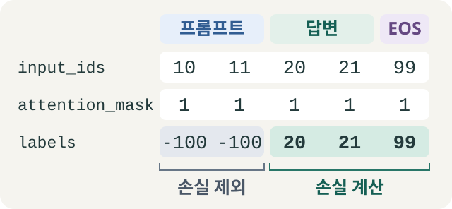
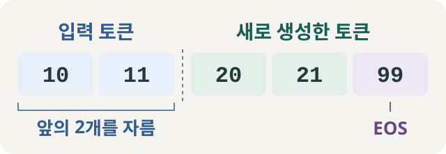

> 🗂️ **Notes · Deep Learning** — `llm` `fine-tuning` `model-evaluation`
{: .prompt-info }

---

## 1. 📖 전체 흐름

- **학습** · 프롬프트 + 모범답안 → 답변과 종료 토큰의 예측 손실 계산
- **평가** · 프롬프트 → 모델이 생성한 답변과 종료 상태 기록

예를 들어 교환 규정을 안내하는 모델이라면, 질문과 규정을 프롬프트로 구성한다. 지도 파인튜닝(SFT)에서는 모범답안을 함께 넣고, 생성 평가에서는 모델이 같은 프롬프트를 바탕으로 답을 작성하게 한다.

---

## 2. 🔍 답변 토큰에만 손실 계산하기

{: w="640" h="296" }

**답변의 시작 위치**는 두 토큰열을 비교해 찾는다. 모델의 채팅 템플릿으로 답변 시작 지점까지의 프롬프트와 모범답안을 포함한 전체 대화를 각각 토큰화한다. 프롬프트가 전체 토큰열의 앞부분과 정확히 일치할 때만, 프롬프트 길이를 답변 시작 위치로 쓸 수 있다.

답변 뒤에 종료 토큰(EOS)을 한 번 쓰는 형식에서는 해당 EOS까지 입력에 포함한다. 입력 길이 한도를 검사해 답변이나 EOS가 잘린 예제가 들어가지 않게 한다.

```python
labels = [-100] * len(prompt_ids) + input_ids[len(prompt_ids):]
```

`labels`의 `-100`은 해당 정답 위치를 손실에서 제외한다. 프롬프트는 답변을 예측하는 문맥이므로 패딩 전 `attention_mask`는 모두 `1`이다. 다음 토큰을 예측할 때는 **`11`까지 읽은 출력**과 **첫 답변 토큰 `20`**을 비교하는 지점부터 손실이 계산된다. 모델이 한 칸 이동을 내부에서 처리하면 그림처럼 입력 위치에 맞춘 `labels`를 전달한다.

---

## 3. 🧪 새 답변과 종료 상태 수집하기

{: w="640" h="222" }

평가에서는 프롬프트를 답변이 시작될 형식으로 만든다. `model.eval()`로 평가 모드를 설정하고 `torch.inference_mode()`에서 기울기 계산을 위한 연산 기록 없이 생성한다. 디코더 전용 모델이 **입력과 생성 토큰을 이어 붙인 텐서**를 반환하는 경우, 한 요청의 새 토큰은 다음과 같이 얻는다.

```python
new_tokens = output[0, inputs["input_ids"].shape[1]:]
```

특수 토큰을 건너뛰어 텍스트로 바꾸기 전에 마지막 토큰이 설정된 EOS에 해당하는지 확인한다. **EOS로 끝나지 않고 새 토큰 수가 `max_new_tokens`에 도달했다면** 길이 상한 도달로 기록한다.

> 💡 **학습 전후 비교** · 같은 문항, 채팅 템플릿, 생성 설정을 사용한다. 교환 안내라면 응답 형식과 실제 교환 가능 여부를 각각 확인한다.
{: .prompt-tip }

---

## 4. 🧠 핵심 기억 카드

<details markdown="1">
<summary><strong>펼쳐서 확인</strong></summary>

- **프롬프트를 학습 입력에 둔 채 답변만 학습하려면?** 프롬프트 위치의 `labels`를 `-100`으로 두고, 답변과 EOS의 토큰 ID는 유지한다.
- **모델이 쓴 답변과 종료 상태는 어디서 확인할까?** 디코더 전용 모델의 반환 토큰열에서 입력 길이 이후를 사용한다. EOS 판정은 디코딩 전에 한다.

</details>

---

## 관련 글

- [파인튜닝 2장 — 학습 데이터 준비](/posts/fine-tuning-dataset-preparation/)
- [파인튜닝 1장 — 기준 응답과 SFT·LoRA](/posts/fine-tuning-baseline-sft-lora/)
