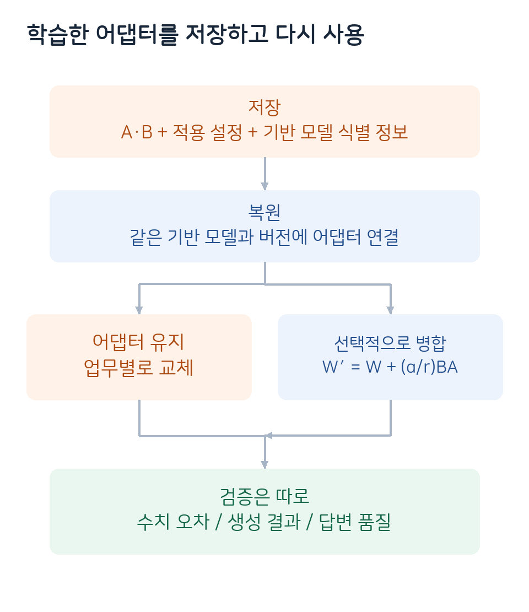

> 🗂️ **Notes · Deep Learning** — `llm` `fine-tuning` `model-evaluation`
{: .prompt-info }

---

## 1. 📖 학습 결과를 저장하고 다시 사용하기

LoRA 학습은 작은 A·B를 갱신한 뒤 어댑터 가중치와 설정을 저장한다. 어댑터만으로 완전한 언어 모델이 되지는 않으므로 **복원할 때는 학습에 사용한 기반 모델과 버전이 필요**하다. 같은 기반 모델을 공유하며 업무별 어댑터를 바꿔 쓸 수 있다.

| 단계 | 확인할 내용 |
| --- | --- |
| 적용 | `LoraConfig`로 r·alpha·적용 위치 지정, `get_peft_model`로 연결 |
| 학습 | A·B가 갱신되고 기반 W는 유지되는지 검사 |
| 저장 | 어댑터 가중치와 적용 설정·기반 모델 식별 정보 보관 |
| 복원 | 기반 모델 ID·revision·정밀도 등 계산 조건을 맞춰 연결 |
| 확인 | 복원한 수치와 실제 생성 결과 비교 |

{: w="960" h="1110" }

---

## 2. 💡 병합의 의미

추론 전에 변화량을 기존 가중치에 더하면 두 경로를 하나로 합칠 수 있다.

$$
W'=W+\frac{\alpha}{r}BA
$$

수학적으로 $(W+\Delta W)x=Wx+\Delta Wx$이다. 예를 들어 기존 출력 `[2,1]`과 보정값 `[1,−1]`을 더하면 `[3,0]`이 되며, 같은 변화량을 가중치에 미리 병합해 계산해도 이 결과가 나온다. 학습 중 기반 W를 고정한다는 말과, 학습 후 변화량을 W에 병합한다는 말을 구분한다.

어댑터를 별도로 유지하면 교체하기 쉽고, 병합하면 추가 경로 없이 추론할 수 있다. 실제 부동소수점 계산에는 반올림 오차가 생길 수 있으므로 복원·병합 전후의 수치와 생성 결과를 확인한다. 수치가 가까운 것과 답변의 품질이 좋은 것은 서로 다른 확인이다.

---

## 3. 🔍 손실·형식·의미를 분리해 평가하기

| 평가 항목 | 확인하는 것 |
| --- | --- |
| 손실 | 목표 토큰에 부여한 확률이 학습 목표에 가까워졌는가 |
| 출력 형식 | JSON 등 요구한 형식을 지켰는가 |
| 내용·판단 | 근거와 조건을 읽고 올바른 결론을 냈는가 |
| 복원·병합의 수치 | 같은 계산이 허용 가능한 오차 안에서 재현되는가 |

손실 감소만으로 생성 행동의 변화나 내용의 정확성을 보장할 수 없다. 예를 들어 지원 한도가 65,000원인데 질문 금액이 70,000원이라면, 유효한 JSON 안에 ‘한도 이하이므로 승인 불필요’라고 작성해도 판단은 틀린다. 형식 통과와 실제 결론의 정확성을 따로 읽어야 한다.

---

## 4. 🧠 핵심 기억 카드

<strong>펼쳐서 확인</strong>

- 어댑터를 복원하려면 맞는 기반 모델과 계산 조건이 필요하다.
- 병합은 학습한 변화량을 W에 더하는 과정이다.
- 수치 재현·손실·출력 형식·판단의 정확성을 따로 확인한다.

---

## 관련 글

- [모델의 숫자와 언어 학습](/posts/model-parameters-and-language-learning/)
- [파인튜닝 방법 비교: SFT·PEFT·LoRA·QLoRA·DPO](/posts/finetuning-methods-sft-peft-qlora-dpo/)
- [LoRA의 원리와 저랭크 행렬 계산](/posts/lora-low-rank-and-matrix-calculation/)
- [Attention의 q·k·v와 LoRA 부착 위치](/posts/attention-qkv-and-lora-targets/)
- [LoRA 초기화·학습과 설정 조정](/posts/lora-initialization-training-and-tuning/)
