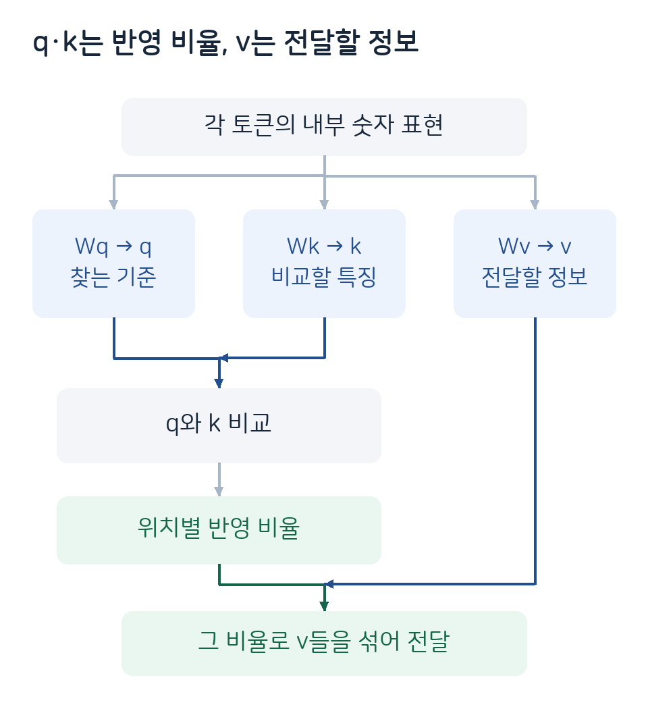
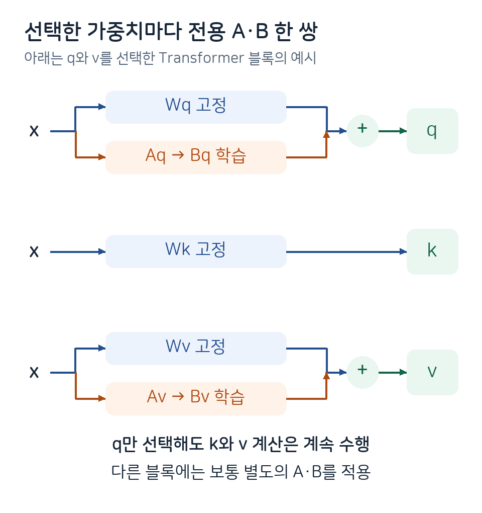

> 🗂️ **Notes · Deep Learning** — `llm` `fine-tuning` `pytorch`
{: .prompt-info }

---

## 1. 📖 q·k·v의 역할

Attention은 한 위치에서 다른 위치의 정보를 얼마나 가져올지 계산한다. Self-Attention에서는 각 토큰의 내부 표현에서 q·k·v를 각각 만든다.

| 구분 | 역할 | 도서관 비유 |
| --- | --- | --- |
| q, Query | 필요한 정보를 찾기 위한 특징 | 찾고 싶은 내용 |
| k, Key | 요청과의 관련도를 비교할 특징 | 책의 제목·검색용 특징 |
| v, Value | 실제로 전달할 정보 | 책의 내용 |

```text
① 현재 위치의 q와 각 위치의 k를 비교
                  ↓
        각 위치를 반영할 비율 계산
                  ↓
② 그 비율대로 각 위치의 v를 섞어서 가져옴
```

q와 k의 비교로 반영 비율을 정하고, 그 비율로 v들을 섞는다. 여러 Attention head는 서로 다른 관계를 함께 계산한다. 예를 들어 ‘민수는 사과를 샀다. 그는…’에서 ‘그는’ 위치의 q가 앞선 ‘민수’의 k와 높은 관련도를 가지면, ‘민수’의 v에 담긴 정보를 많이 반영할 수 있다. 이는 역할을 설명하기 위한 예시다.

{: w="960" h="1050" }

---

## 2. 💡 q·k·v와 Wq·Wk·Wv의 구분

```text
                  ┌─ Wq로 계산 → q
토큰의 내부 표현 ─┼─ Wk로 계산 → k
                  └─ Wv로 계산 → v
```

| 구분 | 의미 |
| --- | --- |
| Wq·Wk·Wv | 모델에 저장된 가중치 |
| q·k·v | 현재 입력에 그 가중치를 적용한 계산 결과 |
| A·B | LoRA가 추가하는 학습 가능한 보정 행렬 |

**q·v와 A·B는 같은 개념이 아니다.** ‘q에 LoRA를 붙인다’는 말은 q를 만드는 Wq의 계산을 보정한다는 의미다. q와 v 양쪽을 선택하면 각각 전용 A·B 한 쌍을 사용한다.

```text
q를 만드는 부분
 ├─ 기존 Wq로 계산 ──────────┐
 └─ q 전용 Aq → Bq로 보정 ──┴─ 합산 → q

v를 만드는 부분
 ├─ 기존 Wv로 계산 ──────────┐
 └─ v 전용 Av → Bv로 보정 ──┴─ 합산 → v
```

```text
q의 기존 가중치 → q 전용 A·B 한 쌍
v의 기존 가중치 → v 전용 A·B 한 쌍
```

```text
q = 고정된 Wq × 입력 + q용 A·B가 만든 보정값
v = 고정된 Wv × 입력 + v용 A·B가 만든 보정값
```

Wq·Wv를 고정해도 A·B가 학습되면 같은 입력에서 q·v가 달라질 수 있다. q의 변화는 k와의 비교 및 반영 비율에, v의 변화는 전달할 정보에 영향을 준다. 이 변화가 다음 계산 층으로 이어져 답변도 달라질 수 있다.

---

## 3. 🔍 q와 v는 항상 세트로 선택하지 않는다

| `target_modules` 예시 | LoRA 부착 위치 |
| --- | --- |
| `["q_proj"]` | q를 만드는 부분만 |
| `["v_proj"]` | v를 만드는 부분만 |
| `["q_proj", "v_proj"]` | q와 v 각각 |

q만 선택해도 k·v 계산은 계속 수행한다.

```text
                  ┌─ 기존 Wq + LoRA → 달라진 q
토큰의 내부 표현 ─┼─ 기존 Wk        → k
                  └─ 기존 Wv        → v
```

```python
LoraConfig(target_modules=["q_proj"])
```

위 설정은 `q_proj`가 별도 모듈로 구현된 모델을 전제로 한다. 모델마다 이름이 다르거나 q·k·v가 하나의 모듈에 묶여 있을 수 있으므로 실제 구조를 확인한다.

고정되는 것은 가중치다. 앞쪽 블록의 출력이 달라지면 뒤쪽 블록은 같은 Wk·Wv를 사용해도 입력이 달라져 k·v 값이 달라질 수 있다.

---

## 4. 🧪 블록 안의 적용 위치와 선택 기준

큰 Transformer 블록 하나에도 여러 가중치 행렬이 있다. 선택한 계산 부분마다 보통 별도의 A·B를 두며, 블록 전체에 무조건 한 쌍만 붙이는 구성은 아니다. q·v를 선택한 예시는 다음과 같다.

```text
Transformer 블록 1
 ├─ q_proj: 기존 W + 전용 A·B
 ├─ k_proj: 기존 W만 사용
 └─ v_proj: 기존 W + 전용 A·B

Transformer 블록 2
 ├─ q_proj: 기존 W + 이 위치의 별도 A·B
 ├─ k_proj: 기존 W만 사용
 └─ v_proj: 기존 W + 이 위치의 별도 A·B
```

{: w="960" h="1020" }

| 비교할 범위 | 조정하는 부분 |
| --- | --- |
| q만 | 정보를 찾는 기준에 영향을 주는 계산 |
| q와 v | 찾는 기준과 전달 정보 |
| q·k·v·o | Attention의 비교·전달·출력 변환 |
| Attention과 MLP의 선형층 | Attention과 내부 특징 변환을 더 넓게 조정 |

`target_modules`로 계산 부분을 고르고 `layers_to_transform` 등으로 적용 블록을 제한할 수 있다. 같은 r에서 적용 범위를 늘리면 학습 파라미터가 증가한다. 조정 범위가 넓어져도 성능 개선이 보장되지는 않는다.

메모리 안에서 후보를 정하고 데이터·학습률·스텝 등의 비교 조건을 맞춘 뒤 검증 성능을 확인한다. 초기 LoRA 논문에서도 q만 적용하는 경우와 q·v 등에 적용하는 경우를 비교했다. **‘문법은 q, 지식은 v’처럼 최적 위치를 작업별로 고정해서 해석하지 않는다.**

---

---

## 5. 🧠 핵심 기억 카드

<details markdown="1">
<summary><strong>펼쳐서 확인</strong></summary>

- q·k의 비교로 반영 비율을 정하고 그 비율로 v를 섞는다.
- Wq·Wk·Wv는 가중치, q·k·v는 입력에 따른 계산 결과다.
- q만 선택할 수 있으며 선택한 계산 부분마다 전용 A·B를 둔다.

</details>

---

## 관련 글

- [모델의 숫자와 언어 학습](/posts/model-parameters-and-language-learning/)
- [파인튜닝 방법 비교: SFT·PEFT·LoRA·QLoRA·DPO](/posts/finetuning-methods-sft-peft-qlora-dpo/)
- [LoRA의 원리와 저랭크 행렬 계산](/posts/lora-low-rank-and-matrix-calculation/)
- [LoRA 초기화·학습과 설정 조정](/posts/lora-initialization-training-and-tuning/)
- [어댑터 저장·복원·병합과 평가](/posts/adapter-lifecycle-and-evaluation/)
