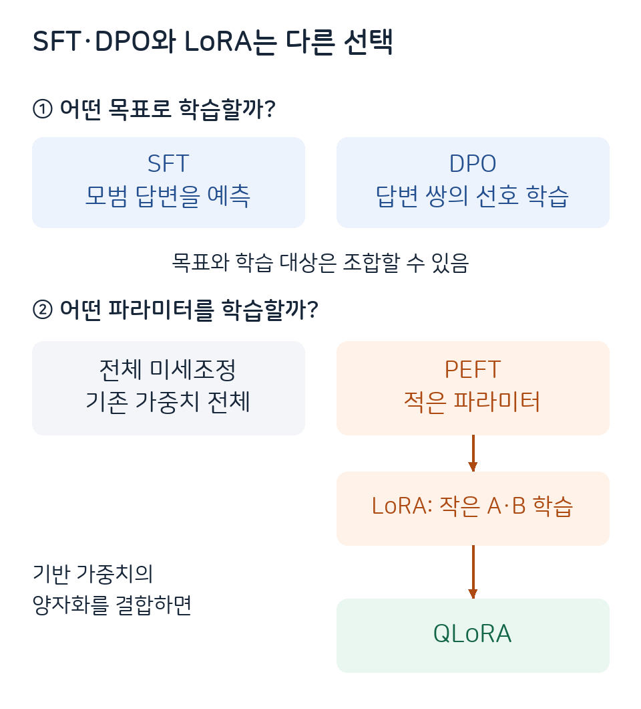
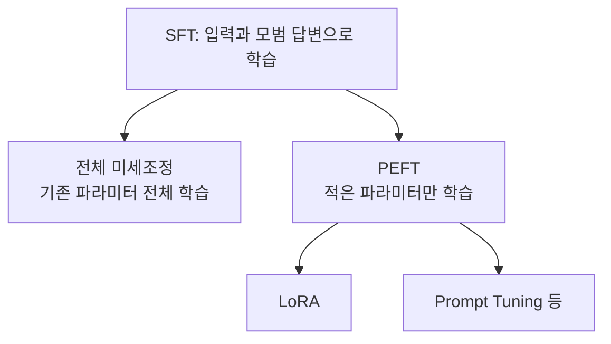
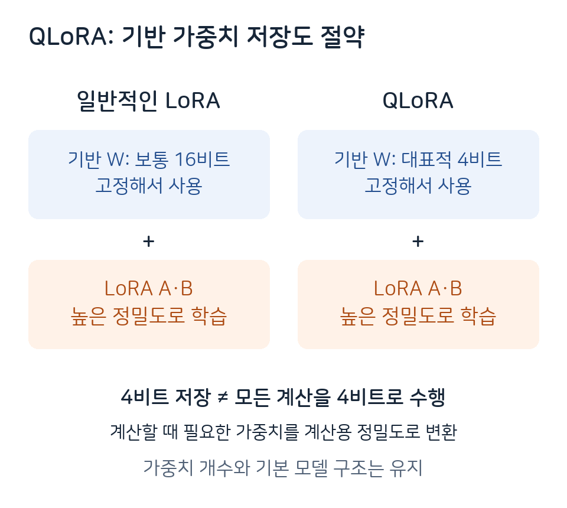
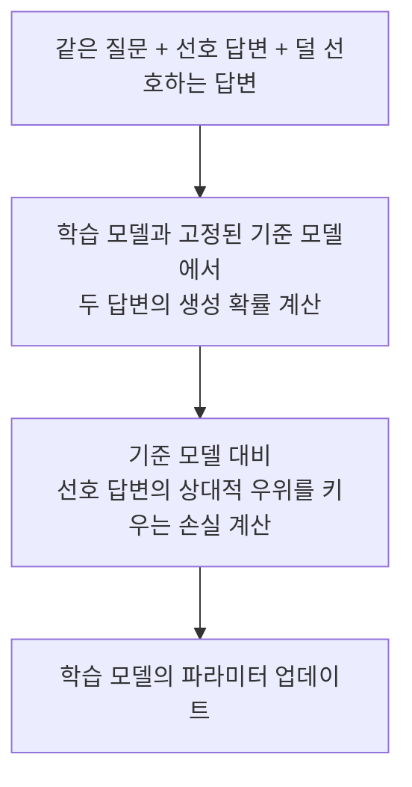
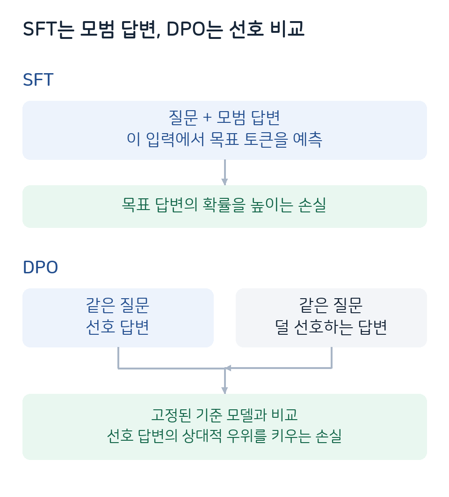

> 🗂️ **Notes · Deep Learning** — `llm` `fine-tuning` `model-evaluation`
{: .prompt-info }

---

## 1. 📖 학습 목표와 학습 대상을 구분하기

| 용어 | 이름 | 결정하는 것 |
| --- | --- | --- |
| SFT | Supervised Fine-Tuning, 지도 미세조정 | 입력과 목표 답변으로 학습할 목표 |
| DPO | Direct Preference Optimization, 직접 선호 최적화 | 같은 질문의 답변 쌍에서 배울 선호 |
| PEFT | Parameter-Efficient Fine-Tuning, 파라미터 효율적 미세조정 | 적은 파라미터만 학습하는 방법들의 범주 |
| LoRA | Low-Rank Adaptation, 저랭크 적응 | 기존 가중치를 고정하고 작은 A·B로 변화량 학습 |
| QLoRA | Quantized LoRA | 양자화한 기반 모델에 LoRA를 결합해 저장 메모리 절약 |

**SFT·DPO는 학습 신호를 정하고, LoRA·QLoRA는 갱신할 파라미터와 기반 가중치의 저장 방식을 정한다.** PEFT에는 LoRA 외에도 Prompt Tuning, Prefix Tuning 등이 있다. Hugging Face의 `PEFT`는 이런 방법을 적용하는 라이브러리 이름이기도 하다.

{: w="960" h="1060" }

---

## 2. 💡 SFT: 모범 답변을 예측하도록 학습

고객 문의에 답하는 모델의 학습 예시는 다음과 같다.

> 입력: “배송지를 바꾸고 싶어요.” 모범 답변: “출고 전이라면 주문 내역에서 배송지를 변경할 수 있습니다.”

입력을 조건으로 목표 답변의 토큰을 높은 확률로 예측하도록 학습한다. 답변 형식, 말투, 지시를 따르는 방식 등을 조정할 수 있다. SFT라는 이름만으로 전체 가중치를 학습할지, 일부 파라미터만 학습할지는 정해지지 않는다.

---

## 3. 🔍 QLoRA: 기반 가중치의 저장 공간도 줄이기

LoRA는 학습 대상이 작아도 기반 모델의 가중치를 메모리에 올려 사용한다. QLoRA는 여기에 **기반 가중치의 양자화**를 결합한다. 양자화는 숫자를 더 적은 비트로 표현하는 방식이다. 사진의 색상 수를 줄여 저장 공간을 아끼는 것과 비슷하며, 표현 정밀도가 낮아지면서 오차가 생길 수 있다.

| 항목 | 일반적인 LoRA 구성 | QLoRA |
| --- | --- | --- |
| 기반 가중치 저장 | 보통 16비트 등 | 대표적으로 4비트 |
| 기반 가중치 갱신 | 고정 | 고정 |
| 학습 대상 | A·B | A·B |
| 주요 절약 대상 | 학습 대상의 기울기·최적화 상태 | 기반 가중치 저장 메모리까지 절약 |

{: w="960" h="860" }

4비트 기반 가중치는 고정하고 LoRA 부분을 더 높은 정밀도로 학습한다. 계산할 때 필요한 가중치를 BF16 같은 계산용 정밀도로 변환하므로 **모든 연산이 4비트로 이루어지는 것은 아니다.**

기본 모델의 구조·가중치 개수는 그대로다. 숫자 하나의 저장 공간이 줄어든다. 활성값·어댑터·기타 상태도 메모리를 사용하므로 16비트에서 4비트로 바꿨다고 전체 학습 메모리가 정확히 1/4이 되지는 않는다.

---

## 4. 🧪 DPO: 같은 질문의 답변 쌍으로 선호 학습

SFT는 목표 답변을 제공하고, DPO는 같은 질문에 대한 \*\*선호 답변 `chosen`과 덜 선호하는 답변 `rejected`\*\*를 제공한다.

| 항목 | 초보자에게 쉬운 설명을 선호하는 예시 |
| --- | --- |
| `prompt` | “과적합이 뭐야?” |
| `chosen` | “학습한 문제에는 잘 맞지만 새로운 문제에는 약해지는 현상이에요. 문제집 답만 외운 경우와 비슷해요.” |
| `rejected` | “학습 데이터에 지나치게 적합되는 현상입니다.” |

두 답변 모두 개념을 설명하지만, 이 예시에서는 초보자가 이해하기 쉬운 답변을 더 선호한다고 표시한다. `rejected`가 반드시 사실과 다른 답변이라는 뜻은 아니다.

{: w="960" h="1060" }

기본 DPO는 보통 학습 시작 시점의 모델을 고정된 기준 모델로 두고, **기준 모델 대비 선호 답변의 상대적 우위**를 키우는 손실로 학습한다. 별도의 보상 모델을 학습하고 PPO 같은 강화학습을 수행하는 절차를 줄일 수 있다. 목표가 상대적인 선호이므로 `chosen` 자체의 생성 확률이 항상 증가한다는 의미는 아니다.

---

## 5. ⚖️ 함께 사용할 수 있는 구성

| 구성 | 학습 신호 | 파라미터 구성 |
| --- | --- | --- |
| SFT + LoRA | 모범 답변 | 기반 가중치 고정, A·B 학습 |
| SFT + QLoRA | 모범 답변 | 양자화한 기반 가중치 고정, A·B 학습 |
| DPO + LoRA | 선호 답변 쌍 | 기반 가중치 고정, A·B 학습 |
| DPO + QLoRA | 선호 답변 쌍 | 양자화한 기반 가중치 고정, A·B 학습 |

SFT로 기본 답변 방식을 익힌 뒤 DPO로 선호를 조정하는 구성이 가능하다. 각 단계에서 LoRA나 QLoRA를 사용할 수 있으며, 이 순서가 모든 작업의 필수 절차는 아니다.

---

---

## 6. 🧠 핵심 기억 카드

<strong>펼쳐서 확인</strong>

- SFT·DPO는 학습 신호를, LoRA·QLoRA는 학습 대상과 저장 방식을 정한다.
- PEFT는 적은 파라미터를 학습하는 방법들의 범주다.
- QLoRA의 4비트 저장과 계산 정밀도는 구분한다.

---

## 관련 글

- [모델의 숫자와 언어 학습](/posts/model-parameters-and-language-learning/)
- [LoRA의 원리와 저랭크 행렬 계산](/posts/lora-low-rank-and-matrix-calculation/)
- [Attention의 q·k·v와 LoRA 부착 위치](/posts/attention-qkv-and-lora-targets/)
- [LoRA 초기화·학습과 설정 조정](/posts/lora-initialization-training-and-tuning/)
- [어댑터 저장·복원·병합과 평가](/posts/adapter-lifecycle-and-evaluation/)
