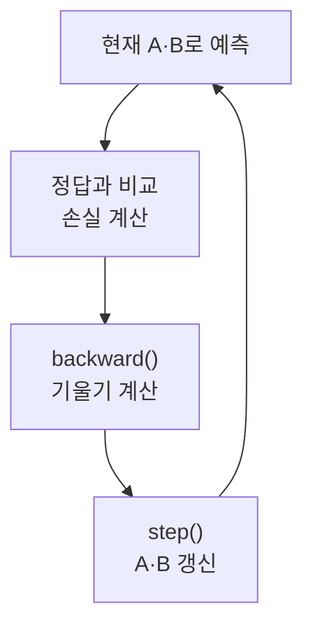
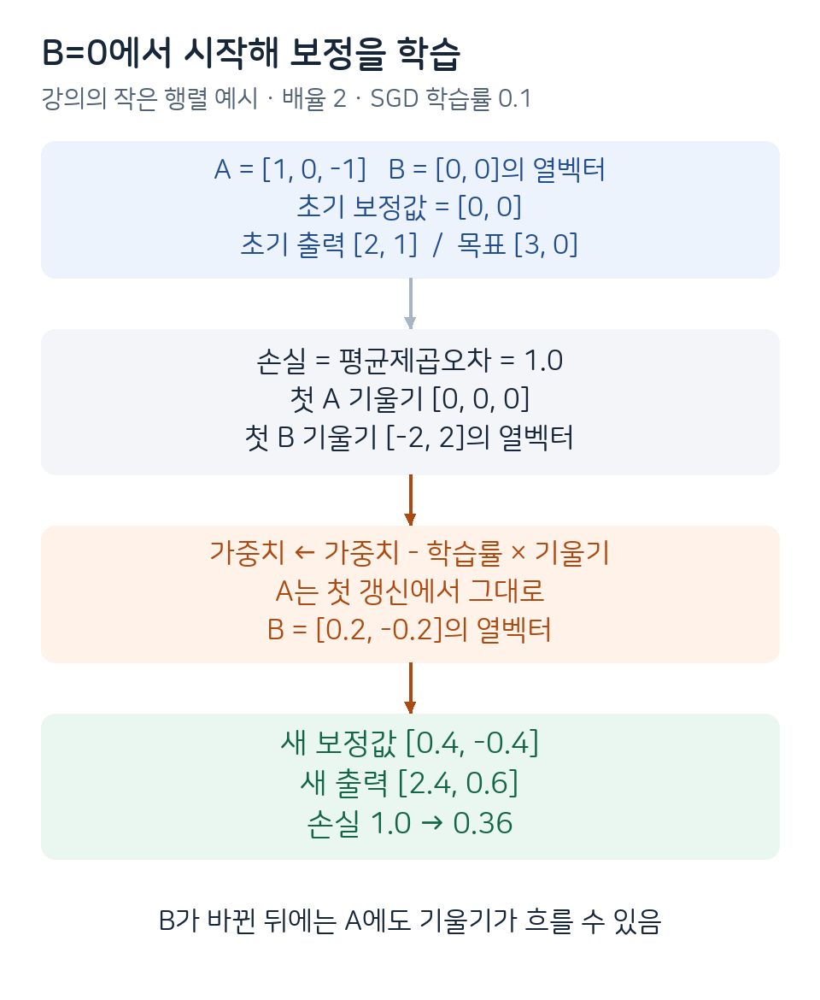

> 🗂️ **Notes · Deep Learning** — `llm` `fine-tuning` `pytorch` `model-evaluation`
{: .prompt-info }

---

## 1. 📖 초기값과 학습되는 값

| 항목 | 기본 시작값 | 학습 중 |
| --- | --- | --- |
| W | 사전학습된 기반 가중치 | 고정 |
| A | 정해진 분포의 무작위 숫자 | 학습 |
| B | 모두 0 | 학습 |
| r·alpha | 실험을 설계하는 사람이 정한 설정 | 기본 구성에서 고정 |

원논문은 A의 Gaussian 초기화를 설명하고, Hugging Face PEFT 기본 설정은 A에 Kaiming-uniform, B에 0을 사용한다. 구체적인 초기화 규칙과 적용 범위를 구분한다.

$$
\text{보정값}=\frac{\alpha}{r}BAx=0
$$

B=0이면 시작 보정이 0이므로 기반 모델의 출력에서 출발한다. A·B를 둘 다 0으로 두면 곱셈 구조 때문에 보정 경로의 두 기울기도 0이 되어 학습이 시작되지 않는다.

---

## 2. 💡 무엇을 기준으로 A·B를 바꾸는가

기준은 A·B의 목표 숫자를 직접 지정하는 것이 아니라 **최종 출력의 손실을 줄이는 것**이다. 역전파가 각 파라미터를 바꿀 때 손실이 어떻게 변하는지 나타내는 기울기를 계산하고, 옵티마이저가 학습률과 갱신 규칙에 따라 값을 수정한다.

```text
현재 W와 A·B로 모델 실행
             ↓
최종 출력과 목표를 비교해 손실 계산
             ↓
역전파로 A·B의 수정 방향인 기울기 계산
             ↓
학습률과 최적화 방법에 따라 A·B 업데이트
```



실제 언어 모델의 SFT는 목표 답변 토큰의 예측 확률로 손실을 계산한다. q·v에 정답 숫자를 직접 부여하지 않고, 최종 답변에서 역전파된 기울기로 A·B를 간접 조정한다. DPO를 사용할 때는 선호 쌍의 손실이 학습 신호가 된다.

---

## 3. 🧪 첫 갱신과 다음 갱신의 계산

<details markdown="1">
<summary><strong>스칼라·행렬 예시와 기울기 계산 펼치기</strong></summary>

### 🧪 스칼라 예시: 첫 갱신과 두 번째 갱신

행렬을 숫자 하나씩으로 줄이고 배율을 1로 둔 설명용 예시다.

```text
기존 가중치 W = 2  ← 계속 고정
입력 x = 1
목표 출력 = 3

모델 출력 = W×x + B×A×x
```

A=1, B=0에서 시작한다.

```text
처음 출력 = 2×1 + 0×1×1 = 2
목표 출력 = 3
```

손실 $L=\frac12(\text{출력}-3)^2$와 학습률 0.5의 SGD로 계산한다. 이 학습률은 계산 예시이며 실제 모델의 권장값이 아니다.

| 시점 | A | B | 출력 |
| --- | --- | --- | --- |
| 처음 | 1 | 0 | 2 |
| 첫 갱신 후 | 1 | 0.5 | 2.5 |
| 두 번째 갱신 후 | 1.125 | 0.75 | 2.84375, 약 2.844 |

첫 역전파에서는 B=0이므로 데이터 손실에서 오는 A의 기울기가 0이다. B에는 기울기가 생길 수 있고, B가 바뀐 뒤에는 A에도 기울기가 흐를 수 있다. **A의 기울기가 0이라는 것과 모든 설정에서 A의 값이 그대로라는 것은 다르다.** 위 예시는 가중치 감쇠 없는 SGD다. AdamW 등에서 가중치 감쇠를 적용하면 기울기가 0이어도 A의 값이 별도로 바뀔 수 있다.

### 🧪 행렬 예시: 손실 1.0에서 0.36으로

아래는 손실과 기울기를 따라가기 위한 작은 행렬 예시다. A를 손계산하기 쉬운 값으로 지정한 것이며 PEFT의 초기화 분포를 재현한 예시는 아니다. 코드는 핵심 설정을 간추린 표현이므로 실제 실행에서는 `nn.Parameter`에 `torch.tensor(...)` 등을 전달해야 한다.

```python
A_small = nn.Parameter([[1.0, 0.0, -1.0]])
B_small = nn.Parameter([[0.0], [0.0]])

target = [3.0, 0.0]
optimizer_small = SGD([A_small, B_small], lr=0.1)
```

이 예시의 고정 행렬은 `W=[[1,0,0],[0,1,0]]`, 입력은 `x=[2,1,1]`이다. `r=1`, `alpha=2`이므로 배율은 2다.

```text
기존 출력 W @ x = [2, 1]

A @ x = 1×2 + 0×1 − 1×1 = 1
B @ (A @ x) = [0, 0]

예측 = [2, 1] + 2×[0, 0]
     = [2, 1]
```

목표는 `[3,0]`이므로 첫 출력을 올리고 둘째 출력을 내려야 한다. 평균제곱오차는 다음과 같다.

$$
L=\frac{(2-3)^2+(1-0)^2}{2}=1
$$

`loss.backward()`는 기울기를 계산한다. 이 단계 자체가 가중치를 갱신하는 것은 아니다.

```text
A의 기울기 = [[0, 0, 0]]
B의 기울기 = [[−2], [2]]
```

A가 만든 값이 B를 통해 출력으로 전달되는데 현재 B=0이므로, A를 조금 바꿔도 출력은 변하지 않는다. 반면 A의 출력은 이미 1이어서 B를 바꾸면 출력에 영향을 줄 수 있다.

`optimizer.step()`에서 학습률 0.1의 SGD를 적용한다.

$$
\text{새 가중치}=\text{기존 가중치}-0.1\times\text{기울기}
$$

| 대상 | 계산 | 갱신 후 |
| --- | --- | --- |
| B의 첫 값 | $0-0.1\times(-2)$ | 0.2 |
| B의 둘째 값 | $0-0.1\times2$ | −0.2 |
| A | 첫 기울기가 모두 0 | `[1,0,−1]` 유지 |

```text
A @ x = 1
B @ 1 = [0.2, −0.2]

배율 2 적용 → [0.4, −0.4]

새 예측 = [2, 1] + [0.4, −0.4]
        = [2.4, 0.6]
```

$$
L=\frac{(2.4-3)^2+(0.6-0)^2}{2}=0.36
$$

{: w="960" h="1170" }

같은 입력으로 한 번 더 학습하면 다음과 같이 계산된다.

```text
A의 기울기 = [−0.96, −0.48, −0.48]
B의 기울기 = [−1.2, 1.2]
```

```text
A = [1.096, 0.048, −0.952]
B = [0.32, −0.32]
```

이제 A·B 모두 바뀐다. A는 입력을 조합하는 방법을, B는 그 결과를 출력에 배분하는 방법을 함께 학습한다.

</details>

---

## 4. 🔍 r·alpha·학습률·스텝의 역할

| 설정 | 바꾸는 것 | 파라미터 개수와의 관계 |
| --- | --- | --- |
| r | A·B의 중간 차원과 표현 가능한 변화량의 최대 랭크 | 같은 적용 범위에서 증가하면 학습 파라미터 증가 |
| alpha | 기본 LoRA 배율 `alpha/r` | 자체로 파라미터 수나 표현 가능한 랭크를 늘리지 않음 |
| 학습률 | 한 번의 갱신 보폭 | 파라미터 개수와 별개 |
| 스텝 수 | 옵티마이저의 총 갱신 횟수 | 학습 기간을 조절 |
| `target_modules` | 추가 변화량을 학습할 계산 부분 | 같은 r에서 적용 범위 확대 시 학습 파라미터 증가 |

**r은 표현할 변화의 범위를, alpha는 보정값의 배율을 정한다.** alpha는 예측 계산과 기울기에 영향을 주며 학습률은 옵티마이저 갱신에 사용된다. alpha를 두 배로 하고 학습률을 절반으로 했다고 항상 같은 결과가 되지는 않는다.

| r | alpha | 기본 배율 alpha/r |
| --- | --- | --- |
| 8 | 16 | 2 |
| 16 | 32 | 2 |
| 16 | 16 | 1 |

앞의 두 설정은 배율이 같아도 r=16 쪽의 학습 행렬이 더 크다. r만 바꾸고 alpha를 고정하면 배율도 달라진다. 메모리 예산과 검증 성능으로 r을 고르고 alpha와 학습률의 조합을 확인한다. `alpha=2r`은 시험할 수 있는 설정이며 항상 최적인 규칙은 아니다. rsLoRA는 배율 `alpha/√r`을 사용하므로 기본 LoRA와 구분한다.

---

## 5. 🧪 한 항목씩 바꾸는 비교와 설정 예시

학습률은 한 번에 얼마나 크게 수정할지, 스텝은 몇 번 수정할지를 정한다. 원인을 구분하려면 먼저 한 항목씩 바꾸어 비교한다.

| 설명용 실험 | 학습률 | 총 스텝 | 확인할 효과 |
| --- | --- | --- | --- |
| 기준 | 0.0001 | 1,000 | 비교 기준 |
| A | 0.0002 | 1,000 | 학습률을 높인 효과 |
| B | 0.0001 | 2,000 | 더 오래 학습한 효과 |

A와 기준, B와 기준을 각각 비교한다. 데이터·배치 크기·r·alpha·적용 범위와 검증 기준은 맞춘다. 각 효과를 파악한 뒤에는 설정 간 상호작용도 확인한다.

작은 행렬로 계산 원리를 확인한 뒤, 언어 모델에서는 학습 → 저장·복원·병합 → 전체 SFT와 비교하는 흐름으로 확인할 수 있다. 아래는 언어 모델에 적용하는 설정 예시다.

```python
LoraConfig(
    r=8,
    lora_alpha=16,
    init_lora_weights=True,
    ...
)
```

| 확인한 항목 | 설정 예시의 값·조건 |
| --- | --- |
| r / alpha | 8 / 16, 기본 배율 `16/8=2` |
| 부착 위치 | q\_proj·v\_proj |
| 학습률 / 갱신 횟수 | 2e-5 / 24회 |
| 손실 대상 | 답변 토큰 |
| 출발 모델 | 전체 SFT 결과를 이어 쓰지 않고 같은 공개 기반 모델에서 각각 시작 |
| 실행 출력 | 이 설정 코드에 포함되지 않음 |

작은 행렬 예시의 r=1·alpha=2·SGD 학습률 0.1과 실제 모델의 r=8·alpha=16·학습률 2e-5를 섞어 해석하지 않는다. 8과 16은 특정 실험 설정이며 일반적인 최적값이 아니다.

---

## 6. ✅ 학습이 잘 안 될 때의 점검 순서

1. **데이터와 마스킹을 확인한다.** 답변 전용 SFT라면 프롬프트·패딩 위치의 `labels=-100`, 답변과 필요한 종료 토큰의 손실 포함 여부를 검사한다. 길이 제한으로 정답이 잘리지 않았는지도 확인한다. 모든 SFT가 반드시 답변만 마스킹해 학습하는 것은 아니다.
2. **실제 갱신 대상을 확인한다.** A·B가 학습 가능 상태이며 옵티마이저에 포함되는지, 학습 전후 A·B와 기반 W가 의도대로 유지·변경되는지 확인한다. B=0의 첫 역전파에서 A의 기울기가 0인 현상만으로 실패라고 판단하지 않는다.
3. **학습률을 비교한다.** 1e-4·2e-4는 후보가 될 수 있으나 필수 하한선은 아니다. 학습률은 모델·데이터·배치 크기·LoRA 구성에 따라 달라진다. ‘약 0.1%만 학습하므로 반드시 높은 학습률이 필요하다’고 일반화하지 않는다. 비율도 r과 적용 범위에 따라 달라진다.
4. **스텝을 검증 결과로 판단한다.** 무조건 더 오래 학습하지 않는다.
5. **r·alpha·적용 범위를 구분해 조정한다.** r이나 적용 범위를 늘려도 품질 개선은 검증해야 한다.
6. **재학습 후 손실·형식·의미를 따로 평가한다.** 변경한 설정과 실제 생성 응답을 함께 기록한다.

| 관찰 결과 | 다음 판단 |
| --- | --- |
| 학습·검증 손실이 높고 계속 개선 중 | 추가 학습 시험 |
| 학습 손실은 감소하지만 검증 손실은 상승 | 과적합 여부 확인 |
| 손실이 거의 움직이지 않음 | 마스킹·기울기·가중치 갱신·학습률부터 확인 |

---

---

## 7. 🧠 핵심 기억 카드

<details markdown="1">
<summary><strong>펼쳐서 확인</strong></summary>

- 기본 초기화는 무작위 A와 0인 B로 보정값 0에서 시작한다.
- 손실의 기울기를 계산한 뒤 옵티마이저가 A·B를 갱신한다.
- r·alpha·학습률·스텝·적용 범위는 역할을 구분해 검증한다.

</details>

---

## 관련 글

- [모델의 숫자와 언어 학습](/posts/model-parameters-and-language-learning/)
- [파인튜닝 방법 비교: SFT·PEFT·LoRA·QLoRA·DPO](/posts/finetuning-methods-sft-peft-qlora-dpo/)
- [LoRA의 원리와 저랭크 행렬 계산](/posts/lora-low-rank-and-matrix-calculation/)
- [Attention의 q·k·v와 LoRA 부착 위치](/posts/attention-qkv-and-lora-targets/)
- [어댑터 저장·복원·병합과 평가](/posts/adapter-lifecycle-and-evaluation/)
