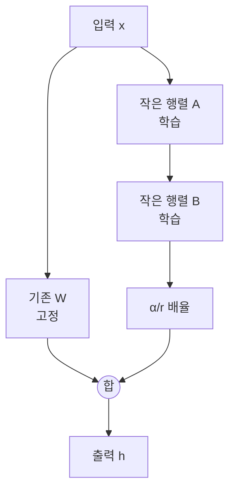
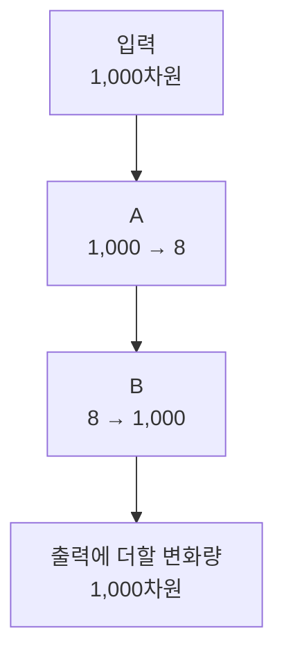
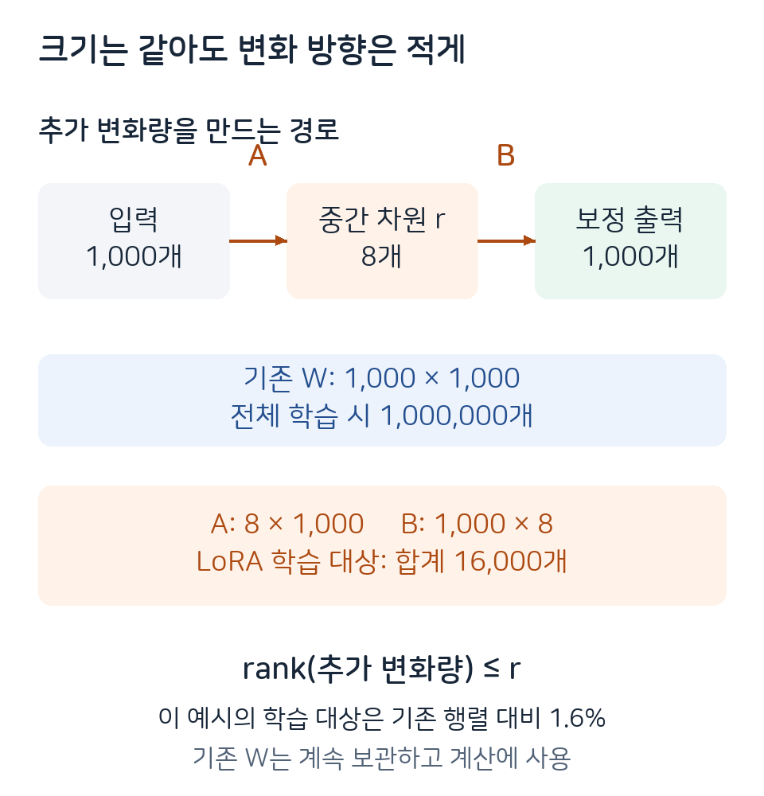
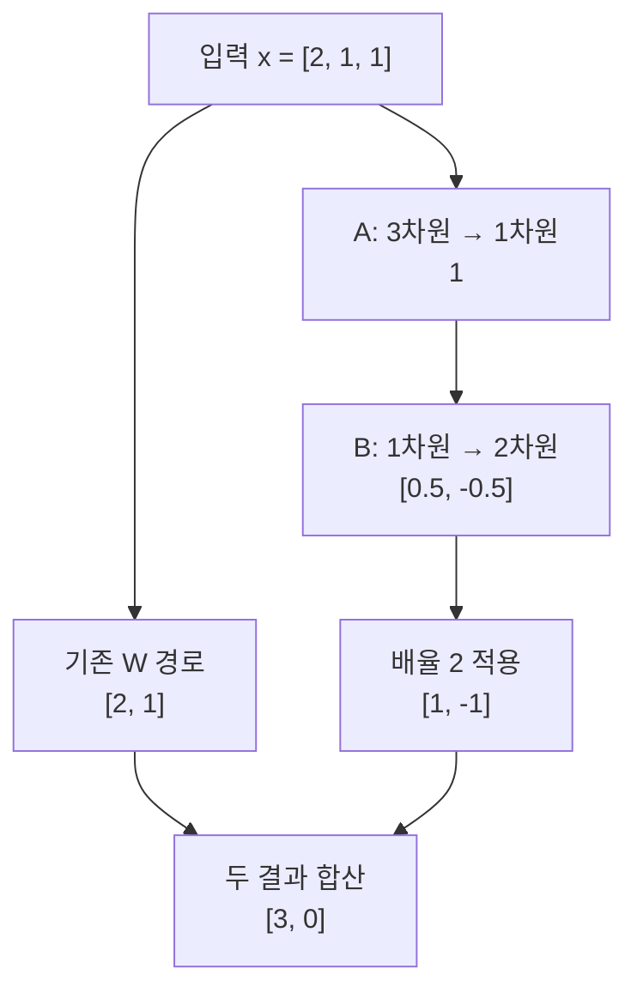
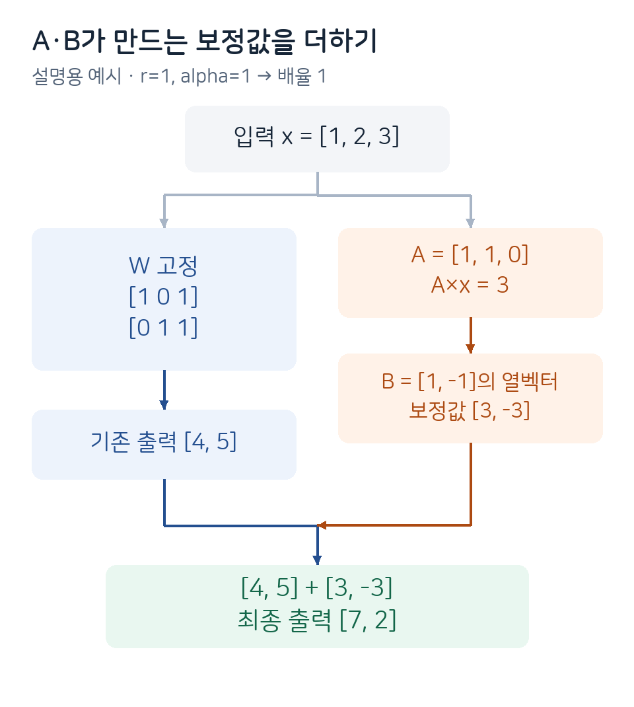

> 🗂️ **Notes · Deep Learning** — `llm` `fine-tuning` `pytorch`
{: .prompt-info }

---

## 1. 📖 기반 모델과 어댑터의 관계

기본 LoRA는 **기존 가중치 W를 고정하고, 추가한 어댑터의 A·B만 학습**한다. 어댑터도 확장된 모델의 일부다. 기존 가중치가 같아도 어댑터가 더하는 값이 달라지면 모델의 동작과 답변이 달라진다.

```text
        ┌─ 기존 가중치로 계산 ──┐
입력 ───┤       [고정]          ├─ 더해서 출력
        └─ LoRA 어댑터로 계산 ─┘
                [학습]
```

어댑터는 특정 계산 층의 출력을 보정하는 작은 행렬들의 묶음이다. 단독으로 문장을 처리하고 답변하는 완성된 언어 모델은 아니다. 사진 편집 프로그램 전체와 특정 스타일의 보정 설정을 구분하는 것과 비슷하다.

```text
기반 모델
  │
  ├─ 첫 번째 계산 층
  │
  ├─ 두 번째 계산 층
  │     ├─ 기존 가중치로 계산 ──┐
  │     └─ LoRA로 보정값 계산 ─┴─ 합산
  │
  ├─ 다음 계산 층들…
  │
  └─ 답변 생성
```

| 구분 | 작은 언어 모델 | LoRA 어댑터 |
| --- | --- | --- |
| 구성 | 문장을 처리하고 답변하는 전체 구조 | 선택한 계산 부분을 보정하는 행렬 |
| 단독 답변 생성 | 가능 | 기반 모델 필요 |
| 역할 | 전체 계산 수행 | 기반 모델의 계산에 변화량 추가 |

기반 가중치를 직접 수정하는 전체 미세조정도 가능하다. LoRA는 기반 모델의 언어·패턴 처리 능력을 사용하면서 필요한 변화량을 적은 파라미터로 표현한다.

```text
기존 모델:       결과 = 2 × 입력

전체 미세조정:   결과 = 2.8 × 입력
                       ↑ 기존 숫자를 수정

LoRA의 원리:    결과 = 2 × 입력 + 0.8 × 입력
                       ↑ 고정     ↑ 보정 부분을 학습
```

---

## 2. 💡 두 경로의 합과 행렬의 모양

입력 차원이 $d_{in}$, 출력 차원이 $d_{out}$일 때 행렬의 모양은 다음과 같다. 열벡터 표기를 사용한다.

| 대상 | 모양 | 상태 |
| --- | --- | --- |
| W | $d_{out}\times d_{in}$ | 고정 |
| A | $r\times d_{in}$ | 학습 |
| B | $d_{out}\times r$ | 학습 |

$$
\text{출력}
=
\underbrace{Wx}_{\text{이미 배운 능력 사용}}
+
\underbrace{\frac{\alpha}{r}BAx}_{\text{업무에 필요한 보정}}
$$

기본 LoRA의 배율은 $\alpha/r$이다. A가 입력을 r개의 중간 값으로 조합하고 B가 이를 출력 차원으로 바꾼다. 이 출력은 기존 계산에 더할 보정값이다. 원래 W를 A·B로 대체하는 구조는 아니다.



배율을 생략하거나 1로 놓으면 유효 가중치를 다음처럼 쓸 수 있다.

$$
W_{\text{적용}} = \underbrace{W}_{\text{고정}} +
\underbrace{BA}_{\text{학습하는 변화량}}
$$

---

## 3. 🔍 저랭크가 뜻하는 것과 파라미터 수

랭크는 행렬의 독립적인 행·열 패턴 수다. 다음 행렬은 둘째 행이 첫째 행의 2배, 셋째 행이 3배이므로 랭크가 1이다.

$$
\begin{bmatrix}
1&2&3\\
2&4&6\\
3&6&9
\end{bmatrix}
$$

LoRA는 **추가 변화량 ****$\Delta W=(\alpha/r)BA$****의 랭크**를 제한한다. 일반적으로 $\operatorname{rank}(BA)\le\min(r,d_{in},d_{out})$이며, 작은 r은 보정에 사용할 독립적인 방향을 제한한다. W 전체나 병합한 가중치가 반드시 저랭크라는 뜻은 아니다.



| 학습 대상 | 크기 | 학습할 파라미터 |
| --- | --- | --- |
| W 전체 | $1{,}000\times1{,}000$ | 1,000,000개 |
| A | $8\times1{,}000$ | 8,000개 |
| B | $1{,}000\times8$ | 8,000개 |
| LoRA 합계 | $r(d_{in}+d_{out})$ | 16,000개 |

{: w="960" h="1000" }

이 예시에서는 기존 행렬 전체의 1.6%만 학습한다. 기반 W는 계속 보관하고 계산에 사용한다. r이 작아도 필요한 변화를 표현할 수 있는 작업에서는 좋은 성능을 얻을 수 있지만, 복잡한 변화에 충분한지는 검증해야 한다.

---

## 4. 🧪 두 가지 숫자 예시

<details markdown="1">
<summary><strong>배율·행렬 곱·최종 출력 계산 펼치기</strong></summary>

### 🧪 숫자 예시 A: 배율 2와 랭크 1

다음은 행렬 계산을 따라가기 위해 정한 작은 예시다. 실제 모델에서 가져온 가중치는 아니다. 코드는 행렬 값을 나타낸 것이며, 실제 행렬 연산에는 텐서 등 적절한 객체가 필요하다.

```python
W = [[1, 0, 0],
     [0, 1, 0]]      # 출력 2 × 입력 3

A = [[1, 0, -1]]     # 중간 차원 1 × 입력 3
B = [[ 0.5],
     [-0.5]]         # 출력 2 × 중간 차원 1

x = [2, 1, 1]
rank, alpha = 1, 2   # 배율 alpha / rank = 2
```

이 예시의 배율은 $\alpha/r=2/1=2$다.



**기존 계산:**

$$
Wx=
   \begin{bmatrix}
   1\times2+0\times1+0\times1\\
   0\times2+1\times1+0\times1
   \end{bmatrix}
   =
   \begin{bmatrix}2\\1\end{bmatrix}
$$

**A의 입력 조합:**

```text
A @ x = 1×2 + 0×1 + (−1)×1 = 1
```

**B의 출력 배분:**

$$
B(Ax)=
   \begin{bmatrix}0.5\\-0.5\end{bmatrix}\times1
   =
   \begin{bmatrix}0.5\\-0.5\end{bmatrix}
$$

**배율 적용과 합산:**

$$
\text{보정값}
   =2\begin{bmatrix}0.5\\-0.5\end{bmatrix}
   =\begin{bmatrix}1\\-1\end{bmatrix}
$$

$$
\text{최종 출력}
   =\begin{bmatrix}2\\1\end{bmatrix}
   +\begin{bmatrix}1\\-1\end{bmatrix}
   =\boxed{\begin{bmatrix}3\\0\end{bmatrix}}
$$

가중치에 더하는 행렬 자체를 계산하면 다음과 같다.

$$
\Delta W=\frac{\alpha}{r}BA
=
2
\begin{bmatrix}0.5\\-0.5\end{bmatrix}
\begin{bmatrix}1&0&-1\end{bmatrix}
=
\begin{bmatrix}
1&0&-1\\
-1&0&1
\end{bmatrix}
$$

둘째 행이 첫째 행의 −1배이므로 독립적인 패턴은 하나다. 입력이 달라져도 보정은 다음처럼 `[1, −1]` 방향을 따라 움직인다.

$$
\Delta Wx=(x_1-x_3)
\begin{bmatrix}1\\-1\end{bmatrix}
$$

이 작은 예시에서는 W 전체 6개 대신 A의 3개와 B의 2개, 합계 5개를 학습한다. 작은 행렬에서는 절약 폭이 작지만 큰 차원에서는 차이가 커진다.

### 🧪 숫자 예시 B: 배율 1과 양·음수 보정

이번 입력은 $x=[1,2,3]$, `r=1`, `alpha=1`이다. x는 이 계산 층에 도착한 내부 숫자 표현이다. 질문 문장을 곧바로 이 세 숫자로 바꾼다는 뜻은 아니다. 편향은 생략한다.

```text
W = [1  0  1]
    [0  1  1]
```

```text
첫 번째: 1×1 + 0×2 + 1×3 = 4
두 번째: 0×1 + 1×2 + 1×3 = 5

기존 출력 = [4, 5]
```

```text
A = [1  1  0]

A의 계산:
1×1 + 1×2 + 0×3 = 3
```

```text
B = [ 1]
    [-1]

B의 계산:
첫 번째:  1×3 =  3
두 번째: -1×3 = -3

어댑터 보정값 = [3, -3]
```

```text
기존 출력       [4,  5]
어댑터 보정값 + [3, -3]
─────────────────────
최종 출력       [7,  2]
```

```text
                 ┌─ W로 계산 ─────────→ [4, 5] ───┐
입력 [1, 2, 3] ──┤                                ├─ 합산 → [7, 2]
                 └─ A로 계산 → [3] → B → [3, -3] ─┘
```

{: w="960" h="1070" }

W를 고정해도 A·B가 만드는 양수·음수 보정을 통해 결과를 바꿀 수 있다. 보정이 유용한 방향인지는 학습 목표의 손실과 실제 검증 성능으로 판단한다.

</details>

---

## 5. ⚖️ 효율성의 의미와 한계

| 관리할 항목 | 전체 미세조정 | LoRA |
| --- | --- | --- |
| 기존 W | 보관·계산·갱신 | 보관·계산, 값은 고정 |
| 기울기 | 전체 W에 대해 관리 | 주로 A·B에 대해 관리 |
| 옵티마이저 상태 | 전체 W에 대해 관리 | 주로 A·B에 대해 관리 |
| 계산 중간값 | 필요 | 계속 필요 |
| 작업별 학습 결과 | 전체 가중치 | 작은 어댑터로 별도 저장 가능 |
| 조정 범위 | 전체 가중치를 직접 조정 | 선택한 위치와 r에 따라 제한 |

Adam 계열은 기울기의 평균·제곱 평균 같은 상태를 관리한다. LoRA는 큰 W 전체의 기울기와 최적화 상태를 줄여 학습 메모리와 저장 비용을 절약한다. **기반 모델의 계산과 앞쪽 층으로 기울기를 전달하는 계산은 남으므로, 파라미터 감소율만큼 학습 속도가 빨라지지는 않는다.** 적은 데이터·스텝으로 반드시 더 잘 배운다는 의미도 아니다.

같은 기반 모델에 고객 상담용·문서 요약용 어댑터를 따로 보관하고 바꿔 쓸 수 있다. 기본 가중치와 다른 파라미터가 유지된 구성에서는 어댑터를 끄면 기반 모델로 돌아갈 수 있다. 다만 **가중치 보존과 어댑터 적용 중의 기존 성능 보장은 다르다.** 전체 미세조정과 비슷한 품질을 낼 수 있어도 항상 동등하거나 더 우수한 것은 아니다.

---

---

## 6. 🧠 핵심 기억 카드

<details markdown="1">
<summary><strong>펼쳐서 확인</strong></summary>

- 기본 LoRA는 W를 고정하고 A·B가 만드는 보정값을 더한다.
- r은 추가 변화량의 최대 랭크와 학습 파라미터 수에 영향을 준다.
- 기반 모델의 계산은 남으므로 파라미터 감소율이 속도 개선율은 아니다.

</details>

---

## 관련 글

- [모델의 숫자와 언어 학습](/posts/model-parameters-and-language-learning/)
- [파인튜닝 방법 비교: SFT·PEFT·LoRA·QLoRA·DPO](/posts/finetuning-methods-sft-peft-qlora-dpo/)
- [Attention의 q·k·v와 LoRA 부착 위치](/posts/attention-qkv-and-lora-targets/)
- [LoRA 초기화·학습과 설정 조정](/posts/lora-initialization-training-and-tuning/)
- [어댑터 저장·복원·병합과 평가](/posts/adapter-lifecycle-and-evaluation/)
