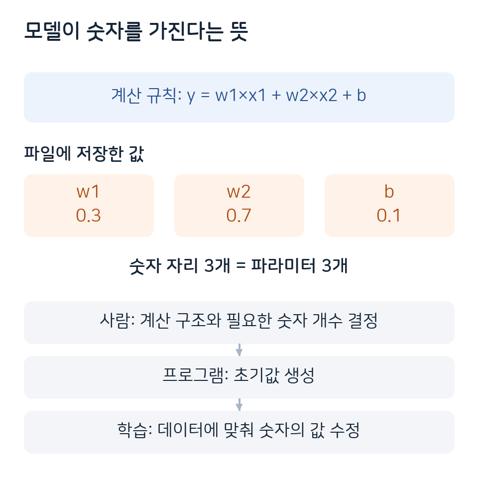
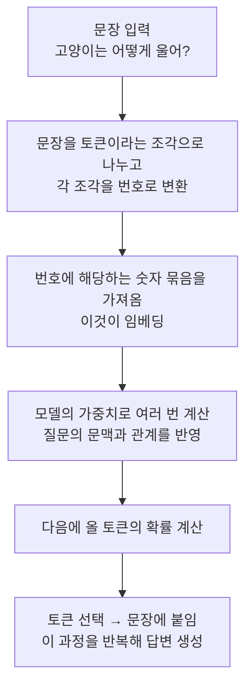
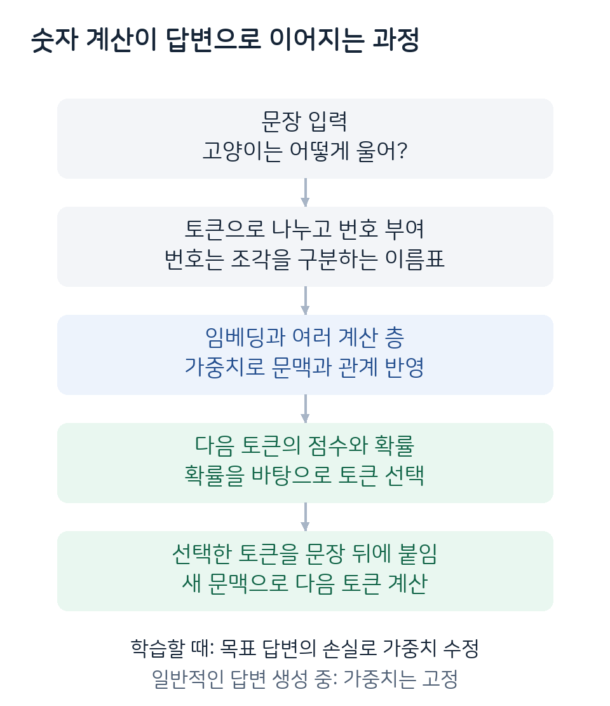

> 🗂️ **Notes · Deep Learning** — `llm` `pytorch` `fine-tuning`
{: .prompt-info }

---

## 1. 📖 모델과 파라미터

모델은 **계산 구조와 그 계산에 사용하는 숫자 데이터**로 구성된다. 파라미터는 입력을 출력으로 바꾸는 계산에 사용하는 학습 가능한 숫자다. 가중치와 편향 등이 여기에 포함된다. 숫자들은 실제 파일에 저장되며, 모델을 실행할 때 메모리에 불러온다.

| 구분 | 의미 | 누가 결정하는가 |
| --- | --- | --- |
| 모델 구조 | 계산 층의 종류·연결·너비·개수 | 연구자·개발팀이 목표 성능, 데이터, GPU 자원과 처리 속도를 고려해 설계 |
| 파라미터 개수 | 구조에 필요한 숫자 자리의 총개수 | 선택한 구조에서 결정 |
| 파라미터 초기값 | 학습을 시작할 때 넣는 값 | 프로그램이 정해진 초기화 규칙으로 생성 |
| 학습된 파라미터 값 | 데이터를 보며 갱신한 값 | 학습 프로그램이 손실과 기울기를 이용해 수정 |

입력 두 개를 계산하는 작은 모델은 다음과 같이 나타낼 수 있다. 아래 값은 설명을 위해 정한 예시다.

```python
# 모델에 저장해 둔 숫자
w1 = 0.3
w2 = 0.7
b = 0.1

# 입력이 들어오면 수행하는 계산
결과 = w1 * 입력1 + w2 * 입력2 + b
```

여기서 파라미터는 `w1`, `w2`, `b` 세 개다. `입력1`, `입력2`는 매번 들어오는 데이터다. 입력으로 2와 4를 넣으면 다음 계산이 이루어진다.

```text
입력1: 2 ── × 0.3 ──→ 0.6 ─┐
                             ├─ 합계 + 0.1 → 결과 3.5
입력2: 4 ── × 0.7 ──→ 2.8 ─┘
```

{: w="960" h="960" }

| 기본 선형층의 구조 | 가중치 수 | 편향 수 | 총 파라미터 |
| --- | --- | --- | --- |
| 입력 2개 → 출력 1개 | 2 | 1 | 3개 |
| 입력 2개 → 출력 3개 | 6 | 3 | 9개 |

큰 모델은 여러 계산 층에 있는 파라미터를 합산한다. **7B 모델은 내부 파라미터가 약 70억 개라는 뜻**이다. 한 번에 입력 70억 개를 처리한다는 뜻은 아니다. 입력 길이 한도는 토큰 수를 기준으로 별도로 정해진다.

파일 용량은 숫자의 개수와 저장 정밀도에 영향을 받는다. 같은 개수의 숫자를 저장해도 16비트와 4비트의 저장 공간은 다르다.

---

## 2. 💡 학습은 개수가 아니라 값을 바꾸는 과정

가중치 $w$와 편향 $b$를 사용하는 작은 모델은 다음과 같다.

$$
\text{예측값} = w \times x + b
$$

$w=2$, $b=1$이고 입력 $x=3$이면 다음 결과가 나온다.

$$
2 \times 3 + 1 = 7
$$

목표 출력이 10일 때, 학습을 통해 값이 아래처럼 바뀌었다고 가정한다.

| 구분 | $w$ | $b$ | 입력 3의 예측값 |
| --- | --- | --- | --- |
| 학습 전 | 2 | 1 | 7 |
| 학습 후의 가상 예시 | 2.8 | 1.4 | 9.8 |

파라미터는 여전히 두 개다. **전체 미세조정은 기존 파라미터 전체를 갱신 대상으로 삼는 것**이며, 보통 구조와 파라미터 개수는 유지한다. 모든 파라미터가 매 단계에서 반드시 다른 값이 된다는 의미는 아니다.

모델 파라미터와 하이퍼파라미터도 구분한다. 가중치·편향·LoRA의 A·B는 학습되는 값이다. 학습률, `r`, `alpha` 등은 기본 구성에서 학습 전에 정하는 설정이다.

---

## 3. 🔍 문장을 숫자로 처리하고 답변을 만드는 과정

문장을 토큰으로 나누고 각 토큰에 번호를 붙인다. 토큰 번호는 조각을 구분하는 이름표다. 모델은 번호에 대응하는 **임베딩이라는 숫자 묶음**을 가져오고, 여러 계산 층에서 가중치를 사용해 문맥과 관계를 반영한다.



{: w="960" h="1110" }

모델은 다음 토큰 후보의 점수를 계산하고 이를 확률로 바꾼다. 그 확률을 바탕으로 토큰을 선택해 입력 뒤에 붙이고 다음 토큰을 생성한다. 일반적인 답변 생성 중에는 가중치를 고정하고, 입력에 따라 중간 계산 결과를 바꾼다.

---

## 4. 🧪 숫자 변경이 지식 학습으로 이어지는 예시

‘고양이는 어떻게 울어?’라는 질문에서 이미 **고양이의 울음소리를 묻는 특징**을 얻었다고 가정한다. 답변 후보를 ‘야옹’과 ‘멍멍’ 두 개로 제한한 작은 예시다.

```text
‘고양이 울음소리’라는 특징 = 1

‘야옹’의 점수 = 1 × 야옹 쪽 가중치
‘멍멍’의 점수 = 1 × 멍멍 쪽 가중치
```

| 시점 | 야옹 쪽 가중치 | 멍멍 쪽 가중치 | softmax 확률 |
| --- | --- | --- | --- |
| 학습 전 | 0 | 0 | 야옹 50%, 멍멍 50% |
| 학습 후의 가상 예시 | 1 | −1 | 야옹 약 88%, 멍멍 약 12% |

계산 구조가 같아도 가중치가 바뀌면 ‘야옹’이 나올 가능성이 커진다. 목표 답변이 ‘야옹 하고 울어요.’라면 그 답변의 토큰에 높은 확률을 주도록 손실을 줄인다.

```text
현재 가중치로 답변의 확률 계산
             ↓
목표 답변에 부여한 확률을 평가
             ↓
목표 답변의 확률을 높이려면
각 가중치를 어떻게 수정해야 하는지 계산
             ↓
가중치를 조금 수정
```

실제 언어 모델은 답변 점수뿐 아니라 **질문의 특징을 만드는 임베딩과 중간 계산의 가중치도 함께 학습**한다. 다양한 문맥에서 학습한 관계를 활용하면 ‘고양이 울음소리를 흉내 내줘’, ‘야옹 소리를 내는 동물은?’처럼 표현이 다른 입력에도 대응할 수 있다.

단어의 의미는 문맥에 따라 달라진다. ‘배를 먹었다’와 ‘배를 탔다’는 같은 ‘배’가 있어도 문장 전체를 처리한 결과가 달라지도록 학습한다. 여러 Attention head와 계산 층이 문맥의 관계를 반영한다.

지식을 학습했다는 말은 **관련 입력에서 적절한 정보를 출력하게 하는 계산 방식이 가중치에 자리 잡았다**는 의미다. 하나의 사실은 여러 파라미터의 조합으로 표현되며, 숫자 하나에 문장 하나가 그대로 저장되는 형태는 아니다.

---

---

## 5. 🧠 핵심 기억 카드

<details markdown="1">
<summary><strong>펼쳐서 확인</strong></summary>

- 모델은 계산 구조와 학습 가능한 숫자 데이터로 구성된다.
- 파라미터 개수는 구조가 정하고, 학습은 주로 그 값을 바꾼다.
- 문장은 토큰·임베딩·문맥 계산을 거쳐 다음 토큰의 확률로 이어진다.

</details>

---

## 관련 글

- [파인튜닝 방법 비교: SFT·PEFT·LoRA·QLoRA·DPO](/posts/finetuning-methods-sft-peft-qlora-dpo/)
- [LoRA의 원리와 저랭크 행렬 계산](/posts/lora-low-rank-and-matrix-calculation/)
- [Attention의 q·k·v와 LoRA 부착 위치](/posts/attention-qkv-and-lora-targets/)
- [LoRA 초기화·학습과 설정 조정](/posts/lora-initialization-training-and-tuning/)
- [어댑터 저장·복원·병합과 평가](/posts/adapter-lifecycle-and-evaluation/)
