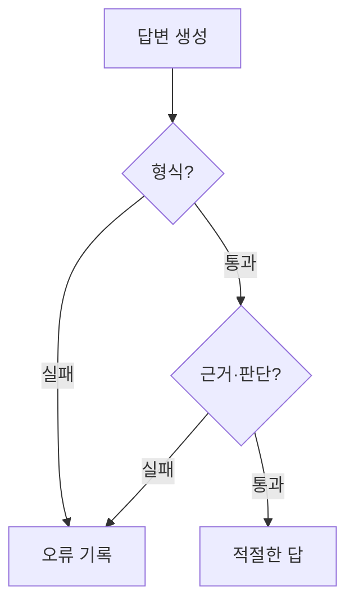

> 📌 **Notes · Deep Learning** — `llm` `dpo` `model-evaluation`
{: .prompt-info }

---

## 1. 🎯 손실은 학습쌍의 점수다

DPO 손실이 낮아지면 학습에 사용한 선호쌍에서 모델의 **상대적인 점수 차이**가 선호 방향으로 바뀌었다는 신호다. 새로운 질문에 대한 답변이 정확해졌는지는 그 숫자만으로 알 수 없다. 앞의 점수 계산에서 chosen의 점수가 내려가도 rejected가 더 크게 내려가면 margin이 커질 수 있다.

평가에는 학습에 사용하지 않은 질문을 준비해 **실제로 답을 생성**시키고, 답변 원문을 읽는 단계가 필요하다.

---

## 2. 🔎 생성 답변을 어떻게 읽을까

| 점검 항목 | 확인할 질문 |
| --- | --- |
| 형식 | 필요한 JSON 키와 값이 맞고 실제로 파싱되는가? |
| 근거 | 인용한 자료가 해당 질문의 항목과 시점에 관련되는가? |
| 판단 | 경계값과 개정 규정을 올바르게 적용했는가? |
| 보류 | 근거가 충분할 때 답하고, 부족할 때는 추측하지 않는가? |

예를 들어 JSON 문법이 맞더라도 다른 경비 항목의 규정을 인용해 답하면 근거 판단은 틀린다. 반대로 근거가 없는데 지원 불가를 단정하는 것도 오류다.

---

## 3. 📊 숫자를 읽을 때 주의할 점

`answered`나 `abstained`의 개수만으로 품질을 평가하면 파싱에 실패한 답변이 집계에서 빠질 수 있다. **전체 생성 건수, 파싱 성공 건수, 형식 오류, 근거·판단 오류**를 함께 확인한다. 선호쌍 점수, 출력 형식, 실제 의미는 서로 다른 검증 대상이다.

> 학습에서 좋아진 상대 점수와 사용자가 받는 실제 답변의 품질은 따로 측정한다.
{: .prompt-tip }

---

## 4. 🔁 다시 보는 카드

<strong>펼쳐서 확인</strong>

- DPO loss는 선호쌍에서의 상대 비교를 나타낸다.
- 새 질문의 생성 결과는 형식·근거·판단·보류 조건으로 평가한다.
- 파싱 실패를 숨긴 상태별 집계는 좋은 결과의 증거가 아니다.

---

## 함께 읽기

- [DPO의 기준 모델, margin과 loss](/posts/dpo-reference-margin-loss/)
- [어댑터 저장·병합·평가](/posts/adapter-lifecycle-and-evaluation/)
