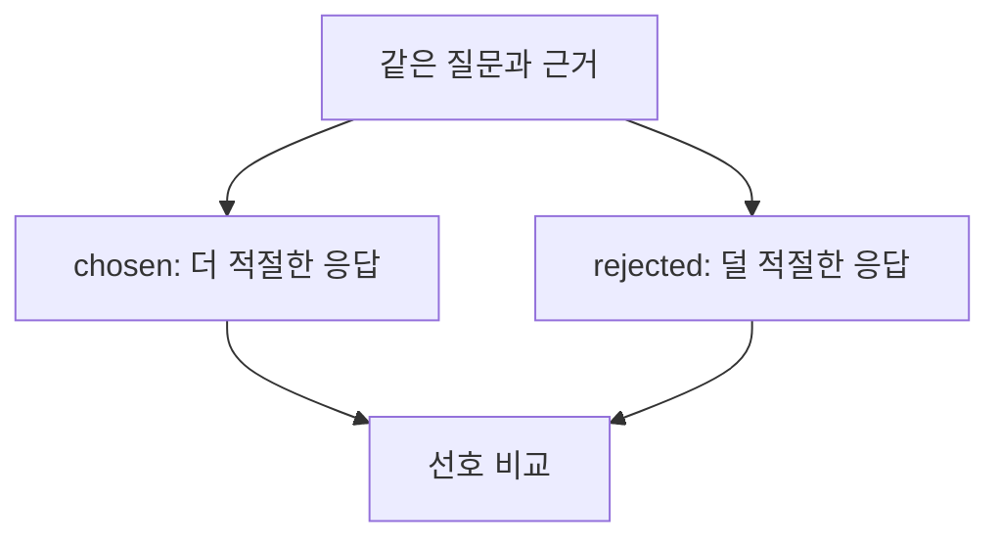

> 📌 **Notes · Deep Learning** — `llm` `dpo` `preference-data`
{: .prompt-info }

---

## 1. 🎯 선호쌍은 무엇을 가르칠까

DPO(Direct Preference Optimization)는 **같은 입력**에 대한 두 응답 중 어느 쪽을 더 선호하는지 배운다. SFT가 입력과 모범답안을 짝지어 답을 따라 쓰게 한다면, DPO의 학습 단위는 `prompt`, `chosen`, `rejected`의 세 부분이다.

두 응답의 입력이 다르면 무엇 때문에 선호가 달라졌는지 분리하기 어렵다. 비교할 때는 질문뿐 아니라 **제공된 근거와 답변 조건**도 같아야 한다.

---

## 2. 🧭 선호는 근거에 따라 달라진다

예를 들어 출장비 규정과 질문이 함께 주어졌다고 하자.

| 입력 상황 | chosen에 가까운 행동 | rejected에 가까운 행동 |
| --- | --- | --- |
| 해당 항목의 규정이 충분함 | 금액과 조건을 비교해 답함 | 근거가 충분한데도 무조건 보류함 |
| 해당 항목의 규정이 없음 | 확인 불가를 명확히 말함 | 근거 없이 지원 불가라고 단정함 |
| 다른 경비 항목의 규정만 있음 | 관련 근거가 없음을 밝힘 | 다른 항목의 한도를 그대로 적용함 |

**보류가 항상 나쁜 답은 아니다.** 어떤 근거가 있는지가 선호 판단의 조건이다. 동일한 형식의 답이라도 경계값을 `초과`로 잘못 읽거나 오래된 규정을 사용하면 의미가 틀릴 수 있다.

---

## 3. 🧪 데이터를 만들 때 확인할 것

교육용 비선호 답은 모범답안에서 한 판단만 바꿔 만들 수 있다. 예를 들어 규정상 `한도와 같음`을 `한도 초과`로 뒤집으면 비교할 오류가 뚜렷해진다. 실제 사용자 응답의 오류는 더 복잡할 수 있으므로, 이렇게 만든 쌍만으로 모든 오류를 대표한다고 보아서는 안 된다.

1. 질문과 근거가 두 응답에서 같은지 확인한다.
2. 선택한 답이 실제로 더 적절한지 근거를 읽고 판단한다.
3. 출력 형식과 인용이 유효한지 확인한다.
4. 두 응답이 서로 다르고, 차이가 학습시키려는 판단과 일치하는지 확인한다.

형식 검사는 JSON 구조가 맞는지 알려 줄 수 있지만, **판단이 옳은지는 별도로 검토**해야 한다.

---

## 4. 🔁 다시 보는 카드

<strong>펼쳐서 확인</strong>

- DPO 선호쌍은 같은 입력에 대한 `chosen`과 `rejected`를 비교한다.
- 답하기와 보류하기 중 어느 쪽이 좋은지는 주어진 근거에 달려 있다.
- 형식이 유효해도 근거 해석이 틀리면 좋은 응답이 아니다.

---

## 함께 읽기

- [파인튜닝 방법 지도: SFT·PEFT·LoRA·QLoRA·DPO](/posts/finetuning-methods-sft-peft-qlora-dpo/)
- [DPO의 기준 모델, margin과 loss](/posts/dpo-reference-margin-loss/)
