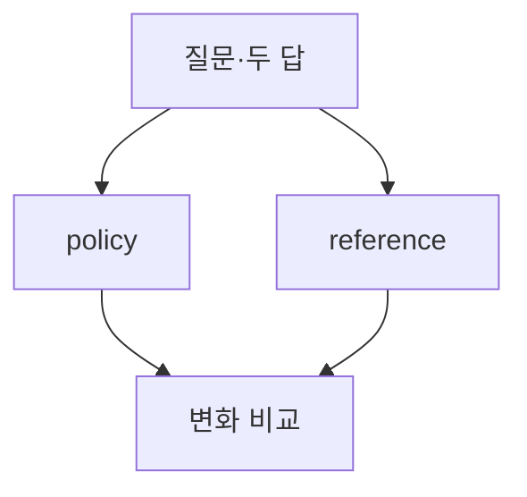

> 📌 **Notes · Deep Learning** — `llm` `dpo` `preference-optimization`
{: .prompt-info }

---

## 1. 🎯 기준 모델과 학습 모델

DPO는 같은 질문에 대한 선호 답(`chosen`)과 비선호 답(`rejected`)을 비교한다. **reference**는 고정된 기준 모델이고, **policy**는 학습 중 바뀌는 모델이다. 흔히 SFT 모델에서 두 모델을 출발시키지만, 중요한 것은 비교하는 동안 기준 쪽이 고정된다는 점이다.



모델은 질문을 문맥으로 읽고, 그 질문 뒤에 특정 응답이 나올 **로그확률**을 계산한다. 일반적으로 응답 토큰의 조건부 로그확률을 합한 값이다. 학습 구현에 따라 질문·패딩을 손실 계산에서 제외할 수 있다. 응답 길이와 점수 집계 방식이 달라지면 숫자의 비교 의미도 달라지므로 동일한 설정으로 비교한다.

---

## 2. 🧮 상대 변화에서 loss까지

각 응답의 변화량은 `policy의 logp − reference의 logp`이다. DPO는 선호 답의 변화량에서 비선호 답의 변화량을 뺀다.

$$
m=\beta\left[\bigl(\log\pi_\theta(y_c\mid x)-\log\pi_{\rm ref}(y_c\mid x)\bigr)-\bigl(\log\pi_\theta(y_r\mid x)-\log\pi_{\rm ref}(y_r\mid x)\bigr)\right]
$$

$$
L_{\rm DPO}=-\log\sigma(m)
$$

여기서 $x$는 공통 입력, $y_c$와 $y_r$는 두 응답, $\beta>0$는 기준 모델 대비 상대 변화에 적용하는 계수다. **margin $m$이 클수록** 이 쌍의 손실은 작아진다. $\beta$는 손실식의 계수이고, 학습률은 optimizer가 가중치를 갱신하는 크기이므로 역할이 다르다.

```python
chosen_change = chosen_policy_logp - chosen_reference_logp
rejected_change = rejected_policy_logp - rejected_reference_logp
margin = beta * (chosen_change - rejected_change)
loss = -log_sigmoid(margin)
```

---

## 3. ⚖️ 같은 margin, 다른 응답 변화

아래 숫자는 원리를 설명하기 위한 예시이며 실제 실험 결과가 아니다.

| 경우 | chosen 변화 | rejected 변화 | 변화량 차이 |
| --- | ---: | ---: | ---: |
| A | 0 | −2 | +2 |
| B | −2 | −4 | +2 |

같은 $\beta$라면 두 경우의 margin과 손실은 같다. 하지만 B에서는 chosen의 logp도 낮아졌다. **상대 비교의 개선만으로 chosen 자체가 더 잘 생성된다고 결론 내릴 수 없다.** 확률 점수와 실제 답변의 의미도 별도로 확인해야 한다.

---

## 4. 🔁 다시 보는 카드

<details markdown="1">
<summary><strong>펼쳐서 확인</strong></summary>

- reference는 고정 기준이고 policy는 학습하며 바뀐다.
- DPO loss는 기준 대비 `chosen 변화 − rejected 변화`의 차이에 반응한다.
- 상대 차이만으로 실제 생성 답변의 품질을 판정할 수 없다.

</details>

---

## 함께 읽기

- [DPO 선호쌍 설계: 같은 질문에서 두 답을 비교하기](/posts/dpo-preference-pair-design/)
- [DPO 학습 후 답변 평가하기](/posts/dpo-generated-answer-evaluation/)
