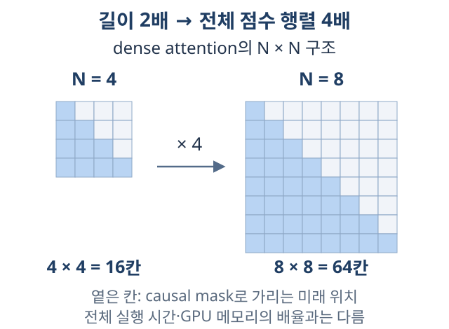

> 🗂️ **Notes · Deep Learning** — `llm` `attention` `context-engineering`
{: .prompt-info }

---

## 1. 📖 문맥 길이는 토큰 수로 센다

자기회귀 언어 모델은 앞에 주어진 토큰들을 바탕으로 다음 토큰을 예측한다. **문맥 길이(context length)** 는 모델이 한 번에 다룰 수 있는 토큰 열의 길이와 관련된 한도다. 글자 수나 단어 수와 같지 않다.

일반적인 decoder-only 생성에서는 **프롬프트와 이미 생성한 답변이 함께 문맥을 차지한다.** 예를 들어 한도가 8토큰이고 입력이 5토큰이라면, 전체 시퀀스를 그 한도 안에 유지하는 설정에서는 출력에 3토큰의 여유가 있다. 특수 토큰도 길이에 포함된다.

### 이름이 비슷해도 같은 설정은 아니다

| 설정 | 뜻 |
| --- | --- |
| 모델의 지원 문맥 길이 | 모델 구조·학습·실행 설정이 지원하는 길이 |
| 학습 샘플의 `context_size` | 데이터 준비 코드에서 선택한 입력 창의 길이 |
| 토크나이저의 `max_length` | 자르기·패딩 옵션과 함께 적용하는 인코딩 길이 기준 |
| Transformers 생성의 `max_length` | decoder-only 모델에서 입력을 포함한 전체 생성 시퀀스 길이 한도 |
| 생성의 `max_new_tokens` | 새로 생성할 토큰 수의 한도 |

> 💡 `max_length`라는 이름만 보고 모델의 문맥 한도라고 단정하지 않는다. **어느 함수의 인자인지** 먼저 확인한다.
{: .prompt-tip }

---

## 2. 🔍 긴 입력의 비용은 왜 커질까?

전체 어텐션(dense attention)은 토큰 위치 사이의 관계를 계산한다. 길이가 `N`이면 전체 점수 행렬의 크기는 **`N × N`** 이다.

{: w="640" h="470" }

일반적인 dense attention의 학습·입력 처리(prefill)에서 어텐션 계산량은 길이에 대해 대략 제곱으로 증가한다. 점수 행렬을 그대로 저장하는 구현은 그 메모리도 제곱으로 늘어난다.

다만 **모델 전체의 시간·메모리가 언제나 정확히 네 배가 되는 것은 아니다.** FlashAttention처럼 중간 행렬을 통째로 저장하지 않는 구현도 있고, KV 캐시를 사용하는 한 토큰씩의 생성은 별도로 봐야 한다. 설정의 최대값만 늘려 놓고 실제 입력은 그대로라면, 실제 비용 변화도 패딩·캐시 할당 등 구현에 달려 있다.

---

## 3. 💡 많이 읽는 능력과 잘 활용하는 능력

| 길이를 늘릴 때 살필 것 | 이유 |
| --- | --- |
| 필요한 정보가 추가되는가 | 관계없는 내용은 비용을 늘리고 답변을 방해할 수 있음 |
| 정보가 놓인 위치 | 일부 모델·과제에서는 긴 입력의 중간 정보를 잘 활용하지 못함 |
| 학습에서 경험한 길이 | 짧은 입력 위주로 학습한 모델이 훨씬 긴 문맥까지 잘 활용한다고 보장할 수 없음 |
| 데이터 구성과 GPU 여유 | 짧은 자료를 큰 길이에 무조건 패딩하면 계산을 낭비할 수 있음 |

중간 정보를 놓치는 **lost-in-the-middle** 은 관찰된 경향이며, 모든 모델이 모든 긴 입력에서 반드시 실패한다는 법칙은 아니다. 길이뿐 아니라 필요한 정보를 찾고 연결하는 능력을 따로 평가해야 한다.

### 나중에 늘릴 수는 없을까?

지원 범위 안에서 학습 창을 줄이거나 입력 길이를 조절하는 일은 가능하다. 원래 지원 범위를 넘어 문맥을 확장하려면 위치 표현 조정, 추가 학습, 긴 입력 평가 등이 필요할 수 있다.

> ⚠️ 문맥 길이는 영원히 고정된 숫자는 아니다. 하지만 **설정값만 키운다고 긴 문맥의 품질까지 확보되는 것도 아니다.**
{: .prompt-warning }

---

## 4. 🧠 핵심 기억 카드

<strong>펼쳐서 확인</strong>

- 문맥 길이의 단위는 토큰이다. 생성한 답변도 문맥을 차지한다.
- 모델 한도, 학습 창, 토크나이저 길이, 생성 길이를 구분한다.
- dense attention의 제곱 비용은 적용 단계와 구현 조건을 함께 말한다.
- 긴 입력을 받을 수 있는지와 필요한 정보를 잘 사용하는지는 별개다.

---

## 관련 글

- [Attention의 q·k·v와 LoRA 부착 위치](/posts/attention-qkv-and-lora-targets/)
- [BPE와 임베딩 — 토큰 사전과 벡터는 어떻게 다른가](/posts/tokenizer-bpe-vocabulary-embedding/)
- [슬라이딩 윈도와 stride — 다음 토큰 학습 데이터 만들기](/posts/llm-sliding-window-stride/)
