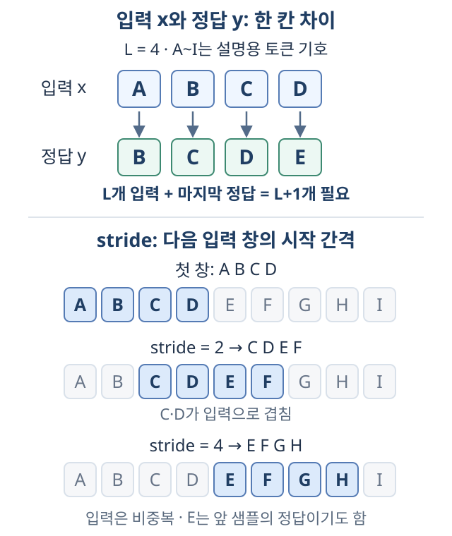

> 🗂️ **Notes · Deep Learning** — `llm` `batch` `train-test-split`
{: .prompt-info }

---

## 1. 📖 한 칸 뒤의 토큰이 정답이다

다음 토큰 예측 학습에서는 입력의 각 위치마다 **바로 다음 토큰**을 정답으로 둔다. 길이 `L`의 입력과 정답을 직접 만들려면 연속된 **`L + 1`개 토큰**이 필요하다.

{: w="640" h="760" }

그림의 `A`부터 `I`는 단어가 아니라 **토큰 ID를 대신한 설명용 기호**다.

| 모델이 볼 수 있는 입력 | 해당 위치의 정답 |
| --- | --- |
| A | B |
| A B | C |
| A B C | D |
| A B C D | E |

입력 전체를 한꺼번에 계산해도 **causal mask** 가 뒤쪽 토큰을 가린다. 예를 들어 A 위치가 입력 안의 B를 미리 보고 B를 맞히면 안 된다. `y`는 손실 계산에 사용하는 정답이다.

> 💡 “정답을 한 칸 민다”는 말은 **같은 위치의 입력보다 원문에서 한 칸 뒤에 있는 토큰을 정답으로 놓는다**는 뜻이다.
{: .prompt-tip }

---

## 2. 🔍 stride는 다음 창의 시작 간격이다

`stride`는 원본 토큰 열에서 **다음 샘플의 시작 위치를 몇 토큰 옮길지** 정한다. 배치를 이동시키는 값이 아니다.

| 입력 길이 L = 4 | 다음 창과의 관계 |
| --- | --- |
| stride = 1 | 입력 3토큰이 겹침 |
| stride = 2 | 입력 2토큰이 겹침 |
| stride = 4 | 입력 창끼리 겹치지 않음 |
| stride > 4 | 입력으로 사용하지 않는 구간이 생김 |

작은 stride는 겹치는 문맥의 학습 기회를 늘리지만, 같은 자료를 여러 번 처리해 계산량과 샘플 간 상관도도 높인다. **작은 stride 자체가 곧 과적합을 뜻하지는 않는다.** 데이터 다양성·학습 횟수·검증 결과를 함께 봐야 한다.

stride가 L과 같아도 “모든 데이터를 딱 한 번만 사용한다”고 단정할 수 없다. 그림의 E는 첫 샘플의 마지막 정답이면서 다음 샘플의 첫 입력이다. 남는 꼬리 구간을 버리는지, 패딩하는지와 여러 epoch를 반복하는지도 별도 조건이다.

---

## 3. 🧪 입력과 정답을 직접 만드는 짧은 예시

아래 코드는 원리를 확인하기 위한 **독립적인 학습용 예시**다. 길이가 부족한 마지막 구간은 버린다.

```python
tokens = list(range(9))  # 토큰 ID를 가정: 0~8
context_size = 4
stride = 2

samples = []
for start in range(0, len(tokens) - context_size, stride):
    x = tokens[start : start + context_size]
    y = tokens[start + 1 : start + context_size + 1]
    samples.append((x, y))
```

이 예시의 결과는 다음과 같다.

```text
x=[0, 1, 2, 3]  y=[1, 2, 3, 4]
x=[2, 3, 4, 5]  y=[3, 4, 5, 6]
x=[4, 5, 6, 7]  y=[5, 6, 7, 8]
```

배치는 만들어 둔 샘플 여러 개를 한 번의 계산에 묶는 단위다. `batch_size=2`로 두 샘플을 묶으면 입력·정답 각각의 모양은 **`[2, 4]`** 다. 샘플을 섞어 배치에 넣을 수도 있으므로 배치 순서와 원문의 창 순서는 같지 않을 수 있다.

### 실제 라이브러리에서는 두 가지를 확인한다

- **정답 이동을 누가 하는가:** Hugging Face의 일반적인 causal LM 학습에서는 입력 ID를 labels로 복사해 주고 모델 내부에서 예측과 정답을 한 칸 어긋나게 맞춘다. 이미 이동한 정답을 또 이동시키지 않도록 사용 모델을 확인한다.
- **stride의 정의가 같은가:** 여기서는 창의 시작 간격이다. Hugging Face 토크나이저의 overflow 처리에서 `stride`는 앞 창과 **겹쳐 가져올 토큰 수**를 뜻하므로 인자 이름만으로 혼동하지 않는다.

평가용 자료는 문서 등 원천 단위로 먼저 나누고 각 집합에서 창을 만든다. 겹치는 창들을 만든 뒤 무작위로 학습·평가에 나누면 거의 같은 내용이 양쪽에 들어갈 수 있다.

---

## 4. 🧠 핵심 기억 카드

<details markdown="1">
<summary><strong>펼쳐서 확인</strong></summary>

- 입력 길이가 L이면 직접 이동한 정답까지 만드는 데 L+1토큰이 필요하다.
- causal mask가 미래 정답을 미리 보는 일을 막는다.
- stride는 샘플의 시작 간격, batch size는 한 번에 묶을 샘플 수다.
- stride=L은 입력 창의 비중복을 뜻하며, 모든 데이터의 일회 사용을 보장하지 않는다.
- 라이브러리의 정답 이동 위치와 stride 정의를 확인한다.

</details>

---

## 관련 글

- [LLM의 문맥 길이 — 길게 읽으면 항상 좋아질까](/posts/llm-context-length-and-cost/)
- [Dataset split과 map() — 학습 데이터를 준비하는 흐름](/posts/dataset-split-and-map/)
