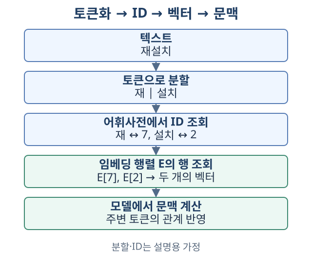
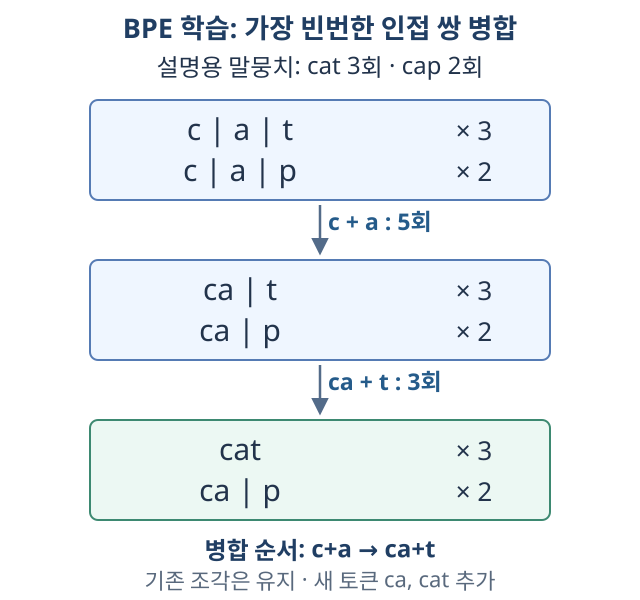

> 🗂️ **Notes · Deep Learning** — `llm` `tokenizer` `subword` `vocabulary` `embedding`
{: .prompt-info }

---

## 1. 📖 텍스트가 모델의 입력이 되는 흐름

토큰화는 텍스트를 **모델이 처리할 조각으로 나누는 과정**이다. 토크나이저의 인코딩은 이 조각들을 어휘사전의 정수 ID로 바꾼다. 토큰은 단어·부분단어·문자·구두점 등이 될 수 있고, byte-level 방식에서는 바이트 조각일 수도 있다.

{: w="640" h="520" }

토크나이저는 분할 규칙과 사전을 적용한다. 문장의 의미를 이해해서 문맥 단위로 자르는 과정은 아니다. 앞뒤 문자·공백에 따라 분할 결과가 달라질 수는 있다. 문서 검색을 위해 문단을 묶는 **청킹(chunking)** 과도 구분한다.

> 💡 **토큰화·ID 변환 → 임베딩 조회 → 문맥 계산**은 서로 다른 단계다.
{: .prompt-tip }

---

## 2. 🔤 BPE는 인접한 조각 두 개를 반복해서 합친다

BPE(Byte Pair Encoding)는 기본 문자 또는 바이트 표현에서 시작해, 학습 말뭉치에서 **가장 자주 붙어 나오는 토큰 쌍**을 새 토큰으로 합친다. 목표 어휘 크기나 종료 조건에 이를 때까지 반복하며 **어휘사전과 병합 규칙의 순서**를 얻는다.

{: w="640" h="600" }

그림은 단어 경계를 넘지 않고, 종료 기호를 생략한 **설명용 예시**다. 한 번 합칠 때마다 빈도를 다시 계산한다. 기존 문자와 조각도 사전에 남는다.

| 단계 | 하는 일 |
| --- | --- |
| 토크나이저 학습 | 말뭉치의 빈도로 병합 순서와 사전을 만든다 |
| 새 텍스트 인코딩 | 이미 학습한 병합 순서를 적용하고 토큰을 ID로 바꾼다 |
| 디코딩 | ID에 대응하는 조각들을 텍스트로 복원한다 |

매번 입력 문장으로 사전을 새로 학습하는 것은 아니다. 병합 결과가 단어 전체가 될 수도 있지만, 모든 조각을 완전한 단어로 만드는 것이 목표는 아니다. 정규화·특수 토큰 제거 등의 설정에 따라 디코딩이 원문과 완전히 같지 않을 수도 있다.

### 모르는 어떤 단어도 처리할 수 있을까?

- **문자 기반 BPE:** 처음 보는 단어도 구성 문자와 조각이 사전에 있으면 표현할 수 있다. 필요한 문자 자체가 없으면 미등록 토큰 처리가 필요할 수 있다.
- **256개 바이트를 모두 기본 사전에 포함하는 byte-level BPE:** 일반 텍스트를 바이트 열로 표현하므로, 처음 보는 문자라는 이유로 표현이 막히는 문제를 피할 수 있다.

> ⚠️ “BPE는 어떤 단어도 처리한다”는 말에는 **기본 문자·바이트의 범위**라는 조건이 필요하다. 표현할 수 있다는 것과 그 뜻을 모델이 안다는 것도 다르다.
{: .prompt-warning }

---

## 3. 🔢 어휘사전·임베딩 행렬·벡터 DB

| 구분 | 저장하는 것 | 사용하는 방법 |
| --- | --- | --- |
| 어휘사전 | 토큰 ↔ 정수 ID | 조각에 맞는 번호를 찾음 |
| 입력 임베딩 행렬 | 토큰 ID별 숫자 벡터 | ID를 행 번호로 삼아 조회 |
| 벡터 DB | 검색용 벡터와 문서 등의 정보 | 질의 벡터와 비슷한 항목을 검색 |

어휘 크기를 `V`, 임베딩 차원을 `d`라고 하면 입력 임베딩 행렬의 크기는 **`[V, d]`** 다. 예를 들어 ID가 7인 토큰은 `E[7]` 행을 가져온다. ID가 7이라고 벡터 값이 7이 되는 것은 아니다.

`[배치 크기 B, 토큰 수 L]` 모양의 ID를 조회하면 **`[B, L, d]`** 모양의 벡터가 나온다. 이 행렬은 모델 파라미터이며, 학습 대상으로 설정된 경우 갱신된다. 동결한 임베딩은 학습 중에도 고정된다.

같은 ID는 같은 입력 임베딩을 조회하지만, 이후 모델 계산에서는 주변 토큰을 반영해 문맥에 따른 표현을 만든다.

---

## 4. 🧠 핵심 기억 카드

<strong>펼쳐서 확인</strong>

- 토큰은 반드시 단어나 의미 단위와 일치하지 않는다.
- BPE는 인접 쌍의 빈도로 병합 규칙을 학습하고, 인코딩 때는 그 규칙을 사용한다.
- 미등록 표현 처리 범위는 기본 문자·바이트의 구성에 달려 있다.
- 어휘사전은 번호표, 임베딩 행렬은 모델의 벡터 표, 벡터 DB는 검색 저장소다.

---

## 관련 글

- [Token과 Vocabulary — 텍스트가 숫자가 되기까지](/posts/nlp-token-subword-vocabulary/)
- [모델의 숫자와 언어 학습](/posts/model-parameters-and-language-learning/)
- [LLM의 문맥 길이 — 길게 읽으면 항상 좋아질까](/posts/llm-context-length-and-cost/)
